# ESSOS

<p>
    
    
    
    
</p>

Stellarator coil optimization and particle tracing in JAX, on CPU or GPU.
Coil objectives and adaptive tracing support automatic differentiation.

```sh
pip install essos
```

## What it does

- **Automatic differentiation.** `jax.grad` works through coil geometry,
  Biot-Savart fields and adaptive tracing.
- **Coil optimization.** Fit coils to a plasma boundary under length, curvature,
  separation, coil-surface-distance and force constraints, with `least_squares`,
  an augmented Lagrangian, multi-objective (Pareto) search, or stochastic
  optimization over Gaussian coil perturbations. Coils can also target a
  near-axis field, particle confinement, or a finite-beta boundary (VMEX, or
  the plasma field from [virtual_casing_jax](https://github.com/uwplasma/virtual_casing_jax)
  in [`optimize_coils_virtual_casing.py`](examples/coil_optimization/optimize_coils_virtual_casing.py)).
- **Particle tracing.** Guiding-centre and full-orbit (Boris) models, with
  Monte Carlo collisions on background species with density and temperature
  profiles (NRL Coulomb logarithm per species pair), electric fields and
  alpha-loss diagnostics.
- **Boozer-coordinate tracing.** Guiding-centre diagnostics from the Boozer
  `|B|` spectrum and flux functions `iota`, `G` and `I`, with fixed-step
  (RK4, Dopri5, Dopri8) or adaptive Dormand-Prince stepping and optional collisions.
- **Field-line tracing.** Adaptive, arclength and toroidal-angle models, with
  Poincare sections.
- **Fields.** Biot-Savart from coils, VMEC equilibria (stellarator-symmetric or
  not, analytic derivatives, optional `mode_tolerance` truncation), near-axis
  expansions, and `CombinedField` to trace a sum of fields as one.
- **Interpolated fields.** `InterpolatedField(source, R=..., Z=..., nr, nz, nphi, nfp)`
  tabulates any Cartesian field (coils, dipoles, MGRID, combined) on a
  cylindrical grid and evaluates `B`, `dB/dX` and guiding-centre terms from a
  tricubic spline; it saves to `.npz` or MGRID and works under `jit` and
  `grad`. See [`trace_particles_interpolated_dipoles.py`](examples/particle_tracing/trace_particles_interpolated_dipoles.py).
- **VMEC MGRID.** Export coil fields and load MGRID files as JAX-compatible
  three-dimensional magnetic fields.
- **Surfaces.** Fourier-represented toroidal surfaces, from a VMEC `wout` or
  built directly.
- **Parallel by default.** ESSOS asks JAX for one device per CPU core and
  shards particles over every CPU core or GPU (`ESSOS_CPU_DEVICES` overrides
  the count; `devices=` picks). Compiled traces are cached on disk
  (`ESSOS_XLA_CACHE`, default `~/.cache/essos/xla`).
- **Checked against SIMSOPT.** [`examples/comparisons_simsopt`](examples/comparisons_simsopt)
  compares coils, surfaces, VMEC import, field lines, guiding-centre and
  full-orbit tracing, and losses with SIMSOPT on the same inputs. Alpha
  losses are also compared with SIMSOPT, FIRM3D and SIMPLE
  ([below](#comparison-with-other-codes)).

## Coil optimization

Fit coils to a VMEC boundary, trading normal-field error against coil length and
curvature. Losses compose with `+`, and `L.grad` is the exact gradient.

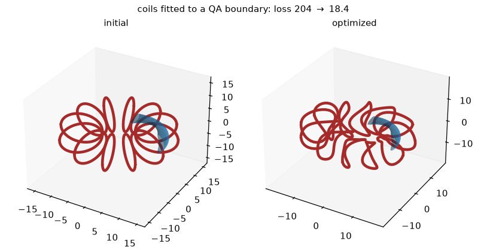

```python
from essos.coils import Coils, CreateEquallySpacedCurves
from essos.fields import BiotSavart
from essos.losses import custom_loss
from essos.surfaces import BdotN_over_B, SurfaceRZFourier
from scipy.optimize import least_squares

surface = SurfaceRZFourier.from_wout_file("wout.nc", s=1, ntheta=30, nphi=30,
                                          range_torus="half period")
coils = Coils(curves=CreateEquallySpacedCurves(3, 3, 10.0, 5.6, n_segments=45,
                                               nfp=2, stellsym=True),
              currents=[1.0] * 3)

L = (custom_loss(lambda field, surface: abs(BdotN_over_B(surface, field)).sum(),
                 "field", surface=surface)
     + custom_loss(lambda field: (field.coils.length - 32.0).clip(0).mean(), "field")
     + custom_loss(lambda field: (field.coils.curvature - 0.1).clip(0).mean(), "field"))
L.dependencies = {"field": BiotSavart(coils)}

result = least_squares(L, L.starting_dofs, L.grad, max_nfev=400)
optimized = L.dofs_to_pytree(result.x)["field"].coils
```

More in [`examples/coil_optimization`](examples/coil_optimization).

## Field-line tracing

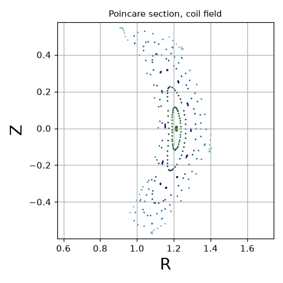

```python
import jax.numpy as jnp
from essos.coils import Coils
from essos.dynamics import Tracing
from essos.fields import BiotSavart

field = BiotSavart(Coils.from_json("coils.json"))
R0 = jnp.linspace(1.21, 1.40, 8)
seeds = jnp.array([R0, jnp.zeros_like(R0), jnp.zeros_like(R0)]).T

tracing = Tracing(field=field, model="FieldLineAdaptative", initial_conditions=seeds,
                  maxtime=8000, times_to_trace=40000, atol=1e-8, rtol=1e-8)
tracing.poincare_plot(shifts=[0.0])
```

More in [`examples/fieldline_tracing`](examples/fieldline_tracing).

## VMEC MGRID fields

Run [`examples/simple_examples/mgrid_from_coils.py`](examples/simple_examples/mgrid_from_coils.py)
to export the included Landreman-Paul QA coils, load the file as a magnetic
field, and compare its interpolated field with direct Biot-Savart. It prints
the differences and saves a plot; the maximum difference at its four sample
points is about 0.2%. Accuracy depends on grid resolution and distance from
the coils, so compare in your region of interest before using a grid.

The cylindrical grid covers one field period in phi. The field repeats across
periods, and R and Z queries are clamped to the grid bounds, so set the bounds
to cover the region you intend to evaluate.

## Particle tracing

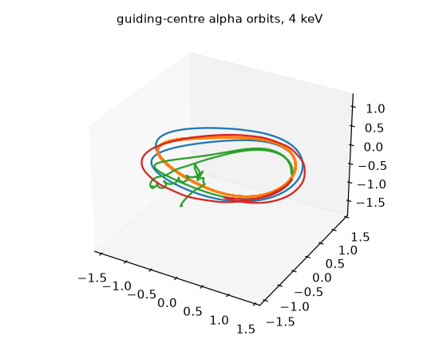

```python
from essos.constants import ALPHA_PARTICLE_CHARGE, ALPHA_PARTICLE_MASS, ONE_EV
from essos.dynamics import Particles, Tracing

particles = Particles(initial_xyz=seeds, mass=ALPHA_PARTICLE_MASS,
                      charge=ALPHA_PARTICLE_CHARGE, energy=4000 * ONE_EV)
tracing = Tracing(field=field, model="GuidingCenterAdaptative", particles=particles,
                  maxtime=1e-4, times_to_trace=800, atol=1e-7, rtol=1e-7)
tracing.plot()
print(tracing.loss_fractions)
```

More in [`examples/particle_tracing`](examples/particle_tracing), including
full-orbit, collisional and electric-field variants.

Pass `integrator="essos_rk45"` for native JAX Dormand--Prince 5(4), or
`integrator="essos_dopri8"` for native Dormand--Prince 8(7), the same RK formula
as ESSOS's default Diffrax solver. Both support `GuidingCenter`,
`GuidingCenterAdaptative`, `FullOrbit` and `FullOrbitAdaptative`;
the `Adaptative` models control step size with
`rtol`/`atol`, while the others use fixed `timestep` steps. Saved times use
dense interpolation and do not set the integration steps. VMEC axis handling,
LCFS crossings and exterior continuation are supported. The default remains
`integrator="diffrax"`; `solver=` selects a solver for that default backend.

VMEC guiding centers use the same `integrator="essos_rk45"` or
`"essos_dopri8"` selection in `Tracing(field=Vmec(...), ...)`. Particle births
are supplied as `(s, theta, phi)` in `Particles.initial_xyz`; integration uses
the existing regular axis chart and measures the embedded position error in
Cartesian metres. Boozer guiding centers use these selections in
[`trace_boozer`](#boozer-coordinate-tracing), with their existing field and drift
equations. Flux-coordinate support here is for guiding centers; the Lorentz
equations require a field that supplies Cartesian magnetic vectors.

The native selections in `Tracing` and `trace_boozer` implement forward
collisionless orbits. Forward split collisions have a separate entry point,
[`essos.split.trace_split`](essos/split.py), described below. A custom
derivative rule for collisionless Cartesian GC/Lorentz is now available with
`native_adjoint="accepted"`, as described below. Split-collision reverse replay
is a subsequent phase. The standalone
[`essos.rk.solve_rk`](essos/rk.py) (and its `solve_rk45` and
`solve_dopri8` entry points) also exposes termination status, accepted/rejected
trial counts and optional accepted-time history.
The comparison scripts in [`examples/paper`](examples/paper) include both
backends; their reported times include JAX compilation.

For nonrelativistic orbit/collision splitting:

```python
from essos.split import trace_split, SplitStatus

result = trace_split(
    field, particles, species,  # existing field, Particles and BackgroundSpecies
    model="GuidingCenter",     # or "FullOrbit" for a Cartesian field
    integrator="essos_dopri8", # or "essos_rk45"
    tmax=1e-5, timestep=1e-7, n_save=100,
    collision_tolerance=1e-3, rtol=1e-9, atol=1e-9,
)
# Check every particle's result.status before interpreting result.ys.
# SUCCESS=0, EVENT=1; codes >=2 indicate an incomplete/failed solve.
```

This Lie split advances the orbit with the native RK solver and then applies
a separate collision kick at its endpoint. The Milstein maps, collision error
estimates, reflecting speed/pitch boundaries and conditional Brownian bridge
follow [Sarkimaki et al., sections 5.1--5.3](https://arxiv.org/pdf/1701.05043).
ESSOS's existing nonrelativistic Maxwellian collision rates supply the physics,
including the derivative of the speed-dependent Coulomb logarithm. Guiding
centers update speed/pitch; full orbits update velocity in its local aligned
basis. These are the paper's local maps, not a full Milstein construction for
arbitrary noncommuting noise. The default `collision_controller="conservative"`
adjusts the interval from the last drift/diffusion estimates.
`collision_controller="paper"` selects section 5.3's Wiener look-ahead
(Eqs. 78--82): candidate times are successive thirds of the proposed interval,
and all sampled values, including failed candidates, remain in Brownian memory.
The particle controller uses the parallel Wiener increment from Eq. (62).
The GC controller uses the Euclidean norm of speed/pitch Wiener increments;
spatial-diffusion noise is excluded because it has no separate error estimate.
This GC vector-norm convention remains an implementation choice: the paper's
scalar step-selection notation does not specify how to combine its two GC
error components. It has not been checked against the authors' reference code.
The pitch error estimate follows the explicit magnitude approximation after
Eq. (55), `abs(dW_pitch) + sqrt(h/3)`, despite the inconsistent printing in
Eq. (75). Local-error acceptance is shared by all adaptive controllers.

There are also numerical-prefactor inconsistencies within the paper. Substituting
the pitch drift/noise and Eq. (55)'s magnitude approximation into the general
Eq. (54) gives a pitch error six times smaller than the explicit Eq. (75).
Likewise, substituting `g = sqrt(2 D_parallel)` into Eq. (53) gives a speed
error smaller than Eq. (62) by `sqrt(2)`. These are algebraic comparisons of
the printed formulas, not confirmation of an intended correction. ESSOS keeps
the explicit particle/GC coefficients in Eqs. (62)/(75), including the larger
pitch coefficient; it does not reduce error estimates to gain speed.

`collision_controller="candidate"` is an optional alternative to the paper's
step-selection heuristic. It reuses the local coefficients computed by the
last trial to predict **both** drift and diffusion errors at candidate times,
including the timestep-dependent speed tolerance. Eight scalar bisections
fit an initial proposal using unit Gaussian magnitudes; up to four retained
Brownian probes backtrack if the predicted error exceeds 0.9. Accepted trials
can grow by at most two. The next full trial always checks the actual errors
against one, even if the prediction passes or the probe budget is exhausted.
This changes the proposal, not the collision maps or local acceptance rule.

The frozen coefficients are returned as optional `CollisionStep.error_model`
metadata. No extra runtime collision-rate, derivative, or orbit RHS evaluation
is needed for a probe. Generic `solve_split` callbacks must supply a scalar
`CollisionErrorModel` when selecting this option; `trace_split` supplies it
automatically. Frozen predictions can become inaccurate as the state changes,
and the additional proposal work must be included when comparing timings.

Rejected kicks repeat the split trial from its previous state. All sampled
future Brownian values are retained in bounded memory. The conservative
controller splits an increment conditionally and stops growth at the next
known endpoint. The paper and candidate controllers can span stored intervals while retaining
their realized Brownian values. Exceeding
`max_pending` returns `BROWNIAN_CAPACITY`, with no discarded samples or forced
acceptance. `result.stats` reports split/orbit attempts, rejections, peak stored
intervals, and the largest accepted collision error estimate.

`timestep` sets the initial and default maximum split interval;
`collision_dtmax` overrides the latter. `orbit_dt0`, `rtol` and `atol` control
the independent RK solve inside each interval. `reuse_orbit_step=True` carries
only its next adaptive step-size guess across collision kicks and retries;
derivatives are recomputed after every kick. Set it to `False` to compare
restarting from `orbit_dt0`. Collision error estimates do
not bound splitting error: refine the maximum interval to check the coupled
orbit/collision accuracy. Saves are exact split boundaries, so changing the
save grid can change the accepted path. There is no ODE interpolation of the
stochastic state. Deterministic orbit events are root-found before a kick;
events caused by a spatial kick stop at the kick endpoint.

GC output states are `(position[3], v_parallel, mu)` with **physical** magnetic
moment `mu = mass*v_perp**2/(2*B)` [J/T]. Cartesian positions use metres;
VMEC/Boozer positions use `(s, theta, zeta)`. Their existing field representations
and axis charts are reused, and these coordinate traces stop at the LCFS;
exterior continuation is not connected to this entry point. Full-orbit output
is `(xyz, vx, vy, vz)`. `result.ts` is shared; other result arrays have a leading
particle dimension. Failures hold the last finite state and remain explicit
in `status`, so finite saved output alone does not imply success.

The default collision kick acts on velocity. Cartesian guiding centers may
select `spatial_diffusion=True` for the paper's local uniform-field spatial
diffusion approximation; spatial diffusion in VMEC/Boozer coordinates is
rejected until its coordinate transformation is implemented. GC speed reflects
at `speed_floor` (default: 5% of the smallest active background thermal speed
for the test mass); check sensitivity to this wall near zero speed. Use
`orbit=False` for collision-only statistics. Randomness uses the explicit
per-particle `particles.random_keys`. Individual collision maps support JVP/VJP;
accepted-step reverse replay through orbit **and** collisions is described below.

Run the small example with
`python -m examples.particle_tracing_collisions.trace_particles_split`;
add `--model FullOrbit` to select Lorentz motion or `--collision-only` for
collision statistics without orbit drift. It reports outcomes and step counts.

### Accepted-step reverse AD for split orbit/collision tracing

`trace_split(..., adjoint="accepted")` enables checkpointed pathwise reverse
AD through both the native orbit solve and collision kick for Cartesian GC
and Lorentz fields. The default `adjoint="none"` preserves forward tracing.
The implementation lives in [`essos/split_ad.py`](essos/split_ad.py); field,
particle and background-species classes remain unchanged.

```python
from essos.split import trace_split
from essos.particle_losses import mean_final_radius

reference_field = BiotSavart(coils)
reference_axis = (reference_field.r_axis, reference_field.z_axis)

def cost(coil_dofs):
    field = BiotSavart(coils.with_dofs(coil_dofs))
    out = trace_split(field, particles, species, model="GuidingCenter",
        tmax=2e-6, timestep=2e-7, collision_dtmax=5e-7, n_save=16,
        adjoint="accepted", adjoint_checkpoint_steps=16,
        adjoint_orbit_checkpoint_steps=16,
        adjoint_max_accepted_steps=256, adjoint_max_orbit_steps=2048,
        max_steps=4096, max_orbit_steps=256)
    return mean_final_radius(out.ys, *reference_axis)

value, gradient = jax.jit(jax.value_and_grad(cost))(coils.dofs)
```

The forward solver retains the production Gaussian sampler, Brownian bridges,
controllers, tolerances and saves. The tape records only committed split maps,
their exact Wiener increments and the inner accepted RK schedule. Rejected
collision trials contribute no physical reverse maps, including their inner
orbit attempts. Pitch deflections, speed/velocity diffusion, collision-coefficient
dependence and enabled GC spatial diffusion remain differentiable. Each
particle retains its own production noise path; reverse replay draws no noise.
Error-estimator preparation is excluded from the physical pullback, including
unused expressions with singular derivatives. Diffusion roots retain their
forward values and positive-coefficient derivatives, with a zero AD tangent
at zero diffusion to preserve vacuum-state sensitivities. Switching noise on
exactly at zero is a singular pathwise limit; this boundary convention does
not supply that missing derivative.

The accepted outer and inner times, controller decisions and event fractions
are held fixed during AD. This computes the discrete gradient of that sampled
numerical path, rather than differentiating adaptive mesh selection. Orbit
events skip the collision kick; kick events stop at their endpoint. Terminal
states held at later save times receive their full objective cotangents. Event
times themselves remain frozen, so this is not the derivative of a moving
hard first-hit boundary; use smooth classifier objectives for optimization.

Outer and inner segment lengths are independent. Outer state storage scales
with `accepted_capacity / adjoint_checkpoint_steps`; the local inner workspace
uses RK segment checkpoints and small stage vectors. The complete inner
accepted schedule is one flat tape, rather than an array sized by the product
of outer and inner work ceilings. `adjoint_max_accepted_steps` bounds committed
outer maps (including a terminal orbit-event map);
`adjoint_max_orbit_steps` bounds the **total** accepted inner RK steps across
these maps. Both default to `max_steps`. They do not change forward integration.
A capacity overflow or failed solve raises during reverse AD, so an incomplete
gradient is never returned. Set explicit capacities for the intended horizon
and parameter range. All particles are vectorized together without chunking.

`solve_split` exposes the same adjoint options for custom physical callbacks.
[`replay_accepted_split`](essos/split_ad.py) supplies a frozen-grid/noise forward
oracle for directional finite differences; it propagates perturbed states
through every map and ignores recorded checkpoint states. Reverse-mode is
first-order; JVPs through the custom VJP and higher derivatives are outside this
phase. VMEC/Boozer split reverse AD remains deferred.

The two native circular-coil optimization examples also support `--collisions`
in this checkout. They keep the same coil DOFs, classifier/final-radius
objectives, engineering penalties and plots, and call the production
`trace_split(..., adjoint="accepted")` path. Orbit-only tracing remains the
default. Editable collision/background settings are in each script's
`PARAMETERS` block; CLI arguments override them. No device backend is forced.

```bash
python -m examples.coil_optimization.optimize_coils_particle_confinement_guidingcenter_native \
  --collisions --objective loss_fraction --bdotn-weight 0 \
  --particles 2 --horizon 1e-6 --maxiter 1 \
  --output output/native_gc_split_loss_run1
python -m examples.coil_optimization.optimize_coils_particle_confinement_fullorbit_native \
  --collisions --objective final_radius --bdotn-weight 0 \
  --particles 2 --horizon 1e-7 --maxiter 1 \
  --output output/native_fo_split_radius_run1
```

`--collision-step` (default 1e-7 s) is the initial adaptive split interval;
`--collision-dtmax` (1e-6 s) is the independent splitting ceiling.
`--no-collision-adaptive` fixes the outer grid while leaving the orbit solve
adaptive. Collision tolerance defaults to 0.003 and the conservative controller;
`--collision-controller paper` or `candidate` selects the other implemented
controllers. The numerical method and production Brownian sampler are the
same as forward split tracing. Per-particle noise uses the unchanged seed-42
keys across objective evaluations; an adaptive parameter perturbation can
choose a different mesh, while each reverse pass freezes its own recorded mesh
and exact increments. This is a sampled pathwise gradient, not an exact
gradient of a statistical ensemble expectation.

The example background is one uniform Maxwellian proton species at
`--background-density 1e20` m^-3 and `--background-temperature-ev 1000`.
Its mass and charge are configurable in proton-mass/elementary-charge units;
`--coulomb-log-model nrl` preserves the existing default (`impact` is optional).
Coil DOFs are the optimization variables; background and birth parameters stay
fixed. `--collision-spatial-diffusion` enables the existing Cartesian GC
increment and is rejected for Lorentz motion. The history/summary include mean
accepted/rejected collision counts and orbit trial/rejection counts.

`--collision-accepted-capacity` bounds the outer tape;
`--accepted-capacity` bounds the total accepted inner RK tape across all
committed intervals. `--collision-checkpoint-steps` and `--checkpoint-steps`
set outer and inner segment lengths, respectively. `--max-steps` limits outer
trials and `--max-orbit-steps` limits trials within one interval. These limits
raise on failure or reverse-tape overflow; no capacity is grown automatically.
All particles remain in one vectorized population. The separate 4.4 m safety
surface is also passed to split tracing. Its orbit crossing is root-found and
later saves hold the terminal state, unlike the collisionless plotting path's
last saved interior point. Its crossing time/fraction remains frozen in AD.

The array particle objectives support native split GC's five-component SI
state `(xyz, v_parallel, mu)`. Energy and heat objectives use its evolving
physical `mu` in J/T; they do not reconstruct a constant birth magnetic moment.

Run the CPU correctness checks and the small production QA-coil timing example:

```bash
export JAX_PLATFORMS=cpu
export ESSOS_CPU_DEVICES=1
export ESSOS_XLA_CACHE=
pytest -q tests/test_split_ad.py tests/test_particle_losses.py
python -m examples.benchmarks.benchmark_split_ad --output examples/benchmarks/results/split_ad_NEW.json
# Optional smooth loss, loss-location and heat-proxy objectives.
python -m examples.benchmarks.benchmark_split_ad --objectives loss_fraction loss_location heat_proxy --output examples/benchmarks/results/split_ad_losses_NEW.json
```

The timing example uses the production `trace_split` pipeline, two particles
and all QA coil DOFs. Fixed cases validate gradients with both grids fixed and
the same per-particle noise keys. Adaptive frozen-grid/noise validation is
performed by the unit tests. Warm timings include forward and reverse execution
and exclude compilation; executable buffer estimates are not peak process RSS.
The saved [two-particle CPU baseline](examples/benchmarks/results/split_ad_cpu_smoke_20261019.json)
uses Dopri8, conservative collision control, eight saves and the final-radius
objective, with all 136 coil DOFs active. Counts below are per particle;
warm times cover the full two-particle value and gradient evaluation.

| Model | Grids | Accepted split maps | Accepted inner RK steps | Warm value + gradient (ms) | Compiler buffers (MiB) |
| --- | --- | ---: | ---: | ---: | ---: |
| GC | Fixed | 14 | 70 | 711.27 | 1.59 |
| GC | Adaptive | 7 | 7 | 133.43 | 1.59 |
| Lorentz | Fixed | 14 | 70 | 179.80 | 1.15 |
| Lorentz | Adaptive | 7 | 7 | 21.95 | 1.15 |

All four cases completed successfully with finite gradients and normalized
forward differences below `3.4e-15` against the ordinary production solve.
The best fixed-grid directional finite-difference relative errors were
`1.2e-9` (GC) and `4.8e-8` (Lorentz). These short adaptive cases had no rejected
steps; the unit tests separately force inner and outer rejections and compare
against frozen-schedule/noise finite differences. This is a split-AD correctness
and timing baseline, not a Diffrax speed or peak-memory comparison.

The separate [warm phase measurements](examples/benchmarks/results/split_ad_cpu_phases_20261019.json)
use the same two-particle QA setup with adaptive Dopri8, 136 coil DOFs, seven
accepted outer maps and seven accepted inner steps per particle. Both checkpoint
segment lengths are 16. Ordinary forward calls, forward linearization (including
tape construction and host dispatch), and standalone reverse pullbacks are
timed separately after compilation, using three blocked repetitions. The
standalone pullback reuses baseline residuals and is checked against the fused
value-and-gradient result. These are small CPU cases, not GPU or long-run
scaling measurements.

| Model | Ordinary forward (ms) | Forward linearization (ms) | Reverse only (ms) | Reverse / ordinary forward | Fused value + gradient (ms) |
| --- | ---: | ---: | ---: | ---: | ---: |
| GC | 9.87 | 12.22 | 127.60 | 12.93 | 132.84 |
| Lorentz | 4.23 | 5.00 | 22.38 | 5.29 | 23.48 |

Separately compiled phase medians need not sum to the fused timing. These saved
baseline measurements predate the collision-state pullback optimization below
and exceed a three-times-forward reverse-time target. With outer segment
lengths greater than one, the backward pass replays
outer maps, replays each map's orbit to build inner checkpoints, and reconstructs
inner RK stages before the physical pullbacks. Removing duplicated reconstruction
is a performance task; checkpointing alone does not establish a runtime bound.

```bash
JAX_PLATFORMS=cpu ESSOS_CPU_DEVICES=1 python -m examples.benchmarks.benchmark_split_ad \
  --modes adaptive --separate-phases \
  --output examples/benchmarks/results/split_ad_phases_NEW.json
```

#### Split collision-state pullback optimization

The split reverse pass projects the production `CollisionStep` onto its physical
state before differentiation. Controller error estimates and unused prepared
inputs are removed from that graph. State derivatives and all active
field/background/birth sensitivities are retained; the original JAX activity
flags still exclude fixed input data from the returned parameter gradient. Collision
parameter cotangents accumulate across accepted kicks, then the collision
preparation is transposed once. This avoids repeating its pullback at every
kick and avoids zero cotangents multiplying singular error-only derivatives.

The ordinary forward solver, error control, accepted schedules, physical kicks,
recorded Gaussian/bridge increments and field classes are unchanged. There is
no particle chunking, lowered precision, tolerance relaxation or frozen physical
collision coefficient. The checkpointed orbit pullback and its FSAL derivatives
retain the same accepted-step map.

The isolated comparison helper runs each model/implementation in a fresh CPU
process. It loads the reference `essos/split.py` and `essos/split_ad.py` into
baseline workers; physical kernels and inputs come from the current checkout.
An optional `--baseline-reverse-source` keeps the adjoint fixed to isolate the
new GC kinetic rule. It checks complete gradient vectors, objective values and
solver statistics. Peak memory uses Linux worker `VmHWM`/`VmRSS`, sampled every
10 ms, and includes compilation plus execution. This is separate from XLA's
compiled buffer estimate and is not a warm-only memory measurement.

The [retained comparison](examples/benchmarks/results/split_reverse_speed_20261019/comparison.json)
uses two QA-coil particles, all 136 coil DOFs, adaptive Dopri8 with conservative
collision control, eight saves and 16-step inner/outer checkpoints. The horizons
are `2e-6 s` for GC and `2e-7 s` for Lorentz. Both versions take seven accepted
outer maps and seven accepted inner steps per particle. Times below are medians
of seven blocked warm calls, excluding compilation. The reference reverse
implementation comes from commit `4abaf51`; this earlier report replaced only
the adjoint module and predates the GC custom derivative below.

| Model | Reverse before (ms) | Reverse after (ms) | Reverse speedup | Value + gradient before (ms) | Value + gradient after (ms) |
| --- | ---: | ---: | ---: | ---: | ---: |
| GC | 129.82 | 79.82 | 1.63x | 135.33 | 85.35 |
| Lorentz | 18.47 | 13.51 | 1.37x | 21.91 | 21.38 |

The separately compiled pullback timings need not add to the fused timings.
In particular the fused Lorentz evaluation changed little in this measurement.
Both objective values and solver statistics match. The maximum absolute change
in the full coil gradient vector is `2.78e-17` for GC and zero for Lorentz.
The retained implementation passed all 50 split/first-loss regression checks;
the classifier, energy and birth-objective checks also passed during this audit.

| Model | Compiler buffers before (MiB) | Compiler buffers after (MiB) | Process peak before (MiB) | Process peak after (MiB) |
| --- | ---: | ---: | ---: | ---: |
| GC | 1.592 | 1.731 | 1223.2 | 1313.4 |
| Lorentz | 1.152 | 1.170 | 1087.0 | 1142.0 |

This is a speed/memory tradeoff: keeping prepared collision parameter
cotangents until the shared pullback adds a persistent buffer. Observed process
peaks increased by 7.4% for GC and 5.1% for Lorentz, including compilation.
These results do not establish a reduction in peak or per-particle memory.
The tested per-kick alternative removed that accumulator but lost most of the
speedup, so it is not retained. Particle chunks and changes to the physical
collision operator were not used. The worker reports retain compilation times,
raw timing samples, gradients, source/input hashes and memory estimates.

```bash
python -m examples.benchmarks.compare_split_reverse \
  --baseline-revision 4abaf51 --particles 2 --repeats 7 \
  --output examples/benchmarks/results/split_reverse_speed_NEW
```

These are short CPU engineering measurements, not a GPU, large-population,
long-horizon or Diffrax comparison. The tests also cover physical density,
temperature and birth gradients, refined events, empty paths and heterogeneous
vectorized populations with unused singular parameter preparation.

#### GC speed/pitch custom derivative

Native accepted-map GC AD uses a custom JVP rule from
[`essos/collision_ad.py`](essos/collision_ad.py). The two kinetic inputs are
scalar speed and pitch. Their partial derivatives are computed by scalar
forward AD and contracted in reverse, rather than transposing the whole
coefficient/update graph with a generic reverse rule. Captured physical
parameters retain ordinary JAX derivatives. Traced integer profile selectors
are passed explicitly, so they cannot leak through a custom-rule closure.
This forms no dense coil Jacobian and changes no field class, physical
collision formula, controller, accepted schedule or recorded Wiener sample.
Keeping speed and pitch together as a two-component state while tracing the
local map is necessary for the measured speedup; tested scalar-only forms did
not provide a reliable improvement.

The ordinary forward tracer and frozen-schedule JVP/FD oracle use the original
map. Only the accepted GC adjoint selects this rule; the Lorentz path is
unchanged. Validation covers forward/reverse local derivatives, pitch endpoints,
zero diffusion, active profile vectors, higher derivatives, physical field,
density, temperature and birth sensitivities, spatial diffusion, and a vmapped
particle lost before its first collision. All 61 relevant checks passed.

The [GC comparison](examples/benchmarks/results/split_gc_kinetic_ad_20261020/comparison.json)
uses the same two QA-coil particles, all 136 coil DOFs, adaptive Dopri8,
eight saves and 16-step checkpoints as the earlier split comparison. Both
versions take seven accepted collision maps per particle. These are medians
of seven blocked warm CPU calls, excluding compilation:

| GC measurement | Previous adjoint | Custom kinetic rule |
| --- | ---: | ---: |
| Ordinary forward (ms) | 9.07 | 8.74 |
| Forward linearization (ms) | 11.42 | 11.84 |
| Reverse only (ms) | 86.85 | 60.11 |
| Fused value + gradient (ms) | 87.52 | 69.94 |
| Compiler buffers (MiB) | 1.731 | 1.731 |
| Process peak, compilation + execution (MiB) | 1310.7 | 1321.3 |
| Fused compilation (s) | 14.71 | 15.96 |

The reverse speedup is 1.44x (31% less time); fused value-and-gradient speedup
is 1.25x (20% less time). The full gradient vector changes by at most
`1.39e-17`, and saved states, objective and solver statistics agree. The
ordinary forward code is unchanged; its small timing difference is run-to-run
variation. Separately compiled phases need not sum to fused execution.

Compiler buffers did not increase, but observed process peak increased by
0.8%, including compilation. This does not establish a reduction in memory
per particle. Reverse remains about 6.9 times ordinary forward in this short
CPU case; a three-times-forward target is still unmet. GPU performance and
large-population/long-horizon scaling were not measured. The Lorentz path was
not changed or rebenchmarked in this comparison.

To isolate this rule from the earlier checkpoint/pullback improvement, use the
committed driver with the same current `split_ad.py` in baseline workers:

```bash
python -m examples.benchmarks.compare_split_reverse \
  --baseline-revision 4abaf51 --baseline-reverse-source essos/split_ad.py \
  --models gc --particles 2 --repeats 7 \
  --output examples/benchmarks/results/split_gc_kinetic_ad_NEW
```

#### Shared orbit reverse in split tracing

The figures in this subsection precede the bounded checkpoint reuse below.

Split backward replay now uses the same native field transposes, compact RK
stage cache and segment parameter accumulation as collisionless tracing. Each
collision interval rebuilds its own initial FSAL cache at the state after the
preceding kick. The forward solver, collision coefficients/kicks, controllers,
accepted grids and production Wiener increments are unchanged. No field class
or particle chunking change is involved. Outer and inner checkpoint lengths
remain 16.

The [saved comparison](examples/benchmarks/results/split_reverse_shared_orbit_comparison_20261021.json)
records the previous split pullback and the shared implementation. The
[short](examples/benchmarks/results/split_reverse_shared_orbit_short_20261021.json)
and [long](examples/benchmarks/results/split_reverse_shared_orbit_long_20261021.json)
reports include complete gradients, solver statistics, compilation times,
raw samples and source/input hashes. Reference reports are retained for
[short](examples/benchmarks/results/split_reverse_current_short_20261021.json)
and [long](examples/benchmarks/results/split_reverse_current_long_20261021.json)
horizons.

These are two QA-coil particles, all 136 coil DOFs, 4 keV alpha particles,
a uniform hydrogen background at `1e20 m^-3` and `1 keV`, eight saves,
adaptive Dopri8, `rtol=atol=1e-9` and conservative collision control with
tolerance `0.003`. GC uses the default velocity-only kicks; optional GC
spatial diffusion is covered by regression tests, not timed here. The objective
is mean final minor radius. Each entry is the median of 21 blocked warm CPU
calls, excluding compilation; reverse reuses baseline pullback residuals.

| Model | Horizon (s) | Forward (ms) | Reverse only (ms) | Fused value + gradient (ms) | Reverse / forward | Value + gradient / forward |
| --- | ---: | ---: | ---: | ---: | ---: | ---: |
| GC | `2e-6` | 9.51 | 37.21 | 47.37 | 3.91 | 4.98 |
| GC | `2e-5` | 49.51 | 255.31 | 295.48 | 5.16 | 5.97 |
| Lorentz | `2e-7` | 3.92 | 9.97 | 14.61 | 2.55 | 3.73 |
| Lorentz | `2e-6` | 18.65 | 65.23 | 89.68 | 3.50 | 4.81 |

The longer cases reduce reverse time by 31.2% for GC and 39.2% for Lorentz;
fused evaluation time falls by 26.5% and 45.5%. Before/after versions run in
separate CPU processes, rather than interleaved samples. Each ratio uses its
own ordinary-forward median. The ordinary forward code is unchanged, so its
timing differences reflect execution variability. Separate phase medians need
not add to fused evaluation time.

These full-split ratios remain higher than the collisionless ratios. Split AD
still reconstructs outer collision segments and each inner orbit's checkpoints
before rebuilding local RK stages; it also transposes the physical collision
kicks. Sharing the orbit kernels does not remove that additional replay work.
The complete value-and-gradient evaluations remain above three times forward
in all four measured split cases.

All four cases reproduce the production trajectory on the recorded accepted
grids and Wiener increments. Independent frozen-replay JVPs and centered
directional finite differences validate the coil gradients; the best relative
FD discrepancy is below `2e-9` in each case. Accepted/rejected counts and solver
statuses match between implementations; the largest absolute change in a full
coil-gradient component is `3.00e-15`. All 48 split/kinetic regression checks
passed, including physical field, density, temperature, birth and optional GC
spatial-diffusion sensitivities. The longer GC case has 26/49 accepted
inner RK steps (3/3 rejected); Lorentz has 67/61 (2/2 rejected). Each has seven
accepted outer maps per particle and no rejected outer trials. This benchmark
therefore does not measure rejection-heavy or long collisional relaxation runs.

Fused compiler buffers decrease from 1,797,384 to 1,773,848 bytes for GC
(-1.31%) and from 1,226,672 to 1,201,528 bytes for Lorentz (-2.05%). These are
executable buffer estimates; process peak RAM and GPU performance are not
measured in this split timing comparison.

Reproduce the current implementation with production replay checks:

```bash
JAX_PLATFORMS=cpu ESSOS_CPU_DEVICES=1 python -m examples.benchmarks.benchmark_split_ad \
  --modes adaptive --separate-phases --validate-replay --particles 2 --repeats 21 \
  --checkpoint-steps 16 --orbit-checkpoint-steps 16 \
  --gc-horizon 2e-6 --lorentz-horizon 2e-7 \
  --output examples/benchmarks/results/split_reverse_shared_orbit_short_NEW.json
JAX_PLATFORMS=cpu ESSOS_CPU_DEVICES=1 python -m examples.benchmarks.benchmark_split_ad \
  --modes adaptive --separate-phases --validate-replay --particles 2 --repeats 21 \
  --checkpoint-steps 16 --orbit-checkpoint-steps 16 \
  --gc-horizon 2e-5 --lorentz-horizon 2e-6 \
  --output examples/benchmarks/results/split_reverse_shared_orbit_long_NEW.json
```

#### Bounded checkpoint reuse across split replay

The split reverse pass now retains inner orbit checkpoints while rebuilding an
outer segment, then reuses them for the orbit pullback. Previously it discarded
these states and repeated the orbit to reconstruct the same checkpoints. The
scratch buffer holds at most `ceil(workspace / inner_segment) + outer_segment - 1`
state/FSAL pairs, where `workspace` is the per-orbit accepted-work bound. It is
reused for each outer segment. Maps that do not fit use the existing replay
path, so this is not an allocation proportional to the product of outer and
inner work ceilings. Stage geometry is still rematerialized.

The fallback is controlled by its loop bound. A conditional around it would
execute both branches under `vmap` and preserve the unwanted RK work. Outer
reconstruction also skips its final collision evaluation because no following
map consumes that state; the physical final collision pullback still runs.
Both checkpoint lengths remain 16, with unchanged forward integration, accepted
times, noise, field classes and physical derivatives. No particle chunking is
used. A pilot of the existing field transpose inside the GC collision callback
showed no further benefit and was not retained.

The comparison reports contain complete gradient vectors, raw warm samples,
source/input hashes and independent production frozen-grid/noise JVP/FD checks.
The long report also archives the preceding reverse module, since it was a
working-tree baseline rather than a separate commit. All 49 split/kinetic
regression checks passed, including a new mixed-particle test that fills the
checkpoint budget in one lane while caching every map in the other, across
multiple outer segments. Its gradients match an independently replayed path.

The [long comparison](examples/benchmarks/results/split_reverse_checkpoint_reuse_long_20261021/comparison.json)
and [short comparison](examples/benchmarks/results/split_reverse_checkpoint_reuse_short_20261021/comparison.json)
use the same two QA-coil particles, 136 coil DOFs, eight saves, conservative
collision tolerance `0.003`, native adaptive Dopri8, `rtol=atol=1e-9` and
16-step inner/outer checkpoints as above. Both implementations are compiled
and warmed before 21 repetitions in seeded randomized order. These paired
measurements supersede the earlier separate-run ratios for performance
comparisons; compilation is excluded.

| Model | Horizon (s) | Forward after (ms) | Reverse before (ms) | Reverse after (ms) | Value + gradient after (ms) | Reverse / forward after | Value + gradient / forward after |
| --- | ---: | ---: | ---: | ---: | ---: | ---: | ---: |
| GC | `2e-6` | 8.84 | 36.22 | 29.39 | 38.32 | 3.32 | 4.33 |
| GC | `2e-5` | 43.34 | 208.49 | 158.14 | 213.62 | 3.65 | 4.93 |
| Lorentz | `2e-7` | 4.14 | 10.47 | 9.71 | 13.74 | 2.35 | 3.32 |
| Lorentz | `2e-6` | 18.65 | 63.84 | 50.74 | 73.88 | 2.72 | 3.96 |

Long-case reverse time falls by 24.1% for GC and 20.5% for Lorentz; fused
evaluation time falls by 18.9% and 12.6%. The shorter reverse gains are 18.9%
and 7.2%, respectively. Each ratio uses its own version's ordinary-forward
median; independent phase timings need not add to the fused evaluation.
GC reverse and all four fused evaluations remain above three times forward.
The full gradient vectors are unchanged in all four comparisons, and each
case passes independent frozen-grid/noise JVP and directional FD checks. The
best FD discrepancies are below `2e-9`.

All maps in these datasets fit the local checkpoint budget. The nominal
accepted-RK step replays therefore decrease from three to two per step; the
reports record these work counts separately from RHS transposes and initial
FSAL calls. These small CPU measurements do not establish speedups for large
or rejection-heavy populations, where mixed cache misses can reduce the
benefit under `vmap`.

The [isolated memory comparison](examples/benchmarks/results/split_reverse_checkpoint_reuse_memory_20261021/comparison.json)
runs each model/version in a fresh process with the longer horizons. Process
peaks include compilation and execution of the benchmark's forward, reverse
and fused executables. They are not warm-only or marginal per-particle memory:

| Model | Compiler buffers before (bytes) | After (bytes) | Change | Process peak before (MiB) | After (MiB) | Change |
| --- | ---: | ---: | ---: | ---: | ---: | ---: |
| GC | 1,773,848 | 1,808,168 | +1.93% | 1333.38 | 1349.04 | +1.17% |
| Lorentz | 1,201,528 | 1,207,896 | +0.53% | 1125.69 | 1139.78 | +1.25% |

This is a measured speed/memory tradeoff. The memory workers use three warm
repetitions to exercise allocation; their phase timings are not the performance
comparison. Use the interleaved 21-repeat reports above for timing conclusions.

Reproduce the paired long case using the archived baseline and identical
current forward driver. The source overrides replace both committed files;
the actual baseline is identified by its recorded SHA:

```bash
mkdir -p .tmp
python -c "import json; from pathlib import Path; r=json.loads(Path('examples/benchmarks/results/split_reverse_checkpoint_reuse_long_20261021/comparison.json').read_text()); Path('.tmp/split_ad_baseline.py').write_bytes(r['metadata']['baseline_reverse_source_archive']['text'].encode())"
JAX_PLATFORMS=cpu ESSOS_CPU_DEVICES=1 python -m examples.benchmarks.compare_split_reverse \
  --baseline-revision HEAD --baseline-driver-source essos/split.py \
  --baseline-reverse-source .tmp/split_ad_baseline.py \
  --interleaved --validate-replay --particles 2 --repeats 21 \
  --gc-horizon 2e-5 --lorentz-horizon 2e-6 \
  --output examples/benchmarks/results/split_reverse_checkpoint_reuse_long_NEW
```

For the short comparison use `--gc-horizon 2e-6 --lorentz-horizon 2e-7` and a
new output directory. Omit `--interleaved --validate-replay` and use three
repetitions to reproduce the separate-process compilation/execution RAM check.

#### Collisionless reverse cost diagnosis

The [collisionless profile](examples/benchmarks/results/native_reverse_profile_20261020.json)
uses production GC/Lorentz RHS and native accepted-step AD without collisions
or Diffrax. Two QA-coil particles, all 136 coil DOFs, a fixed reference axis,
eight saves, adaptive Dopri8 with I control, `rtol=atol=1e-9`, standard dense
output and 16-step checkpoints are held fixed. The objective is mean final
minor radius. These are medians of 21 blocked warm CPU calls, excluding
compilation; reverse alone reuses the forward pullback residuals.

| Model | Horizon (s) | Accepted steps per particle | Rejected steps per particle | Forward (ms) | Reverse only (ms) | Fused value + gradient (ms) | Reverse / forward |
| --- | ---: | --- | --- | ---: | ---: | ---: | ---: |
| GC | `2e-6` | 4, 5 | 0, 0 | 5.75 | 24.87 | 28.75 | 4.33 |
| GC | `2e-5` | 25, 44 | 2, 4 | 51.52 | 214.01 | 258.24 | 4.15 |
| Lorentz | `2e-7` | 7, 6 | 1, 1 | 2.46 | 13.44 | 15.16 | 5.47 |
| Lorentz | `2e-6` | 63, 56 | 2, 3 | 14.99 | 111.75 | 127.34 | 7.46 |

The fused value-and-gradient / forward ratios are 5.00, 5.01, 6.16 and 8.50,
respectively. Independently compiled forward and reverse phases need not sum
to fused execution. All four cases agree with forward-mode derivatives on
the frozen accepted grid and pass directional finite differences; the largest
best FD relative error is `8.34e-9`. Full reverse and fused gradients agree.
Rejected steps remain excluded from the adjoint, including the longer runs.

A diagnostic holds coils fixed and differentiates only the initial states,
using the same forward trajectories, accepted schedules and objective. On the
longer horizons, reverse takes 182.40 ms for GC and 50.35 ms for Lorentz,
compared with 214.01 and 111.75 ms for coil sensitivities. These different
derivative targets isolate work; the state-only gradient cannot replace the
coil-optimization gradient. The decrease indicates substantially more
coil-sensitivity overhead in Lorentz relative to its inexpensive forward RHS.

The accepted adjoint reconstructs RK stage increments once per segment, then
rebuilds local RHS derivative intermediates for each stage VJP. It retains
small state/stage vectors and avoids storing every field-sized AD residual.
GC differentiates a forward RHS that already uses spatial field gradients,
so its state pullback includes second spatial derivatives and its coil
pullback includes mixed field/coil derivatives. Lorentz's forward RHS needs
only B, while its pullback additionally propagates position and coil-field
sensitivities. Prepared parameter cotangents are accumulated through the
stages and their preparation is transposed once per accepted step.

Thus one accepted-grid replay does not imply a universal three-times-forward
execution bound. The report also records frozen-grid replay and independent
RHS state/parameter VJP kernels, with a cached-residual pullback diagnostic.
These separately compiled kernels are not an additive profile of the full
reverse. No field class or production adjoint was changed for this profile.
The collisionless GC state here is the production four-component energy-based
state; split GC evolves a fifth magnetic-moment component, so comparisons with
earlier split timings would also change state representation and step grids.

```bash
JAX_PLATFORMS=cpu ESSOS_CPU_DEVICES=1 python -m examples.benchmarks.profile_native_reverse \
  --particles 2 --horizon-factors 1 10 --repeats 21 \
  --output examples/benchmarks/results/native_reverse_profile_NEW.json
```

The report retains raw samples, gradients, work counts, compiler-buffer
estimates and source/input hashes. It does not measure process peak RSS or
GPU performance. Older collisionless timing/memory reports later in this
README were measured at base commit `c50da30`; they are not measurements of
the split adjoint or this profile.

The collisionless adjoint now retains compact RHS reduction results within
the current replay segment. It reuses the original RHS linearization and
rematerializes field-sized arrays; the forward solver, field classes and
accepted-grid derivative contract are unchanged. On the QA-coil cases the
cache holds 10 scalars per GC stage and nine per Lorentz stage, including
the stage state. Cheap RHS functions retain the earlier reconstruction.

The [interleaved comparison](examples/benchmarks/results/native_reverse_cache_comparison_20261020.json)
compiles the committed `4abaf51` adjoint and the compact-cache implementation
before 21 randomized, blocked warm CPU repeats. Inputs and solver settings
are those of the profile above. Times are measured together, so use these
before/after pairs rather than differences between separate profiling runs.

| Model | Horizon (s) | Reverse before / after (ms) | Full value + gradient before / after (ms) | New full / forward | Executable buffers before / after (bytes) |
| --- | ---: | ---: | ---: | ---: | ---: |
| GC | `2e-6` | 29.20 / 26.13 | 36.90 / 32.10 | 4.53 | 1,085,232 / 1,095,080 |
| GC | `2e-5` | 257.74 / 215.85 | 312.90 / 282.54 | 4.46 | 1,085,232 / 1,095,080 |
| Lorentz | `2e-7` | 15.37 / 12.16 | 17.03 / 13.49 | 5.29 | 1,147,168 / 1,156,888 |
| Lorentz | `2e-6` | 115.79 / 92.43 | 138.43 / 110.90 | 7.24 | 1,147,168 / 1,156,888 |

Reverse time decreases by 11--16% for GC and 20--21% for Lorentz, with
less than 1% more executable buffers. Full coil gradients match the previous
adjoint to `1.3e-15` maximum absolute difference; states, step counts and
statuses also match. The [production-RHS validation](examples/benchmarks/results/native_reverse_cache_validation_20261020.json)
checks the four cases against frozen-grid JVPs and directional finite
differences. The RK/cache/first-loss suite passed 83 tests covering both
Dopri methods, dense modes, events, partial segments and batched empty paths.

The [isolated memory comparison](examples/benchmarks/results/native_reverse_cache_memory_20261020.json)
runs each longer case in a fresh Linux CPU process. Peak RSS, including
compilation, changes from 794.81 to 796.97 MiB for GC and 799.84 to 798.78 MiB
for Lorentz. The warm peaks after resetting Linux RSS high-water accounting
are the same in these cases. These measurements include resident JAX,
executable and allocator memory; they are not marginal per-particle memory.
Executable buffer estimates above exclude compiler/host/runtime allocations.
Neither this comparison nor the cache establishes a three-times-forward
bound or a GPU speedup.

```bash
JAX_PLATFORMS=cpu ESSOS_CPU_DEVICES=1 python -m examples.benchmarks.compare_native_reverse \
  --baseline-revision 4abaf51 --particles 2 --repeats 21 \
  --output examples/benchmarks/results/native_reverse_cache_NEW.json
JAX_PLATFORMS=cpu ESSOS_CPU_DEVICES=1 python -m examples.benchmarks.compare_native_reverse \
  --baseline-revision 4abaf51 --particles 2 --horizon-factors 10 --repeats 5 \
  --isolated-memory --output examples/benchmarks/results/native_reverse_cache_memory_NEW.json
```

For collisionless tracing, `adjoint_parameter_accumulation="segment"` in
`solve_rk`, or `native_adjoint_parameter_accumulation="segment"` in `Tracing`,
sums prepared RHS cotangents over one checkpoint segment before transposing
parameter preparation. This uses its linearity in the cotangent; all stage,
state and coil derivatives remain present. This is now the default for both GC
and Lorentz. The optional `"step"` mode transposes preparation once per accepted
step. Both models support both modes. Segment
accumulation changes the reverse workspace and its performance depends on the
RHS and backend; it does not change checkpoint spacing or the forward solver.

The circular-coil optimization scripts expose this as
`--parameter-accumulation segment`, with `parameter_accumulation="segment"` also
editable in both scripts' `PARAMETERS`. This setting currently applies to
the collisionless path. `--checkpoint-steps N` selects the accepted steps per
segment (default 16), identically for GC and Lorentz; the corresponding APIs are
`adjoint_checkpoint_steps=N` in `solve_rk` and
`native_adjoint_checkpoint_steps=N` in `Tracing`. Segment length can affect
runtime and memory, so comparisons must report it. To isolate the two modes in
interleaved CPU timing:

```bash
JAX_PLATFORMS=cpu ESSOS_CPU_DEVICES=1 python -m examples.benchmarks.compare_native_reverse \
  --compare-accumulation --parameter-accumulation segment --particles 2 --horizon-factors 10 --repeats 21 \
  --output examples/benchmarks/results/native_reverse_accumulation_NEW.json
```

The [current-source accumulation comparison](examples/benchmarks/results/native_reverse_accumulation_comparison_20261020.json)
changes only this setting, with 21 interleaved warm CPU repeats per mode:

| Model / horizon | Reverse step / segment (ms) | Full value + gradient step / segment (ms) | Executable buffers step / segment (bytes) |
| --- | ---: | ---: | ---: |
| GC / `2e-5` s | 207.91 / 214.71 | 271.58 / 269.69 | 1,095,080 / 1,231,016 |
| Lorentz / `2e-6` s | 91.31 / 74.25 | 108.04 / 93.89 | 1,156,888 / 1,124,696 |

For Lorentz this is 18.7% less reverse time, 13.1% less fused time and 2.8%
fewer executable buffers. GC has no useful timing improvement and 12.4% more
buffers in that historical run. Both models now default to `"segment"`.
The mode is available to both models
without changing the integration method. Full gradients match between modes
to `4.5e-16` maximum absolute difference, with identical work counts/statuses.
The shared forward map is unchanged. The original mixed-mode ratios are
superseded by the matched segment-mode benchmark below.

The [combined cache/segment comparison](examples/benchmarks/results/native_reverse_segment_comparison_20261020.json)
also measures both horizons against commit `4abaf51`. Lorentz reverse time
decreases by 33--36%, fused time by 27--32%, and executable buffers by 2%.
The [fresh-process comparison](examples/benchmarks/results/native_reverse_segment_memory_20261020.json)
records peak RSS of 811.09 to 799.92 MiB for the longer Lorentz case, including
compilation; the measured warm peaks are the same. These are whole-process
measurements, not marginal per-particle storage. The larger GC segment
workspace is not justified by these timings even though whole-process RSS is
similar. The [segment validation](examples/benchmarks/results/native_reverse_segment_validation_20261020.json)
passes frozen-grid JVPs and directional finite differences for both models
and horizons; the largest best FD relative error is `8.35e-9`. Both modes,
both RK methods, dense output, events, empty batches and optimization wiring
passed 104 targeted tests.

```bash
JAX_PLATFORMS=cpu ESSOS_CPU_DEVICES=1 python -m examples.benchmarks.compare_native_reverse \
  --baseline-revision 4abaf51 --parameter-accumulation segment --repeats 21 \
  --output examples/benchmarks/results/native_reverse_segment_NEW.json
JAX_PLATFORMS=cpu ESSOS_CPU_DEVICES=1 python -m examples.benchmarks.compare_native_reverse \
  --baseline-revision 4abaf51 --parameter-accumulation segment --horizon-factors 10 \
  --repeats 5 --isolated-memory --output examples/benchmarks/results/native_reverse_segment_memory_NEW.json
JAX_PLATFORMS=cpu ESSOS_CPU_DEVICES=1 python -m examples.benchmarks.profile_native_reverse \
  --parameter-accumulation segment --repeats 5 \
  --output examples/benchmarks/results/native_reverse_segment_validation_NEW.json
```

#### Reverse RHS preparation and custom derivative rules

The collisionless reverse replay exposes ordinary internal JIT calls before
building its RHS transpose. The adaptive forward driver and field classes keep
their original calculations. This changes the representation of the same
accepted-step derivative; it adds no rejected-step or controller derivatives.

RHS graphs containing custom JVP/VJP calls use conservative preparation instead.
Whole primitive calls are separated by value dependence without transforming
their control-flow bodies. Parameter-only work still moves out of the stage
calculation, so fixed discretization data does not acquire an unnecessary
pullback. This also applies to split-solver preparation. Tests use deliberately
distinct custom derivatives inside conditionals and nested JITs, checking the
complete RK adjoint against independent frozen-grid JVPs for both RK methods
and both parameter-accumulation modes.

To isolate reverse JIT-boundary removal on the longer production-RHS cases:

```bash
JAX_PLATFORMS=cpu ESSOS_CPU_DEVICES=1 python -m examples.benchmarks.compare_native_reverse \
  --compare-rhs-inlining --parameter-accumulation recommended \
  --horizon-factors 10 --repeats 21 \
  --output examples/benchmarks/results/native_reverse_inline_NEW.json
JAX_PLATFORMS=cpu ESSOS_CPU_DEVICES=1 python -m examples.benchmarks.compare_native_reverse \
  --compare-rhs-inlining --parameter-accumulation recommended \
  --horizon-factors 10 --repeats 5 --isolated-memory \
  --output examples/benchmarks/results/native_reverse_inline_memory_NEW.json
```

Here `recommended` reproduces the historical benchmark setting selecting step
accumulation for GC and segment accumulation for Lorentz. The current public
solver and benchmark default is `segment` for both; historical commands above
retain their explicit mixed setting. Production device selection is unchanged.

The [fresh interleaved comparison](examples/benchmarks/results/native_reverse_inline_comparison_20261020.json)
uses two particles, all 136 coil DOFs and 21 blocked warm CPU repeats. Both
versions use the compact cache and the same accumulation mode; only reverse
JIT-boundary removal changes. Compilation is excluded.

| Model / mode | Forward before / after (ms) | Reverse before / after (ms) | Full value + gradient before / after (ms) | New full / forward |
| --- | ---: | ---: | ---: | ---: |
| GC / step | 49.28 / 47.75 | 183.37 / 181.59 | 228.75 / 229.09 | 4.80 |
| Lorentz / segment | 14.02 / 13.92 | 64.17 / 56.22 | 79.89 / 71.95 | 5.17 |

This provides no useful GC timing gain. Lorentz reverse decreases by 12.4%
and the full call by 9.9%. Ratios use each row's measured after-forward median;
the forward map is identical, although its timing fluctuates. Neither case
reaches three times forward. Accepted/rejected counts stay at 25/2 and 44/4
for GC, and 63/2 and 56/3 for Lorentz. Full gradients differ by at most
`1.8e-15` for GC and `2.0e-16` for Lorentz.

Executable buffers stay effectively unchanged: 1,095,080 to 1,094,936 bytes
for GC and 1,124,696 to 1,124,688 bytes for Lorentz. The affected preparation,
custom-rule, activity-filtering and split/collision AD regression run passed
64 tests. This is a CPU result for these cases, not a GPU speedup claim.

The [fresh-process memory report](examples/benchmarks/results/native_reverse_inline_guard_memory_20261020.json)
records overall peaks of 789.75 to 787.06 MiB for GC and 794.08 to 799.45 MiB
for Lorentz. Compilation-phase peaks are 786.31 to 784.29 MiB and 790.44 to
796.69 MiB, respectively. These changes are below 1%; they do not establish
a memory reduction. RSS includes JAX, executables and allocator residency,
and must not be interpreted as marginal memory per particle.

The [production-RHS validation](examples/benchmarks/results/native_reverse_inline_validation_20261020.json)
passes independent frozen-grid JVPs and directional finite differences for both
models at both horizons, with a largest best FD relative discrepancy of
`8.35e-9`. This validation uses segment accumulation for both models; the paired
GC timing above uses step accumulation. Step and segment modes also have
complete-RK frozen-grid JVP regression checks. Reproduce the validation with:

```bash
JAX_PLATFORMS=cpu ESSOS_CPU_DEVICES=1 python -m examples.benchmarks.profile_native_reverse \
  --parameter-accumulation segment --horizon-factors 1 10 --repeats 5 \
  --output examples/benchmarks/results/native_reverse_inline_validation_NEW.json
```

#### Native Biot--Savart Jacobian transpose

Native collisionless reverse replay now recognizes the stock prepared
`BiotSavart.B_and_dB_by_dX` call and supplies an exact geometry linearization.
The original field method supplies every primal value. Its transpose includes
position, discretized coil positions, tangent components, the full tangent
tensor and current weights. The original parameter-setup pullback still maps
these cotangents to Fourier/current DOFs, including symmetry and scaling.
Second spatial and mixed coil/spatial derivatives required by GC remain live.

The transpose expresses its small coordinate matrix products directly so they
can fuse with the geometry operations. Its JVP is obtained by transposing that
linear pullback; the geometry coefficients remain differentiable. Tests compare
all independent prepared inputs, ordinary JVPs and Hessian-vector products
against the original field graph. Complete RK tests compare coil and birth
position/pitch/energy sensitivities with independent frozen-grid JVPs, including
both RK methods, dense-save modes and accumulation modes.

This changes native backward preparation only. Field classes, forward RHS,
RK formulas, controller tolerances and accepted-step schedules are unchanged.
Recognition requires the stock source and prepared float64 signature; other
fields/signatures keep ordinary JAX AD. The B/J specialization targets GC;
the later field-only extension for Lorentz is described below. The separate
split-collision adjoint keeps its existing derivative path.

The [21-repeat paired CPU timing report](examples/benchmarks/results/native_reverse_field_comparison_20261020.json)
uses the same two-particle QA-coil cases as the preceding comparison. Both
versions compile before interleaved warm measurements. Only this field
linearization is enabled/disabled; GC uses step accumulation and Lorentz uses
segment accumulation in both versions.

| Case | Forward before / after (ms) | Reverse before / after (ms) | Forward + gradient before / after (ms) | After reverse / forward | After total / forward |
| --- | ---: | ---: | ---: | ---: | ---: |
| GC, 20 microseconds | 52.54 / 53.00 | 191.88 / 142.86 | 240.15 / 198.29 | 2.70 | 3.74 |
| Lorentz, 2 microseconds | 13.94 / 14.01 | 57.92 / 58.39 | 74.44 / 73.00 | 4.17 | 5.21 |

GC reverse time decreases 25.5% and total AD time decreases 17.4%. Forward
work is unchanged: GC accepts 25/44 steps and rejects 2/4; Lorentz accepts
63/56 and rejects 2/3. Maximum absolute gradient differences are
`1.34e-15` for GC and zero for Lorentz. Lorentz does not use this specialization;
its small timing changes are measurement variation. The total GC evaluation
still exceeds three times forward time. Standalone reverse and fused total
timings are measured independently and need not add exactly.

The [fresh-process memory report](examples/benchmarks/results/native_reverse_field_memory_20261020.json)
shows GC executable buffers decreasing from 1,094,936 to 938,752 bytes (14.3%).
Whole-process peak RSS instead increases from 782.96 to 799.21 MiB (2.1%);
compilation peaks are 778.64/796.45 MiB and warm peaks are 782.96/799.21 MiB.
These include the runtime, compiler and retained allocator memory and are not
marginal memory per particle. This change improves speed and executable-buffer
usage, without demonstrating lower process peak RAM. Lorentz executable buffers
are unchanged and its process peaks are 785.84/788.15 MiB.

All 132 targeted field, reverse-RK, stopping-surface and optimization integration
tests pass. The [independent frozen-grid validation](examples/benchmarks/results/native_reverse_field_validation_20261020.json)
also checks coil and initial-state directional derivatives for short and long
GC/Lorentz runs against the original RHS JVPs. Each coil finite-difference sweep
contains a relative discrepancy below `8.35e-9`. That validation uses segment
accumulation for both models; the paired GC timing above uses step accumulation.
These measurements are CPU-only, with no particle chunking; they do not
establish GPU performance or new split-collision speedups.

To compare this change alone with the preceding native implementation:

```bash
JAX_PLATFORMS=cpu ESSOS_CPU_DEVICES=1 python -m examples.benchmarks.compare_native_reverse \
  --compare-field-transpose --parameter-accumulation recommended \
  --horizon-factors 10 --repeats 21 \
  --output examples/benchmarks/results/native_reverse_field_NEW.json
JAX_PLATFORMS=cpu ESSOS_CPU_DEVICES=1 python -m examples.benchmarks.compare_native_reverse \
  --compare-field-transpose --parameter-accumulation recommended \
  --horizon-factors 10 --repeats 5 --isolated-memory \
  --output examples/benchmarks/results/native_reverse_field_memory_NEW.json
JAX_PLATFORMS=cpu ESSOS_CPU_DEVICES=1 python -m examples.benchmarks.profile_native_reverse \
  --parameter-accumulation segment --horizon-factors 1 10 --repeats 5 \
  --output examples/benchmarks/results/native_reverse_field_validation_NEW.json
```

#### Shared segment default for GC and Lorentz

Collisionless accepted-step AD now defaults to segment accumulation in
`solve_rk`, `Tracing`, both circular-coil optimization scripts and the benchmark
CLI. The optional step mode remains available. Segment size is selectable with
`--checkpoint-steps N`, or `adjoint_checkpoint_steps=N` /
`native_adjoint_checkpoint_steps=N` in the two public orbit APIs.

The matched benchmark uses segment mode and 16 accepted steps per checkpoint
for both models, adaptive Dopri8, standard dense output, I control,
`rtol=atol=1e-9`, two particles and all 136 bundled QA-coil DOFs. Warm medians
exclude compilation. Each row uses its own measured forward median as the
denominator; neither mode nor forward samples are mixed between cases.
Segment length can affect execution time and memory, so the ratios apply to
the reported setting.

The [21-repeat interleaved confirmation](examples/benchmarks/results/native_reverse_segment_standard_paired_20261020.json)
compiles both versions before sampling. Both use segment accumulation; the
before/after difference is only the stock field linearization. The table uses
the new implementation's medians, with its own forward time in each row:

| Model / horizon | Forward (ms) | Reverse (ms) | Forward + gradient (ms) | Reverse / forward | Total AD / forward |
| --- | ---: | ---: | ---: | ---: | ---: |
| GC / 20 microseconds | 55.91 | 148.30 | 201.97 | 2.65 | 3.61 |
| Lorentz / 2 microseconds | 14.95 | 61.79 | 79.08 | 4.13 | 5.29 |

The [initial phased timing and independent gradient checks](examples/benchmarks/results/native_reverse_segment_standard_20261020.json)
are retained too. That batch measured GC forward/reverse/total at
57.40/243.78/270.78 ms (ratios 4.25/4.72), with reverse samples spanning
159.44--279.22 ms. The interleaved GC reverse samples span 136.80--214.39 ms.
Thus the GC timing varies materially across batches; the latest medians are
measurements of this CPU case, not a stable performance guarantee. The phased
Lorentz ratios were 4.07/5.12.

Both batches have identical accepted/rejected counts: GC 25/44 accepted and
2/4 rejected; Lorentz 63/56 accepted and 2/3 rejected. Native coil gradients in
the interleaved field comparison differ by at most `1.28e-15` (GC) and zero
(Lorentz). Independent frozen-grid coil JVP/finite-difference checks also pass;
best directional finite-difference relative discrepancies are `1.37e-10`
for GC and `3.76e-10` for Lorentz.

The default-change regression run passes 66 tests, including frozen-grid RK
gradients, nonlinear parameter preparation, both optimization models and
safety stopping surfaces.

```bash
JAX_PLATFORMS=cpu ESSOS_CPU_DEVICES=1 python -m examples.benchmarks.profile_native_reverse \
  --parameter-accumulation segment --checkpoint-steps 16 \
  --horizon-factors 10 --repeats 21 \
  --output examples/benchmarks/results/native_reverse_segment_standard_NEW.json
JAX_PLATFORMS=cpu ESSOS_CPU_DEVICES=1 python -m examples.benchmarks.compare_native_reverse \
  --compare-field-transpose --parameter-accumulation segment --checkpoint-steps 16 \
  --horizon-factors 10 --repeats 21 \
  --output examples/benchmarks/results/native_reverse_segment_standard_paired_NEW.json
```

#### Lorentz field-only transpose

Native collisionless reverse preparation also recognizes the stock prepared
float64 `BiotSavart.B` call. Its original graph still computes every primal
field value. A coordinate-wise exact transpose returns sensitivities for the
position, coil points, three independent tangent views and current weights.
The original setup pullback combines these into coil Fourier/current DOFs.
The physical Lorentz RHS, field classes, RK maps and accepted grids are unchanged.

For each coil quadrature contribution, write `r = x - gamma`, tangent `l`,
weight `w` and field cotangent `u`. With `c = l cross r` and `k = u dot c`,
the transpose uses `bar_r = w*((u cross l)/|r|^3 - 3*k*r/|r|^5)` and
`bar_l = w*(r cross u)/|r|^3`, with the original quadrature normalization.
Position sums `bar_r`; coil points receive its negative; weight gradients use
`k/|r|^3`. Coordinate products allow these operations to fuse without a
separate large cross-product transpose. All position and geometry coefficients
remain differentiable. A custom JVP obtained by transposing this linear
pullback supports ordinary JVPs and mixed Hessian-vector products too.

Recognition checks stock source, prepared layout and dtype. Other fields or
signatures keep ordinary AD, including user derivative rules. Tests compare all
six independent field inputs against the original graph and compare complete
Dopri5/Dopri8 coil and birth-position/pitch/energy/gyrophase gradients against
independent frozen-grid JVPs, with standard/higher-order dense output and both
accumulation modes. The timing configuration uses segment accumulation and
16 accepted steps per checkpoint for both orbit models, without particle chunks.

These transpose-only figures precede the small-output cache fix below.
The [21-repeat paired production timing](examples/benchmarks/results/native_reverse_lorentz_field_comparison_20261020.json)
uses the same two-particle QA-coil, 2-microsecond Lorentz case, all 136 coil DOFs,
adaptive Dopri8, I control, standard dense output and `rtol=atol=1e-9`.
Both versions compile before interleaved blocked warm measurements:

| Measurement | Ordinary field AD | Exact field-only transpose |
| --- | ---: | ---: |
| Forward (ms) | 13.978 | 13.973 |
| Reverse (ms) | 56.969 | 47.908 |
| Forward + gradient (ms) | 73.817 | 63.975 |
| Reverse / own forward | 4.08 | 3.43 |
| Total AD / own forward | 5.28 | 4.58 |

Reverse decreases 15.9% and total AD decreases 13.3%. Full gradients differ by
at most `8.33e-17`, with identical forward outputs and work counts: 63/56
accepted steps and 2/3 rejected trials. The full AD evaluation still exceeds
three times forward time. Ratios use each version's own forward median.

The [fresh-process memory comparison](examples/benchmarks/results/native_reverse_lorentz_field_memory_20261020.json)
shows fused executable buffers decreasing slightly, 1,124,688 to 1,119,704 bytes
(0.44%). Whole-process peak/warm RSS increases from 784.45 to 797.95 MiB
(1.72%); compilation peaks are 780.27/794.30 MiB. Thus this is a runtime gain
with a small process-memory increase, without demonstrating lower peak RAM.
RSS includes compiler/runtime/allocator residency and is not marginal memory
per particle. Compilation durations in these single fresh-process cases are
4.45/4.56 seconds; they are diagnostic and excluded from warm timings.

All 77 targeted tests pass, including the new Lorentz field/trajectory checks,
existing GC field checks, user custom derivative rules and both native
optimization examples. The [independent short/long frozen-grid checks](examples/benchmarks/results/native_reverse_lorentz_field_validation_20261020.json)
also pass for both models' coil and initial-state directional derivatives.
Every coil finite-difference sweep contains a relative discrepancy below
`8.35e-9`. Both models use segment accumulation with 16-step checkpoints in
that validation; its five-repeat diagnostic timings are separate from the
21-repeat controlled Lorentz comparison above. These results are CPU-only;
they do not establish GPU or split-collision speedups.

```bash
JAX_PLATFORMS=cpu ESSOS_CPU_DEVICES=1 python -m examples.benchmarks.compare_native_reverse \
  --models lorentz --compare-field-transpose --parameter-accumulation segment \
  --checkpoint-steps 16 --horizon-factors 10 --repeats 21 \
  --output examples/benchmarks/results/native_reverse_lorentz_field_NEW.json
JAX_PLATFORMS=cpu ESSOS_CPU_DEVICES=1 python -m examples.benchmarks.compare_native_reverse \
  --models lorentz --compare-field-transpose --parameter-accumulation segment \
  --checkpoint-steps 16 --horizon-factors 10 --repeats 5 --isolated-memory \
  --output examples/benchmarks/results/native_reverse_lorentz_field_memory_NEW.json
JAX_PLATFORMS=cpu ESSOS_CPU_DEVICES=1 python -m examples.benchmarks.profile_native_reverse \
  --parameter-accumulation segment --checkpoint-steps 16 \
  --horizon-factors 1 10 --repeats 5 \
  --output examples/benchmarks/results/native_reverse_lorentz_field_validation_NEW.json
```

#### Restoring the small field-output cache

Profiling exposed an interaction between the exact field transposes and the
compact checkpoint policy. The policy selected small `reduce_sum` results,
but the new custom-JVP calls hid their internal field reductions. A runtime
probe returned no compact RHS linearization for either model. The warmed
Lorentz kernel consequently recomputed the primal Biot--Savart field inside
the stage pullback, alongside the geometry needed for its derivatives.

The field outputs are now explicitly named for checkpoint retention. The
policy accepts only that private name and an output of at most 12 scalars;
large coil geometry arrays remain rematerialized. Lorentz retains its three
field components and GC retains the field plus its nine Jacobian components.
Including state data, the packed cache holds 9 float64 values (72 bytes) per
Lorentz stage and 16 (128 bytes) per GC stage. The validation report records
these actual shapes and confirms the cache is inactive when named-output
retention is disabled.

The cached values are the actual stage primals used by the exact transpose.
Position, coil-shape/current and birth derivatives remain present. Forward
field classes, physical RHS, RK recurrences, dense output, accepted grids and
segment size are unchanged. Both models still default to segment accumulation
with 16 accepted steps per checkpoint. No particle chunking is used.

The pilot also tested carrying parameter bars directly across each segment
and reversing the initial FSAL call outside the stage loop. The former slowed
GC without a useful memory gain; the latter increased buffers without a useful
speed gain. Neither layout change is retained.

The [paired measurement](examples/benchmarks/results/native_reverse_output_cache_comparison_20261020.json)
uses two QA-coil particles, all 136 coil DOFs, eight saves, adaptive Dopri8
with standard dense output and 16-step segment accumulation. These are medians
of 21 blocked warm CPU calls, excluding compilation. The horizons are 20 us
for GC and 2 us for Lorentz. Before and after use the same exact field
transposes; only retention of the named small outputs differs.

| Model | Forward after (ms) | Reverse before (ms) | Reverse after (ms) | Value + gradient before (ms) | Value + gradient after (ms) | Reverse / forward after | Value + gradient / forward after |
| --- | ---: | ---: | ---: | ---: | ---: | ---: | ---: |
| GC | 55.45 | 141.51 | 94.57 | 192.53 | 147.02 | 1.71 | 2.65 |
| Lorentz | 14.36 | 48.22 | 35.00 | 64.29 | 51.05 | 2.44 | 3.55 |

Reverse time decreases by 33.2% for GC and 27.4% for Lorentz; fused evaluation
time decreases by 23.6% and 20.6%. Each ratio uses that version's own ordinary
forward median. Separate reverse timings reuse baseline pullback residuals and
need not add to the fused evaluation. Both reverse-only ratios are below three
in this measurement; the full Lorentz value-and-gradient evaluation remains
above three times ordinary forward.

The [fresh-process memory report](examples/benchmarks/results/native_reverse_output_cache_memory_20261020.json)
measures each model/version separately, including compilation and execution:

| Model | Fused compiler buffers before (bytes) | After (bytes) | Change | Process peak before (MiB) | After (MiB) |
| --- | ---: | ---: | ---: | ---: | ---: |
| GC | 1,056,496 | 1,046,008 | -0.99% | 794.51 | 790.01 |
| Lorentz | 1,119,704 | 1,121,696 | +0.18% | 799.32 | 794.76 |

The net Lorentz buffer increase is 1.95 KiB; GC buffers decrease by 10.24 KiB.
Process peaks decrease by about 0.57% in this run, too little to establish a
meaningful RAM reduction. RSS includes JAX, compiler and allocator memory;
these two-particle measurements do not determine marginal memory per particle.
There is no GPU or collision-speed claim from this collisionless comparison.

Saved states, statuses and accepted/rejected counts match between versions.
The maximum absolute change in the complete coil gradient is `9.99e-16` for
GC and zero for Lorentz. The
[independent validation](examples/benchmarks/results/native_reverse_output_cache_validation_20261020.json)
checks short and long horizons against frozen-grid forward JVPs and directional
finite differences, including initial-state sensitivities. The best relative
FD discrepancies are below `9e-9` in all four cases. The validation report's
phase timings are separate diagnostics; the interleaved 21-repeat report above
supplies the paired performance comparison. All 80 targeted field-rule,
compact-cache, RHS and toroidal-loss optimization checks passed.

To isolate the retained cache change with the same exact transposes in both
versions:

```bash
JAX_PLATFORMS=cpu ESSOS_CPU_DEVICES=1 python -m examples.benchmarks.compare_native_reverse \
  --compare-field-cache --parameter-accumulation segment --checkpoint-steps 16 \
  --horizon-factors 10 --repeats 21 \
  --output examples/benchmarks/results/native_reverse_output_cache_NEW.json
JAX_PLATFORMS=cpu ESSOS_CPU_DEVICES=1 python -m examples.benchmarks.compare_native_reverse \
  --compare-field-cache --parameter-accumulation segment --checkpoint-steps 16 \
  --horizon-factors 10 --repeats 5 --isolated-memory \
  --output examples/benchmarks/results/native_reverse_output_cache_memory_NEW.json
JAX_PLATFORMS=cpu ESSOS_CPU_DEVICES=1 python -m examples.benchmarks.profile_native_reverse \
  --parameter-accumulation segment --checkpoint-steps 16 \
  --horizon-factors 1 10 --repeats 5 \
  --output examples/benchmarks/results/native_reverse_output_cache_validation_NEW.json
```

### Circular-coil gradient horizon audit

`examples/benchmarks/audit_orbit_collision_gradients.py` compares collisionless
and production adaptive split tracing for GC and Lorentz. It retains birth IDs
0 and 9 from the ten-particle circular-coil examples, including their original
seed-42 collision keys, 3.52 MeV energy, model-specific Fourier normalization,
and the 4.4 m safety torus. All 120 order-six coil DOFs are active. The cost is
the mean final saved minor radius about the fixed reference axis; classifier
and engineering penalties are omitted. No optimizer runs in this audit.

```bash
JAX_PLATFORMS=cpu ESSOS_CPU_DEVICES=1 python -m examples.benchmarks.audit_orbit_collision_gradients \
  --horizons 1e-7 1e-6 1e-5 3e-5 --accepted-capacity 16384 \
  --output examples/benchmarks/results/orbit_collision_gradient_audit_NEW.json
```

The audit records the production accepted schedules and Wiener increments,
then checks reverse AD against an independently differentiated frozen replay
(JVP) and centered directional finite differences at three perturbation sizes.
It also reports fresh adaptive finite differences separately: those change the
adaptive grid and can change save/stop decisions. Collision coefficients,
velocity-space directions and physical field dependence remain differentiable.
The selected perturbation direction is the normalized mean coil gradient;
these are directional checks, not exhaustive finite differences of 120 DOFs.

Saved JSON includes complete per-particle gradient vectors, step counts, solver
statuses, sampled coil clearance, energy changes and source hashes. Gradients
use `coil_dofs = initial_dofs + 0.01 * delta`. The explicitly recorded replay
threshold is `1e-9` in the position/velocity/energy scales; both that discrepancy
and derivative-check errors are saved. Audit wall times include compilation
and validation work and must not be read as warm execution benchmarks.
Collisional energy changes include physical drag/diffusion. Two births test
derivative consistency, not ensemble statistics or convergence of optimization.

The saved [CPU horizon audit](examples/benchmarks/results/orbit_collision_gradient_audit_20261019.json)
contains 15 completed cases. Its `complete` flag is **false**: the last Lorentz
collision case at 30 microseconds stopped on a scaled replay discrepancy of
`1.0507e-8`, above the explicit `1e-9` audit threshold. This is not a passing
certificate for the full requested sweep. The successful 30-microsecond GC,
GC-with-collisions and collisionless Lorentz cases have best frozen directional
FD relative errors of `1.29e-7`, `7.39e-8` and `6.57e-8`, respectively. No safety
stop was triggered in those cases. They do not reproduce or explain the huge
gradients previously seen in the long-horizon optimizer.

The 10-microsecond Lorentz collision case revealed a separate sampling
smoothness problem: `velocity_basis` chooses its perpendicular reference axis
with `argmin(abs(direction))`. The basis is orthonormal on each branch, but a
finite parameter perturbation can switch branches and abruptly rotate a fixed
noise realization. Independent JVP and reverse AD agree locally, while a
finite-difference interval crossing a branch need not approximate that local
derivative.

The [frame observation audit](examples/benchmarks/results/lorentz_collision_frame_audit_20261019.json)
retains the exact production grids, Wiener increments and physical collision
function. An ordered callback observes the reference-axis choices and returns
the original basis unchanged. For birth ID 9 and the original two-particle mean
gradient direction, it found:

| Perturbation in scaled coil coordinates | AD directional derivative | Frozen directional FD | Changed reference-axis choices |
| ---: | ---: | ---: | ---: |
| `1e-5` | -0.03272256736 | -0.2705588697 | 1 in the negative perturbation |
| `1e-6` | -0.03272256736 | -0.03272256499 | 0 |

The second row agrees to `7.25e-8` relative error. The switch in the first row
occurs at zero-based kick 98. This diagnoses nonsmooth coupling of fixed local
noise to parameter-dependent frames; it does not establish incorrect
thermalization statistics. A smooth Cartesian diffusion square root is a
candidate correction, with its parallel noise, Milstein term and adaptive
error calculations changed consistently and then physically revalidated.
This audit does not change the production collision method or optimizer cost.

```bash
JAX_PLATFORMS=cpu ESSOS_CPU_DEVICES=1 python -m examples.benchmarks.audit_lorentz_collision_frames \
  --audit examples/benchmarks/results/orbit_collision_gradient_audit_20261019.json \
  --output examples/benchmarks/results/lorentz_collision_frames_NEW.json
```

### First-loss-time objective and crossing derivative

The opt-in functions in [`essos/first_loss.py`](essos/first_loss.py) provide a
normalized confinement-time objective. With `t_i = min(first_exit_i, T)` and
`rate = 2`, the per-particle penalty is
`(exp(-2*t_i/T) - exp(-2)) / (1 - exp(-2))`. It is one for loss at birth and zero
for retention through `T`. Later escape improves this cost even if the loss
fraction is unchanged. This is a confinement-time objective, not a measurement
of physical collisional energy loss or a guarantee of smaller trajectory
sensitivities. The selected confinement surface is distinct from a numerical
guard near the coils.

The existing accepted-step adjoints still freeze event times/fractions. For
this objective only, `first_loss_time` adds the implicit derivative of the
physical level-set crossing. If `g(t,y,parameters)=0` at escape, it uses
`dt_hit = -d(g at fixed time) / (g_t + g_y * ydot_dense)`. The tangent is the
derivative of the exact standard RK interpolant used by the event search, not
an endpoint RHS approximation. The adaptive schedule, accepted interval,
Wiener increments and bisection decisions remain frozen. Physical trajectory
and boundary-parameter derivatives stay active. The general terminal-state
adjoint is not changed by this separate time sensitivity.

`solve_rk` and `trace_split` accept `record_event_tangent=True` to expose this
small terminal metadata vector as `solution.event_tangent`; the default does
not calculate it. Use `adjoint="accepted"` for reverse differentiation. For
example, in an existing Cartesian split cost:

```python
from essos.first_loss import (
    toroidal_loss_boundary, first_loss_event, mean_loss_time_cost,
)

boundary = toroidal_loss_boundary(major_radius=7.74, minor_radius=3.5)
solution = trace_split(
    field, particles, species, model="GuidingCenter",
    tmax=T, timestep=1e-7, collision_dtmax=1e-6,
    event=first_loss_event(boundary),
    record_event_tangent=True, adjoint="accepted",
)
cost = mean_loss_time_cost(solution, boundary, T)
```

`boundary` must be a differentiable, unclamped scalar level set positive inside.
`first_loss_event` supplies its clipped forward counterpart to stop initial
exterior births immediately. Initial losses and retained particles have zero
time sensitivity. Wrong-surface events and failed solves raise explicitly.
The gradient requires a finite transverse outward crossing; no denominator
clipping or gradient regularization is applied. Boolean/unrefined events and
instantaneous spatial-kick crossings do not have this continuous-time rule.
Cartesian split GC/Lorentz are supported; VMEC/Boozer event tangents are deferred.
Existing coil optimization entry points retain their objective selections and
defaults. The separate staged example below uses this first-loss objective.

#### Staged coil optimization with a fixed torus

[`optimize_coils_first_loss_staged.py`](examples/coil_optimization/optimize_coils_first_loss_staged.py)
uses the native checkpointed accepted-step reverse AD for Cartesian GC or
Lorentz tracing, optionally with production split collisions. Edit `PARAMETERS`
in that file or override it on the CLI. `stage_times` and `stage_orders` are
paired lists, not a Cartesian product. Each stage starts from the best total
cost evaluated at the preceding stage; its baseline is included when selecting
the best. `maxiter` limits optimizer iterations; `max_evaluations` separately
caps actual value/gradient calls per stage, including line searches.

The orders unlock **coil** Fourier coefficients. Higher modes remain frozen;
the stored representation, normalization and coil quadrature resolution stay
fixed at the maximum requested order. Optional currents are active at every
stage (`--no-optimize-currents` freezes them). The global bounds remain
`initial_dofs +/- max_change` throughout the sequence. There are no VMEC or
Boozer optimization variables. This adapts the continuation idea in
[Bindel, Landreman and Padidar](https://arxiv.org/html/2302.11369v2), rather than
reproducing their plasma-boundary optimization or derivative-free optimizer.

The circular coils have `R=7.74 m`, minor radius `4.5 m`, and the fixed
first-loss torus has minor radius `3.5 m`. The torus is an absorbing geometric
confinement region, not a computed magnetic flux surface or a soft classifier.
Tracing terminates on its first detected continuous crossing, with root
refinement; the implicit time derivative enters the objective. No separate
near-coil guard is needed after termination at this inner target.

Births are sampled **once**, saved in `births.npz`, and reused across all
evaluations and stages. Positions cover the full torus and default to uniform
physical volume between minor-radius fractions `0` and `0.9`, including the
toroidal volume Jacobian. Pitches are sampled uniformly in `[-1,1]`. Energy,
gyrophase, particle IDs and collision keys also stay fixed. Lorentz conversion
from GC birth coordinates to particle position/velocity remains field-dependent.
To select several radii explicitly, use `--birth-radius-fractions 0 .3 .6 .9`:
counts are balanced across shells, with random positions weighted by physical
surface area on each shell. Neither birth distribution is a fusion-weighted
source model. Same production collision keys are reused, but changing horizons
or adaptive proposals does not promise identical increments across separate
solves; each reverse pass replays its own exact recorded increments.

For example, start with a shorter continuation than the editable default:

```bash
python -m examples.coil_optimization.optimize_coils_first_loss_staged \
  --model gc --particles 10 \
  --stage-times 1e-5 1e-4 1e-4 1e-3 \
  --stage-orders 1 1 2 2 \
  --birth-radius-fractions 0 .3 .6 .9 \
  --maxiter 10 --max-evaluations 40 \
  --output output/native_gc_first_loss_staged
```

Use `--model lorentz` for full orbits, `--collisions` for production split
velocity kicks, or `--stage-maxiter 5 10 10 20` for different iteration limits.
Spatial collision kicks are excluded from this continuous-crossing derivative.
An optional `--max-stage-loss-fraction 0.05` prevents advancing to the next
stage unless the best coils satisfy that sampled loss fraction. Ten particles
are a small trial population, not evidence of statistical confinement quality.
Later stages do not automatically cure large sensitivities or failed line
searches. Check each stage's status, loss fraction, first-loss cost and penalties.
Costs at different horizons describe different objectives and should be compared
within stages. The normalized particle cost rescales the exponential objective;
engineering penalty weights are explicitly selectable in this script.

Each `stage_XX` directory contains a flushed evaluation history, summary,
initial/best coil JSON files, trajectories/loss times, and matched initial/final
3D and R-Z plots of up to ten fixed random particle IDs. The root summary
records completion, advancement gating and backend/device information; the
root `optimized_coils.json` contains the most recent completed stage's best coils.
The script follows the available JAX backend and does not force CPU execution.
No full optimization is run by the tests: solver wiring uses one-particle short
GC/Lorentz cases, with and without collisions, alongside mode/population and
evaluation-budget checks in `tests/test_staged_first_loss.py`.

The [saved two-particle CPU pilot](examples/benchmarks/results/first_loss_coils_20261019.json)
uses the same 12 circular coils, order-six representation, 120 coil DOFs and
3.52 MeV particles as the native examples. It retains original birth IDs 0 and
9, pitches, gyrophase and production noise keys, while moving their GC birth
positions to `Z=+3.2 m` to obtain short crossings of the `3.5 m` torus within a
`5 microsecond` horizon. This different birth population is a local validation
case, not a test of the original axis-born optimizer. The split cases execute
physical collision kicks before escape. No collision method, noise sampler or
checkpoint algorithm is replaced.

The independent FD oracle propagates perturbed states through the recorded
accepted maps and collision increments, then re-solves the last crossing on
the full accepted RK polynomial. It does not use the implicit AD formula.
Reported FD intervals are checked to retain a valid crossing bracket. Fresh
adaptive forward calls separately test actual descent along the negative AD
gradient, using the same two births and production keys.

| Case | Mean initial cost | Best frozen-root directional FD relative error | Fresh cost change at step `1e-3` |
| --- | ---: | ---: | ---: |
| GC, orbit only | 0.0165810530 | 3.33e-9 | -1.18688e-6 |
| GC, split collisions | 0.0165991791 | 3.34e-9 | -1.19520e-6 |
| Lorentz, orbit only | 0.0436054851 | 2.61e-9 | -1.57231e-6 |
| Lorentz, split collisions | 0.0436071011 | 7.27e-10 | -1.57082e-6 |

Steps are in scaled coordinates `coil_dofs = initial_dofs + 0.01*delta`, along
the normalized mean cost gradient. All four tested step sizes from `1e-3` to
`1e-6` reduced the fresh cost in every case. One particle remained retained and
one was lost in each case/trial: the decrease reflects later escape, not a
reduction in loss fraction. These small fixed-sample changes validate local
derivatives/descent; they do not establish statistical robustness or successful
long-horizon optimization.

```bash
JAX_PLATFORMS=cpu ESSOS_CPU_DEVICES=1 python -m pytest -q tests/test_first_loss.py
JAX_PLATFORMS=cpu ESSOS_CPU_DEVICES=1 python -m pytest -q tests/test_staged_first_loss.py
JAX_PLATFORMS=cpu ESSOS_CPU_DEVICES=1 python -m examples.benchmarks.validate_first_loss_coils \
  --output examples/benchmarks/results/first_loss_coils_NEW.json
```

Analytic tests cover flow, birth-state and moving-boundary parameters;
nonlinear rejected-step cases; the actual coarse-step dense-output derivative;
stochastic drag/diffusion sensitivities; retained/initial losses; and unsupported
grazing or jump events. Focused existing RK/split event tests retain their
original frozen-event contracts. The new tests also exposed and corrected
native RK adjoint event callbacks receiving prepared RHS data instead of their
original public `args` object.

### Optional impact-parameter Coulomb logarithm

`BackgroundSpecies(..., coulomb_log_model="impact")` selects a shared
coefficient model for native and Diffrax, guiding-center and full-orbit
tracing. The default remains `"nrl"`, preserving previous results. The
low-speed Chandrasekhar series from [PR #114](https://github.com/uwplasma/ESSOS/pull/114)
is retained for both models. That PR addresses cancellation in the special
function; the impact option addresses the cutoff and screening prescription.

The implementation in [`essos/coulomb.py`](essos/coulomb.py) uses
`lnLambda = log(lambda_D / hypot(b90, b_quantum))`, where
`b90 = abs(q_a*q_b)/(4*pi*epsilon_0*m_reduced*u_eff**2)` and
`b_quantum = hbar/(2*m_reduced*u_eff)`. The smooth inner cutoff follows
[Landau--Spitzer GMS-1](https://docs.plasmapy.org/en/stable/api/plasmapy.formulary.collisions.coulomb.Coulomb_logarithm.html).
Here `u_eff**2 = v**2 + 3*T_b/m_b` is the mean squared relative velocity
against a stationary Maxwellian background (temperature converted to joules).
Evaluating the cutoffs at this RMS speed is an explicit approximation;
it is not exact averaging of the scattering kernel. Screening is static
Debye screening from the supplied background species. Dynamic screening,
relativistic corrections and strong coupling are outside this option.

An optional `screening_species=another_background` specifies a separate
screening population without adding its collision contributions. For example,
an explicit electron screening bath can accompany ion-only collision tests.
The impact model never infers electron temperature from the test particle's
energy. Invalid nonpositive occupied-background logarithms propagate NaN;
they are not silently clipped. A vacuum contributes zero collision rates.

The old thermal/beam switch is absent, and the existing coefficient
derivatives include the new logarithm's speed dependence. Tests check both
speed and Cartesian drift/diffusion balance against the Maxwellian for
proton, alpha and electron test masses. Independent NumPy coefficients use
an algebraic expression and analytic derivative, and the backward references
are recalculated for the selected law. For the smooth model the ideal
Maxwellian is stationary, with the GC reference conditioned on its existing
reflecting speed floor. This does not certify finite-step accuracy.
Agreement with the selected-law references checks that the tracer implements
that model. It does not establish that its RMS averaging and static screening
are more accurate than NRL for every plasma regime.

### Accepted collision physics benchmarks

The retained benchmarks use the production collision maps and native split
driver, including its Gaussian increments and Brownian rejection memory.
The coefficient model is the optional smooth impact-parameter law above;
the production default remains NRL. Each configuration contains 2,000
independent particles, evaluated on CPU in batches of 50. These tests start
from a monoenergetic anisotropic proton beam, `E=5T` and pitch 0.6, in a
stationary 1 keV proton background at `1e20 m^-3`, without a source.
References use independent NumPy/SciPy coefficients and backward generators.
Black curves show those references; intervals describe sampling uncertainty.
Run the commands below from the ESSOS repository root with the project
environment activated. Force CPU execution in that shell with:

```bash
export JAX_PLATFORMS=cpu
export ESSOS_CPU_DEVICES=1
```

The JSON/CSV records, PNG figures and adjacent SVG versions are retained.
Fresh output names ending in `_NEW` keep the saved reference runs intact.

#### Thermalization

The unabsorbed beam evolves for 20 collision times. Checks cover speed and
pitch means, variances and distributions, plus parallel-velocity statistics.
The GC reference includes the same reflecting speed floor. The black lines
below include the transient evolution toward the Maxwellian equilibrium.

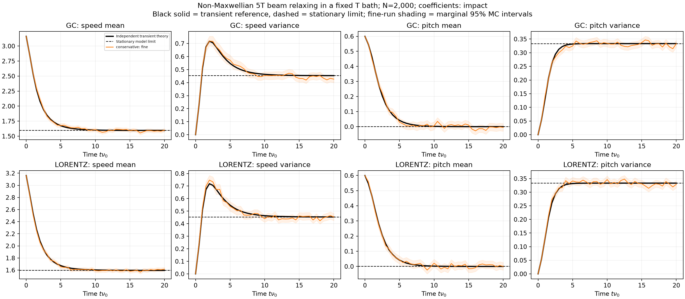

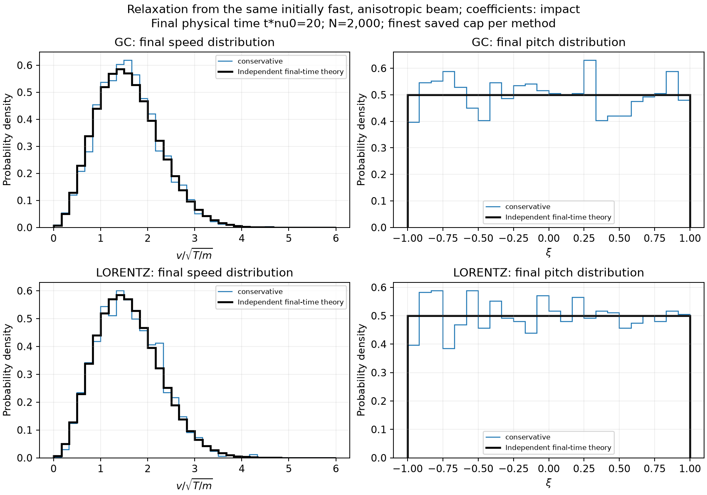

Saved [thermalization data](examples/benchmarks/results/impact_beam_relaxation_2000_20261016.json).
Reproduce with `python -m examples.benchmarks.validate_beam_relaxation --particles 2000 --batch-size 50 --coefficient-model impact --methods conservative --settings fine --output examples/benchmarks/results/thermalization_NEW.json`.

#### Spatial diffusion

The GC test measures actual perpendicular displacement and accumulated
diffusion during unabsorbed relaxation. Independent spatial noise is checked
conditionally on each path's accumulated diffusion. The Lorentz test evolves
full gyromotion and physical Coulomb collisions, and measures the displacement
of `X=x+v cross b/Omega`. Its reference retains finite gyrofrequency effects;
the cases use `Omega/nu0=32,64` and two step ceilings.

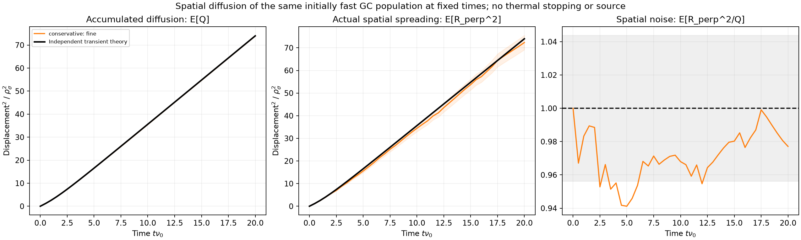

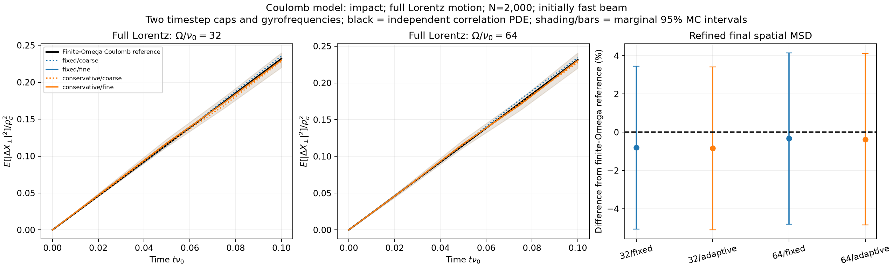

Saved [Lorentz spatial data](examples/benchmarks/results/impact_coulomb_spatial_2000_20261016.json).
Reproduce with `python -m examples.benchmarks.validate_lorentz_coulomb_spatial --particles 2000 --batch-size 50 --coulomb-log-model impact --output examples/benchmarks/results/spatial_NEW.json`.

#### First stopping

First stopping means first detected entry from `E=5T` into `E<=2T`.
The existing boundary-aware diagnostic refines crossing intervals; it is not
an automatic thermal stop in ordinary tracing. The accepted comparison keeps
`hmax*nu0=0.00078125`, the same initial interval, save anchors and event
interval `1.220703125e-5`. It compares fixed stepping with conservative
adaptive tolerances `0.001` and `0.00025`, using 2,000 particles per case.
Fifty baseline paths for each model/method replay exactly before reuse.

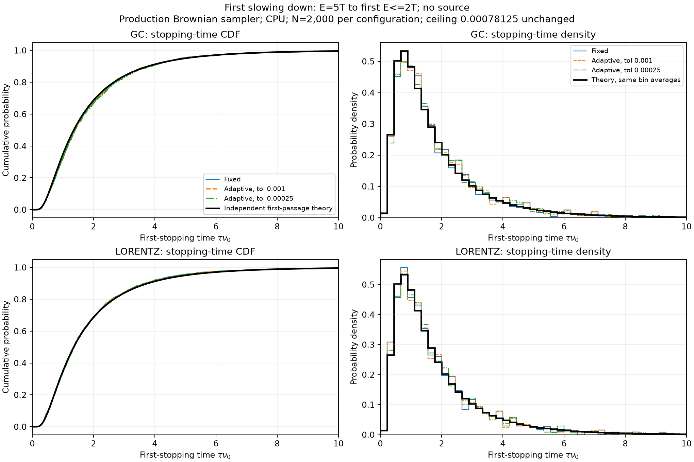

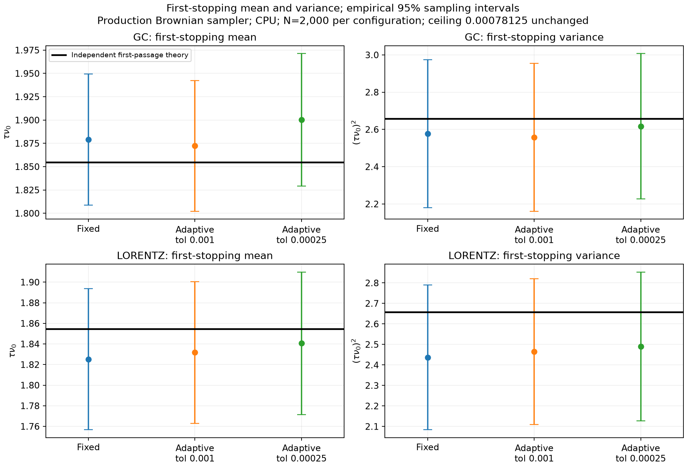

All six mean/variance intervals include theory at the marginal 95% level;
all six CDF screens pass, with no censored paths. These checks establish
statistical agreement at the tested settings. Step-ceiling and boundary-
resolution convergence remain separate checks. Shared particle keys do not
guarantee identical production Wiener paths after timestep histories diverge.

Saved [comparison JSON](examples/benchmarks/results/production_tolerance_2000_original_ceiling_20261017.json)
and [CSV](examples/benchmarks/results/production_tolerance_2000_original_ceiling_20261017.csv).
The [baseline ensembles](examples/benchmarks/results/impact_first_passage_2000_matched_20261016.json)
retain two independent 2,000-particle seeds per model/method and stopped GC
spatial diagnostics. Their NRL replay input is retained for reproducibility.
Reproduce with `python -m examples.benchmarks.validate_production_tolerance --baseline examples/benchmarks/results/impact_first_passage_2000_matched_20261016.json --output examples/benchmarks/results/stopping_NEW.json`.
The helper `plot_matched_first_passage` renders the saved pooled baseline.

#### Regenerate the accepted plots from saved data

This renders the six accepted figures without running particle trajectories
or changing the saved JSON/CSV records:

```bash
python - <<'PY'
import json
from pathlib import Path
from examples.benchmarks.validate_beam_relaxation import plot as plot_beam
from examples.benchmarks.validate_lorentz_coulomb_spatial import plot as plot_spatial
from examples.benchmarks.validate_production_tolerance import plot as plot_stopping
from examples.benchmarks.nonrelativistic_collision_reference import ProtonBackground, proton_first_passage

results = Path("examples/benchmarks/results")
beam = results / "impact_beam_relaxation_2000_20261016.json"
spatial = results / "impact_coulomb_spatial_2000_20261016.json"
stopping = results / "production_tolerance_2000_original_ceiling_20261017.json"
plot_beam(json.loads(beam.read_text()), beam)
plot_spatial(json.loads(spatial.read_text()), spatial)
reference = proton_first_passage(ProtonBackground(coulomb_log_model="impact"), nodes=1536)
plot_stopping(json.loads(stopping.read_text()), reference, stopping)
PY
```

#### Retained adaptive/fixed convergence controls

The current thermalization runner can compare fixed and conservative adaptive
stepping at both caps, including GC spatial spreading. The Lorentz spatial
runner already includes both methods and two caps. The first-stopping runner
retains the fixed baseline and two adaptive tolerances at the original ceiling.
For a new thermalization convergence study, use:

```bash
python -m examples.benchmarks.validate_beam_relaxation \
  --particles 512 --batch-size 64 --coefficient-model impact \
  --methods fixed conservative --settings coarse fine \
  --output examples/benchmarks/results/thermalization_convergence_NEW.json
```

Two additional production-sampler controls and their saved inputs are retained:

| Control | Saved data | Reproduction module |
| --- | --- | --- |
| Fixed/adaptive timestep, tolerance and particle-prefix sweeps | [512-particle JSON](examples/benchmarks/results/collisional_convergence_512_20261016.json), [CSV](examples/benchmarks/results/collisional_convergence_512_20261016.csv) | `examples.benchmarks.converge_collisional_slowing_down` |
| First-entry event-resolution refinement | [2,000-particle JSON](examples/benchmarks/results/collisional_event_refinement_2000_20261016.json), [CSV](examples/benchmarks/results/collisional_event_refinement_2000_20261016.csv), [required input](examples/benchmarks/results/collisional_physics_2000_20261016.json) | `examples.benchmarks.validate_collision_event_refinement` |

These dated NRL controls are historical convergence diagnostics. The first
uses endpoint-only stopping; the second investigates its boundary-resolution
bias. Their recorded source hashes describe those historical runs. The
accepted validation figures above use the later refined stopping diagnostic
and impact coefficients. No custom Wiener generator is retained.

```bash
python -m examples.benchmarks.converge_collisional_slowing_down \
  --paths 512 --batch-size 64 --repeats 3 \
  --output examples/benchmarks/results/collision_convergence_NEW.json

python -m examples.benchmarks.validate_collision_event_refinement \
  examples/benchmarks/results/collisional_physics_2000_20261016.json \
  --particles 512 --batch-size 64 --methods fixed conservative \
  --output examples/benchmarks/results/event_resolution_NEW.json
```

Each historical control also supports `--plot-only` with its saved output
JSON; the event-resolution command still requires the input path. These
optional studies use the explicit settings written to their own reports.

### Tracing speed on the bundled QA coil example

`python -m examples.benchmarks.benchmark_collision_tracing --output examples/benchmarks/results/qa_tracing_NEW.json`
compares native adaptive collisions, native fixed collisions, fixed Diffrax
`GuidingCenterCollisionsMuFixed`, and native collisionless tracing. It uses
the field and 4 keV alpha launch setup from
[`trace_particles_coils_guidingcenter.py`](examples/particle_tracing/trace_particles_coils_guidingcenter.py).
JSON/CSV record settings, source hashes, completion status, split/orbit counts,
effective mean intervals, compilation times and interleaved warm timings.
The small timing ensemble is separate from the physics benchmarks above.

The saved CPU run uses the example's original two-particle ensemble, `tmax=1e-4 s`,
101 save times and five interleaved warm repetitions. Native orbit solves use
Dopri8 with `rtol=atol=1e-9`; adaptive collisions use tolerance `0.001` and a
`1e-6 s` ceiling. Both fixed collision cases use `1e-7 s` steps. Each native
collision interval contains its own adaptive orbit solve.

| Case | Accepted intervals per particle | Native orbit trials per particle | Effective mean interval (s) | Warm median, two particles (ms) |
| --- | ---: | ---: | ---: | ---: |
| Native adaptive collisions | 314.5 | 380.0 | 3.180e-7 | 506.1 |
| Native fixed collisions | 1000.0 | 1000.0 | 1.000e-7 | 1202.0 |
| Fixed Diffrax collisions | 1000.0 | n/a | 1.000e-7 | 871.1 |
| Native without collisions | 175.5 | 182.5 | 5.698e-7 | 228.4 |

For the collisionless row, intervals and trials refer to RK steps. For native
collision rows, the first count is the collision/split interval count and the
second includes inner RK attempts and rejections. Diffrax advances its coupled
SDE in each fixed step. The effective interval is the horizon divided by the
mean accepted count; it is not a maximum timestep or a measured per-step cost.
Native adaptive collisions take about 1.72 times less warm time than fixed
Diffrax in this case. Native fixed collisions take about 1.38 times as long
as Diffrax at the same fixed count. The collisionless row measures integration
cost with different physical dynamics; this small timing study does not
establish statistical equivalence between the collisional implementations.

Saved [JSON](examples/benchmarks/results/qa_collision_tracing_20261017.json) and
[CSV](examples/benchmarks/results/qa_collision_tracing_20261017.csv) include all
five timing samples and per-particle counts. All four reported cases complete.
The original eight-particle preflight had no loss boundary. Its fourth fixed-
collision particle escaped toward a coil; the inner orbit solve then stopped
at `t=7.876591344455e-5 s`. Independent SciPy DOP853 and RK45 solves of that same
interval also stop because their required timestep falls below floating-point
time resolution. At the terminal point the particle is about **7 mm** from the
coil polyline, the configured field gives `rho / L_B = 10.77`, and
`Bstar_parallel / B` approaches zero. The local 75-point coil quadrature is
strongly resolution dependent: diagnostic copies with 300/600 points remove
the near-zero denominator at that position. Those copies are sensitivity
checks, not a converged near-coil reference or a change to the traced field.
This identifies a near-coil field/GC-validity problem, rather than an RK
controller failure. Unbounded GC tracing is still expected to fail there.

Use an explicit loss boundary to stop escaped particles before this region.
The regression uses the same reference geometry as
[`connection_length_coils.py`](examples/fieldline_tracing/connection_length_coils.py):
the bundled QA boundary rescaled to the coils' unit major radius, with an 8 cm
wall clearance. This reference wall is not a newly solved coil LCFS or a
measured vessel. All launches, production Brownian sampling, collision maps,
orbit tolerances and the 75-point coil field stay unchanged. Fixed and adaptive
collision runs are checked with both 2 and 101 saves; a wall hit is an `EVENT`,
while a surviving particle must reach the full horizon with `SUCCESS`.

| Collision stepping | Saves | Reached 100 microseconds | Wall hits | Numerical failures |
| --- | ---: | ---: | ---: | ---: |
| Fixed | 2 | 1 | 7 | 0 |
| Fixed | 101 | 1 | 7 | 0 |
| Adaptive | 2 | 2 | 6 | 0 |
| Adaptive | 101 | 3 | 5 | 0 |

The original failing fixed launch hits the wall at `50.3321805911` microseconds
with either save grid. Changing adaptive save anchors also changes the split
grid and sampled paths; these eight-particle counts are regression outcomes,
not estimates of converged loss fractions.

A separate unbounded eight-particle fixed Diffrax run completes with finite
outputs, but follows different stochastic trajectories. The corresponding
fourth particle's nearest saved coil distance is about 156 mm, compared with
about 7 mm at the native failure. Identical key labels do not produce identical
paths across the two Brownian generators. Fixed Diffrax Milstein also has no
adaptive embedded orbit-error check; its completion is not evidence of accurate
continuation through the native particle's problematic interval.

Saved [orbit-loss diagnosis and wall regressions](examples/benchmarks/results/qa_coil_orbit_loss_20261017.json)
include the independent ODE checks, quadrature sensitivity, per-particle
outcomes, counts and source/input hashes. Reproduce on CPU with:

```bash
python -m examples.benchmarks.validate_coil_orbit_loss --output examples/benchmarks/results/qa_coil_orbit_loss_NEW.json
python -m pytest -q tests/test_split_coil_boundary.py
```

For a production geometry, pass its wall through `trace_split(..., event=wall)`;
`LevelsetStoppingCriterion(classifier, maximum_distance=clearance)` accepts the
existing positive-inside surface classifier. The tracer root-finds orbit wall
crossings and skips the collision kick at an orbit event. It does not infer a
wall from coils or switch automatically to full Lorentz dynamics. The original
two-particle timing and memory runs above remain unbounded cost measurements;
the wall regressions do not replace or extend their timing claims.

Memory is measured by replaying each case once in its own fresh Linux CPU
process. All four replays reproduce the timed run's per-particle step counts
and terminal states exactly. The compiler buffer estimate is arguments plus
outputs plus temporaries minus aliases. Peak resident RAM (`ru_maxrss`) includes
Python/JAX, input setup, compilation and execution, and is measured only for
the child process itself. It is not a runtime-only integration allocation.

| Case | Compiled forward buffers (MiB) | Peak process RAM, including compilation (MiB) |
| --- | ---: | ---: |
| Native adaptive collisions | 0.959 | 779.1 |
| Native fixed collisions | 0.959 | 779.7 |
| Fixed Diffrax collisions | 3.501 | 1226.6 |
| Native without collisions | 0.388 | 695.2 |

These are forward measurements for the two-particle example. They do not
measure AD memory. Fewer adaptive steps reduce execution work while the
compiled buffers remain the same size as the fixed native case.

Saved [memory JSON](examples/benchmarks/results/qa_collision_tracing_memory_20261017.json)
and [CSV](examples/benchmarks/results/qa_collision_tracing_memory_20261017.csv)
retain compiler buffer components, setup/compile/execute RSS peaks, source
hashes and replay checks. Reproduce on Linux/WSL with
`python -m examples.benchmarks.measure_collision_tracing_memory --timings examples/benchmarks/results/qa_collision_tracing_20261017.json --output examples/benchmarks/results/qa_memory_NEW.json`.

The retained collision-map, Brownian-memory, event-diagnostic and independent
reference regression selection passes **184 tests** on CPU.

### Native orbit integration

#### Accepted-step reverse AD for collisionless GC and Lorentz

The native integrators opt into reverse AD with `native_adjoint="accepted"`:

```python
tracing = Tracing(field=field, particles=particles,
    model="GuidingCenterAdaptative",  # or "FullOrbitAdaptative"
    integrator="essos_dopri8",        # or "essos_rk45"
    native_adjoint="accepted", native_adjoint_checkpoint_steps=16,
    native_adjoint_max_accepted_steps=512, max_steps=4096,
    maxtime=2e-6, timestep=1e-7, times_to_trace=32, progress=False)
```

The standalone API uses `solve_rk(..., adjoint="accepted")`. The default
`"none"` keeps the existing forward/JVP path. This phase covers collisionless
Cartesian tracing. Split-collision reverse replay and the public VMEC/exterior
segment driver are not included.

Like NEOPAX's accepted-step replay, the forward controller chooses its grid
and the reverse rule treats that grid as fixed. The forward solve records
accepted step sizes, the terminal event fraction, and time/state/FSAL
checkpoints at segment starts. Saved-sample ownership is reconstructed from
these frozen times. The backward loop reconstructs one segment's states and
caches its small RK stage vectors, then transposes one step at a time. Each RHS transpose uses
ordinary JAX AD, with only one stage's field intermediates live at a time.
One reverse-stage loop includes internal stages, endpoint FSAL and the first
step's initial RHS derivative, so these paths share one RHS transpose body.
Parameter cotangents include initial-condition construction, field/coil parameters and
direct dependence of each objective on the field. Rejected trials, embedded
errors, controller history and chosen step sizes have no derivative path.

Dense interpolation is differentiated. Event times and root fractions are
frozen; this is not the derivative of a moving hard first-hit time. Use the
classifier surrogates below for the loss benchmarks. Failed solves raise an
error during reverse AD. No gradients are returned for an incomplete trace.
Forward-mode through this custom VJP and higher derivatives are outside this
phase; the pure RK maps retain their ordinary JVP/VJP support.

`native_adjoint_checkpoint_steps` (standalone `adjoint_checkpoint_steps`)
defaults to 16. Set 1 to retain every accepted state, or a larger positive
integer to trade checkpoint storage for segment reconstruction. Following
NEOPAX's segment strategy, the RK tape and reconstruction workspace scale as
`O((accepted_capacity / segment_length + segment_length * rk_stages) * state_size)`;
the accepted schedule also uses `O(accepted_capacity)` scalar metadata. The
stage cache holds small state-sized vectors, not field intermediates. It avoids
reconstructing every RK step twice during backward execution.

`native_adjoint_max_accepted_steps` (standalone `adjoint_max_accepted_steps`)
optionally bounds this AD storage independently of `max_steps`, which still
counts accepted and rejected trials. The default `None` retains the existing
`max_steps` allocation bound. A full tape does not alter forward trajectories
or controller decisions; requesting its gradient raises an explicit capacity
error. Increase the capacity and retry rather than accepting a partial gradient.
The RK pullback never reruns rejected trials or the adaptive controller.

Forward execution and segment reconstruction use the forward solver's generic
preparation of parameter-only RHS expressions. Backward execution rebuilds
that setup once. Ordinary JAX VJPs transpose the stage RHS with respect to
state and prepared parameters; each accepted step accumulates its stage
cotangents before applying the setup pullback once. JAX's activity flags
exclude fixed input data from differentiation; they do not exclude any active
physical parameter. The reverse loop accumulates gradients in the original
parameter representation. No field/particle
class or PyTree structure is changed. The implementation is isolated in
[`essos/rk_ad.py`](essos/rk_ad.py).

The current benchmark differentiates coils and birth parameters:

| Parameter family | Coverage in this phase |
| --- | --- |
| Coil geometry and current | All 136 bundled QA Fourier/normalized-current DOFs |
| Birth position and pitch | Independent Cartesian XYZ in metres and `v_parallel/v` for each particle |
| Birth energy | Shared `log(E / 4000 eV)` parameter; includes speed initialization, GC RHS and direct energy-objective dependence |
| Lorentz birth gyrophase | Shared angle in radians; includes both gyroradius displacement and velocity initialization |

Energy and gyrophase are shared across the population in this first benchmark;
the existing particle class and scalar-energy API are unchanged. For Lorentz,
the GC-to-full-orbit conversion also retains its dependence on the coil field.
VMEC/Boozer RBC/ZBS benchmarks are deferred. They require the full
equilibrium-to-field chain, including the Boozer transform when used;
perturbing only a loaded field table would not validate that chain.

The array objectives in [`essos/particle_losses.py`](essos/particle_losses.py)
adapt the inspected branch formulas to collisionless SI GC/Lorentz states:

| Objective | Definition / source |
| --- | --- |
| `mean_final_radius` | Mean minor radius over particles at the final save |
| `legacy_rcross_cost` | Exact existing `loss_particle_rcross_final`: norm of each particle's time-mean minor radius; despite its name it is not a final-save mean |
| `classifier_loss_fraction` | Mean over particles of the maximum saved sigmoid outside probability; `jax_9` / `jax_10` |
| `classifier_loss_location` | Distance to target weighted by increments of cumulative loss probability; `jax_9` / `jax_10` |
| `classifier_energy_cost(kind="heat_jax10")` | Escape-weighted total kinetic energy times perpendicular speed, with the original normalization |
| `classifier_energy_cost(kind="perpendicular_jax9")` | Escape-weighted perpendicular energy in joules; `jax_9`'s method named heat flux |
| `classifier_energy_cost(kind="perpendicular_jax10")` | Escape-weighted perpendicular energy with `jax_10`'s original normalization |

`Tracing` also exposes the classifier loss-fraction, location, heat-proxy and
normalized perpendicular-energy methods with the branch method names. The
original main objective accepts native solver options; the separately named
`loss_particle_mean_final_radius` supplies the actual final-save mean.
The source snapshots are `jax_9` at `4b68978` and `jax_10` at `9258ce0`.
The one-distance-per-point shape correction from `jax_8` (`bb74c07`) is included
in `signed_distance_from_surface_jax` and tested for scalar and batch inputs.

The branch energy objectives retain their `+1e-12` denominators for comparison.
In SI units this constant can dominate the particle birth energy, so the
`jax_10` energy normalization is not scale invariant at arbitrary energies.
The heat objective is a proxy, not an area-resolved physical wall heat flux.

#### Coil optimization with accepted-step AD

Two runnable examples use the production `Tracing` API and optimize all coil
Fourier and normalized-current DOFs. Birth XYZ, pitch, energy and gyrophase
stay fixed; the Lorentz GC-to-full-orbit conversion retains its field
dependence. All particles are vectorized together, without particle chunking.

Optimization follows JAX's default device selection. The examples do not set
`JAX_PLATFORMS` or `ESSOS_CPU_DEVICES`; the backend and selected devices are
printed at startup and saved in `summary.json`. Clear any CPU override left
from benchmark commands before launching on a GPU machine, for example with
`unset JAX_PLATFORMS JAX_PLATFORM_NAME`. Restart an existing Python process
after changing backend settings. On an NVIDIA installation,
`JAX_PLATFORMS=cuda,cpu python -m ...` requires CUDA and selects it as the
default while retaining CPU devices for runtime error callbacks. Do not use
`cuda` alone: a failed native solve or accepted-step tape overflow could then
be obscured by a callback error about a missing CPU device.
JAX orbit integration and AD use the selected devices; compilation, SciPy
optimization control and plotting still involve the CPU.

The two original entry points start from the bundled QA coil JSON.
Two additional examples put editable physical and optimization settings in a
`PARAMETERS` block at the top of each script:

- [Native full-orbit circular-coil case](examples/coil_optimization/optimize_coils_particle_confinement_fullorbit_native.py)
- [Native GC circular-coil case](examples/coil_optimization/optimize_coils_particle_confinement_guidingcenter_native.py)

These use the respective `optimize_coils_particle_confinement_*` reference
parameters: three independent circular coils, two field periods, stellarator
symmetry (12 physical coils), major radius 7.74 m, coil radius 4.5 m, 18.4 MA
currents, Fourier order 6 and 60 quadrature points. Ten 3.52 MeV alpha particles
start at equally spaced angles on the R=7.74 m, Z=0 circle, including the
reference examples' duplicated 0/2pi endpoint. Pitches are sampled uniformly
in [-1,1] with seed 42; gyrophase is zero. The GC case retains L2 Fourier
scaling factor 1.2; the full-orbit case uses factor 0. Both expose 120 coil
geometry/current DOFs.

They reuse the same native runner, Dopri8, I controller, standard dense output,
accepted-step reverse AD, 16-step checkpoints and bounded L-BFGS-B optimization.
Their final time is 100 us, tolerance `rtol=atol=1e-8` and save count 1000.
The reference `1e-14 s` timestep becomes the initial adaptive step guess.
Their 200 function-evaluation setting uses the native optimizer's limit;
these scripts do not reproduce the old least-squares optimizer or Boris map.
The full-orbit birth conversion remains field-dependent. Edit `PARTICLE_OBJECTIVE`
to select `"final_radius"` (default), `"loss_fraction"` or `"radial_increment"`.
The latter implements the intended full-orbit reference formula with Cartesian
time indexing corrected: `sum_i(mean_j(r[i,j+1]-r[i,j]))**2`. It has no division
by dt, depends on save count and measures net displacement rather than excursions.
All reference radii stay fixed at their initial values, as in the native runner.

```bash
python -m examples.coil_optimization.optimize_coils_particle_confinement_fullorbit_native
python -m examples.coil_optimization.optimize_coils_particle_confinement_guidingcenter_native
```

No CLI arguments are required for these two cases. Edit `horizon` for final
time and choose a fresh `output` directory in `PARAMETERS`; optional CLI
arguments override the script settings. These circular-coil cases use a fixed
circular torus for both the classifier and Bn surface, with major radius
7.74 m and minor radius 3.5 m, inside the initial 4.5 m coil circles. Edit
`target_surface="torus"` and `target_minor_radius=3.5` in `PARAMETERS` to choose
the target; its minor radius must be smaller than the initial coil radius.
Use `target_surface="qa"` for the original scaled QA shape instead. The torus
does not read a VMEC file. The target stays fixed while coils deform.

Set `PARTICLE_OBJECTIVE = "loss_fraction"` in either script to use the classifier
surrogate, or override the objective on the command line:

```bash
python -m examples.coil_optimization.optimize_coils_particle_confinement_fullorbit_native --objective loss_fraction --target-surface torus --target-minor-radius 3.5 --output output/native_fullorbit_loss
python -m examples.coil_optimization.optimize_coils_particle_confinement_guidingcenter_native --objective loss_fraction --target-surface torus --target-minor-radius 3.5 --output output/native_gc_loss
```

The surrogate averages, over particles, the maximum saved-time outside
probability `sigmoid(-softness * signed_distance)`. Distance is positive inside
the target and probability is 0.5 on the surface. `softness` has units 1/m;
larger values sharpen the transition. This is a geometric confinement objective
and does not stop particles at the surface.

The two circular-coil examples additionally enable a **separate safety stop**:
`safety_minor_radius=4.4` m, 10 cm inside the initial 4.5 m coil circles.
The 3.5 m target remains a soft classifier. Both GC and Lorentz tracing stop
on the first accepted step reaching the safety torus, using an inexpensive
analytic level set about the fixed initial axis. Later saves hold the last
saved interior state; the plotted endpoint is therefore slightly inside the
safety surface and depends on the save spacing. The RK stages of the crossing
trial are still evaluated. This prevents continuing escaped trajectories
toward the wires; it is not a change to the field or RK formulas.

Use `--safety-minor-radius 4.4` to change the safety radius, or
`--no-safety-stop` to disable it. For circular targets it must lie outside
the soft target and inside the initial coil radius. The torus stays fixed as
coils deform; it is not a wire-clearance constraint on optimized coils.
Plots show the soft target in black and the safety surface in red.
`safety_stop_fraction` in the history and summary records physical safety
hits separately from the surrogate, without adding a new optimization term.
The original QA entry points leave safety stopping disabled unless requested.

The existing maximum-sigmoid objective is unchanged and can level off once
all particles reach the safety stop (about 0.76 at radius 4.4 m with the
reference softness). It does not reward a later exit explicitly. Accepted
steps and stopping/saved-time decisions remain frozen during reverse AD;
these are not derivatives of a moving first-hit time. A safety stop alone
does not establish that the long-horizon gradients or optimization converge.

```bash
python -m examples.coil_optimization.optimize_coils_native_loss_fraction --output .tmp/native_loss_fraction
python -m examples.coil_optimization.optimize_coils_native_final_radius --output .tmp/native_final_radius
# Small one-iteration check; select a fresh output directory for each run.
python -m examples.coil_optimization.optimize_coils_native_final_radius --particles 2 --maxiter 1 --output .tmp/native_radius_smoke
```

The [loss-fraction example](examples/coil_optimization/optimize_coils_native_loss_fraction.py)
uses the particle mean of the maximum saved sigmoid outside probability as
its particle term, using the fixed, scaled QA reference surface. This surrogate is not a hard
particle count. The [radius example](examples/coil_optimization/optimize_coils_native_final_radius.py)
uses the particle mean of final-save minor radius in metres:
`sqrt((sqrt(x*x + y*y) - R_axis)**2 + (z - Z_axis)**2)`.
The initial field's reference axis is held fixed throughout optimization.
This is distinct from the legacy time-averaged radius reduction above.

All four entry points include the length, curvature and normal-field terms from
`optimize_coils_vmec_surface.py` in a weighted scalar cost:

```text
cost = particle_weight * particle_metric
     + length_weight * mean(max(coil_length - length_target, 0))
     + curvature_weight * mean(max(pointwise_curvature - curvature_target, 0))
     + bdotn_weight * sum(abs(B dot unitnormal / |B|))
     + axis_field_weight * abs(mean(axis |B|) - axis_field_target)
     + regularization * mean(delta**2)
```

`--particle-weight`, `--length-weight`, `--curvature-weight` and
`--bdotn-weight` each default to 1. The last three terms can be disabled
individually with weight 0; disabled terms are omitted and logged as zero.
`--axis-field-weight` adds an independently selectable axis-field term. Its
default is zero in the two original entry points and one in the two reference
case scripts, alongside the other four terms. The target is 5.7 T, sampled at
15 angles on the fixed initial axis circle. Set `axis_field_weight=0` in the
script to omit it; the other objective weights work in the same way.
`--length-target` is in metres and `--curvature-target` in inverse metres.
The original QA entry points default to 1.05 times the largest initial coil
length and pointwise curvature, respectively. The two circular-coil cases
explicitly use the reference targets of 31 m and 0.4 /m.
Resolved targets and weights are saved in the summary. The normal-field term
uses the same fixed target shape as the classifier, sampled separately
on a half-period mesh (`--surface-ntheta 30 --surface-nphi 30`). Its sum follows
the existing example and changes with mesh size; choose weights accordingly.
All these derivatives include the coil geometry/current dependence.

```bash
python -m examples.coil_optimization.optimize_coils_native_loss_fraction --length-weight 1 --curvature-weight 0.1 --bdotn-weight 0.01 --output .tmp/native_loss_fraction_weighted
# Recover the particle-only objective used by the earlier smoke checks.
python -m examples.coil_optimization.optimize_coils_native_final_radius --length-weight 0 --curvature-weight 0 --bdotn-weight 0 --output .tmp/native_radius_particle_only
```

The two original QA entry points default to eight 4 keV alpha particles, Dopri8, I control,
`rtol=atol=1e-9`, 32 saves, 16-step checkpoints, accepted capacity 512,
trial limit 4096 and ten L-BFGS-B iterations. The default horizon is 20 us for
GC and 2 us with `--model lorentz`. `--method dopri5` selects the other native
RK method. `--max-change` bounds the absolute displacement of each public
normalized coil DOF (default 0.01), including initially zero coefficients.
An optional `--regularization` adds a mean-square displacement penalty;
its default is zero. The geometry targets are soft penalties, in addition to
the small coil-DOF box; coil separation and other engineering constraints
are not included.

Each fresh output directory contains `initial_coils.json`, `optimized_coils.json`, `summary.json`,
`history.csv` and `orbits.npz` with initial/final trajectories and coil DOFs.
Plots are saved by default as `orbit_comparison.png` and `orbit_comparison.svg`.
Their four panels show initial and optimized coils with 3D trajectories and
the corresponding R-Z poloidal projections across all toroidal angles. These
are projections, not Poincare sections. A reproducible random sample of up to
ten traced particles is used, with identical particle IDs and colors in both
configurations; all particles are shown when fewer than ten were traced.
The plots reuse the stored optimization trajectories without additional tracing.
Edit `save_plots`, `plot_particles` and `plot_seed` in the reference scripts,
or use `--no-save-plots`, `--plot-particles` and `--plot-seed`. The selected
particle IDs and plot filenames are recorded in `summary.json`.
The summary records optimizer termination, solver settings, initial/final loss
components, their weights, gradient norms and the fixed reference axis. Every
history row logs each raw component as well as the weighted total cost, so a
tradeoff between particle confinement and coil objectives remains visible.
History times include compilation on the first evaluation. Reaching
`--maxiter` is recorded as the optimizer's
iteration limit, rather than reported as convergence. Increase
`--accepted-capacity` if an updated coil needs more accepted steps; an
incomplete reverse tape raises an error.

#### Retained reverse-AD timing and memory comparisons (CPU, 2026-10-18)

The complete [seven-objective JSON](examples/benchmarks/results/native_ad_unbatched_25x_20261018.json)
and [per-objective CSV](examples/benchmarks/results/native_ad_unbatched_25x_20261018.csv)
compare both GC/Lorentz models and both RK methods with Diffrax's default
`RecursiveCheckpointAdjoint`. They use two particles, the bundled QA coils,
136 coil DOFs plus birth parameters, 32 saves, `rtol=atol=1e-9`, trial limit
4096, 16-step native checkpoints and accepted capacity 2048. GC runs for
50 us; Lorentz for 5 us. Both backends have the same physical embedded-error
budgets; native uses I and Diffrax uses ESSOS's PI coefficients `p=.4, i=.3`,
so their accepted grids can differ. All particles are vectorized together.

| Model / method | Native reverse (ms) | Diffrax reverse (ms) | Native speedup |
| --- | ---: | ---: | ---: |
| GC / Dopri5 | 523.3 | 1117.0 | 2.13x |
| GC / Dopri8 | 514.6 | 1118.9 | 2.17x |
| Lorentz / Dopri5 | 911.1 | 2123.7 | 2.33x |
| Lorentz / Dopri8 | 275.8 | 696.6 | 2.53x |

These are warm reverse-only times, excluding compilation and forward
linearization. Each entry is the mean of seven per-objective medians from
three repetitions, representing one reverse pass. The JSON also retains raw
timings, full gradients, objective values, accepted/rejected counts, source
fingerprints and compiler buffer estimates. Native frozen-schedule directional
finite differences agree within `1.18e-8`; native/Diffrax gradient relative-L2
differences are at most about `1.01e-7` in these cases. Ordinary adaptive finite
differences are recorded separately. Replay must reproduce the adaptive primal.

The classifier uses `angular_interpolation="periodic_cubic"`, with periodic
Hermite tangents matching values and first derivatives at every angular knot
and the `0/2*pi` seam. R/Z interpolation remains bilinear, so this is not a
globally smooth or exact signed-distance function. The default `"linear"`
classifier behavior is unchanged. The fixed reference surface is not a newly
solved coil equilibrium; no hard wall event is used in these comparisons.
At least one particle's maximum outside probability must occur after birth.
Lorentz starts at gyrophase `pi` to exercise evolved-state loss gradients.

Process memory is measured separately for the scalar mean-final-radius
`value_and_grad`, using Dopri8, 1 and 8 particles, the same million-trial
ceiling for both backends, and one fresh Linux CPU process per case. The
[trial-limit-sized tape report](examples/benchmarks/results/native_ad_full_population_capacity_baseline_20261018.json)
uses native accepted capacity `None`; the [bounded tape report](examples/benchmarks/results/native_ad_full_population_capacity_bounded_20261018.json)
uses capacity 512. The [comparison CSV](examples/benchmarks/results/native_ad_full_population_capacity_20261018.csv)
contains both settings, all backends, compiler/first-execution/warm peaks,
timings and executable buffers. The uncapped comparison is retained so the
benefit of the explicit storage setting remains visible.

| Dopri8, 8 particles | Native value/grad (ms) | Diffrax value/grad (ms) | Native peak RSS (MiB) | Diffrax peak RSS (MiB) | Native buffers (KiB/particle) | Diffrax buffers (KiB/particle) |
| --- | ---: | ---: | ---: | ---: | ---: | ---: |
| GC | 1922.9 | 2596.2 | 815.3 | 857.6 | 478.3 | 642.0 |
| Lorentz | 1223.6 | 1782.1 | 806.0 | 862.5 | 539.5 | 797.3 |

Here native uses capacity 512. Times include the complete scalar forward and
reverse calculation, excluding compilation, with three blocked warm repeats.
Peak RSS is the maximum over setup, compilation and execution. Native warm
RSS peaks are 814.3/805.2 MiB; Diffrax's are 857.6/862.5 MiB. Linux RSS
high-water marks are reset after compilation and first execution to isolate
warm peaks; resident JAX, executable and allocator memory remain included.
Executable buffers are `arguments + outputs + temporaries - aliases`, divided
by eight: an amortized footprint, not marginal process memory per particle.

The largest native accepted counts are 109 for GC and 154 for Lorentz, so
capacity 512 accommodates the complete paths. Bounded and trial-limit-sized
native tapes give exactly matching gradient vectors, counts and values.
Without the separate storage bound, native peak RSS is 1006.1/1034.6 MiB and
warm value/gradient execution takes 3623.8/4199.2 ms. Capacity 512 reduces the
native executable buffers from 191.9/223.0 MiB to 3.74/4.22 MiB without
changing the forward trial limit or accuracy. The default capacity remains
`None`; choose an explicit bound for the intended parameter range.

These CPU cases demonstrate a speed and memory advantage with the stated
configuration, not a universal ranking. In the shared seven-objective graph,
native compiler buffer estimates are slightly larger than Diffrax's
(50.66/51.07 MiB versus 50.62/51.03 MiB for GC/Lorentz), so the scalar RSS and
buffer gains should not be generalized to every objective graph. Neither
comparison uses particle chunking. Superseded AD development reports have
been removed; unrelated orbit and collision physics/convergence benchmarks
remain available above and below.

Reproduce from this checkout's root, choosing new output names:

```bash
export JAX_PLATFORMS=cpu
export ESSOS_CPU_DEVICES=1
export ESSOS_XLA_CACHE=
python -m examples.benchmarks.benchmark_native_ad --checkpoint-steps 16 --accepted-capacity 2048 --max-steps 4096 --gc-horizon 5e-5 --lorentz-horizon 5e-6 --output examples/benchmarks/results/native_ad_full_population_NEW.json
python -m examples.benchmarks.benchmark_native_ad_scaling --particle-counts 1 8 --checkpoint-steps 16 --max-steps 1000000 --output examples/benchmarks/results/native_ad_capacity_baseline_NEW.json
python -m examples.benchmarks.benchmark_native_ad_scaling --particle-counts 1 8 --backends native --checkpoint-steps 16 --max-steps 1000000 --accepted-capacity 512 --reference examples/benchmarks/results/native_ad_capacity_baseline_NEW.json --output examples/benchmarks/results/native_ad_capacity_bounded_NEW.json
pytest -q tests/test_rk_ad.py tests/test_particle_losses.py tests/test_surface_classifier_ad.py tests/test_rk.py tests/test_rk_rhs.py tests/test_rk_controllers.py tests/test_rk_dense.py tests/test_rk_higher_dense.py tests/test_orbit_error.py
```

The AD/forward/controller/dense-output CPU regression selection passes
**245 tests**. Capacity checks cover identical forward results and gradients,
independent allocation sizes and an explicit reverse-AD overflow error.
Two-particle, one-iteration Dopri8 particle-only optimization smoke checks
decrease both particle objectives for GC and Lorentz. Four composite checks
with active geometry penalties and a 10-by-10 normal-field mesh also reduce
the weighted total cost. Each coil-penalty gradient agrees with directional
finite differences. These checks do not establish optimizer convergence.

GC and Lorentz use the same native RK increment loop, separate from adaptive
retries, events and saving. It stores `k_i = h*f_i` for stage combinations and
dense output, and keeps the final derivative separately for FSAL reuse. No
division by `h` is needed. The stage loop and the public derivative-based
`rk45_step`/`dopri8_step` maps have ordinary forward/reverse JAX derivatives
in state, time, step size, vector-field parameters and the FSAL cache;
their values and derivatives are checked against each other, including `h=0`.
The full driver exposes the opt-in accepted-step reverse rule described above.

At solve setup, native RK separates RHS work that depends only on parameters
from work that depends on time or the particle state. The parameter work runs
once per solve, so coil geometry is not rebuilt at every timestep. This generic
JAX partial evaluation leaves the field objects and RK formulas unchanged;
time, the complete state, and parameter derivatives remain live. It uses JAX's
partial-evaluation interface in the isolated `_prepare_rhs` helper in `rk.py`.

Native adaptive orbits default to `native_error_control="physics"`. The
embedded error is measured in separate Cartesian-position and velocity blocks:
`max(norm(dx)/L, norm(dv)/V) / (atol + rtol)`. The position reference
`orbit_length_scale=L` defaults to **1 metre**; choose a relevant device or
orbit length when this is unsuitable. `orbit_speed_scale=V` defaults to the
particle's total speed, so a parallel turning point or a zero Cartesian
velocity component does not shrink its error budget. Both tolerances apply to
these nondimensional physical blocks. These are **local estimated errors**;
they do not bound the accumulated trajectory error.

VMEC position errors compare the embedded endpoints after mapping to Cartesian
space, including the regular chart angle. Constant magnetic moment and failure
flags do not enter the norm. Fixed steps do not evaluate the error policy.
`native_error_control="standard"` restores componentwise scaling
`atol + rtol*max(abs(y_old), abs(y_trial))` with an RMS norm. The bare
`solve_rk` API keeps that generic default and accepts a separate `error_norm`
callable; [`essos/orbit_error.py`](essos/orbit_error.py) contains the physical
policy without a Diffrax dependency.

The native driver defaults to `native_controller="i"` and `rtol=atol=1e-9`.
Explicit tolerances override these defaults. Diffrax tracing keeps its existing
`1e-7` defaults. Select
`native_controller="pi"`, `native_pcoeff=.4`, `native_icoeff=.3` in `Tracing`
to compare with ESSOS's Diffrax PI coefficients. The standalone `solve_rk`
keywords are `controller="pi"`, `pcoeff=.4`, `icoeff=.3`. PI uses the previous
accepted error, safety factor .9, accepted growth limits [1, 10] and rejected
growth limits [.2, .9]. Fixed stepping ignores the controller. PI does not
change the embedded error or acceptance threshold.

Diffrax's ESSOS path keeps its existing componentwise RMS/PI configuration
(`PIDController` with `dcoeff=0`). Native controller and error-policy options
do not change Diffrax, Boris or collisions. Comparing step counts also requires
the same error norm, initial step and tolerances. Neither native method is
symplectic.

An optional `native_dense_output="optimized"` changes Dopri8's saved-time
polynomial weights. The standalone solver keyword is `dense_output="optimized"`.
It reuses the existing RK stages, with **no additional field/RHS evaluations**,
and prepares six polynomial coefficient vectors once per trial for all saves
in that step. GC and Lorentz use the same implementation. The integration
formula, embedded estimator, controller and event-root interpolation are
unchanged; Dopri5 retains its standard quartic for either setting.

The weights in [`essos/rk_dense.py`](essos/rk_dense.py) preserve the continuous
RK conditions through order five and endpoint values/slopes. They reduce the
integrated order-six/seven B-series error norm without increasing the formal
dense order. The calculation is independent of any orbit data and can be
reproduced with `python -m examples.benchmarks.derive_rk_dense_output`.
Accuracy gains depend on the ODE, so `native_dense_output="standard"` remains
the default. This option improves saved output and does not impose a global
error bound from `rtol`/`atol`.

To compare standard I, optimized-output I, native PI and Diffrax PI together:

```bash
python -m examples.benchmarks.compare_orbit_controllers --compare-dense-output --repeats 9 --output examples/benchmarks/results/orbit_dense_output_20261015.json
```

The comparison verifies unchanged per-particle step counts and terminal states
within floating-point roundoff, and records position/velocity errors and warm
timings separately from compilation.
The [2026-10-15 dense-output comparison](examples/benchmarks/results/orbit_dense_output_20261015.json)
and [CSV](examples/benchmarks/results/orbit_dense_output_20261015.csv) preserve
the nine-repeat QA-coil run at `rtol=atol=1e-9`. Dopri8 Lorentz saved position
and velocity errors fell by about sevenfold at essentially unchanged cost;
GC gains were smaller. All per-particle step counts matched the standard I run.

For higher continuous order on both methods, select
`native_dense_output="higher_order"` in `Tracing`, or `dense_output="higher_order"`
in `solve_rk`. Dopri5 adds two output-only RHS evaluations to increase dense
order from four to five. Dopri8 adds three to increase dense order from five
to seven. Both GC and Lorentz use the same implementation and original RHS.
The new stages never feed the orbit endpoint, embedded estimator, controller,
or FSAL cache. Event roots retain the standard interpolant and terminal state.

Output stages run once per accepted step containing an interior save; all
saves in that step reuse the polynomial. Rejected trials and steps with only
endpoint saves skip them. Under particle batching, masked particles may share
the evaluations required by another particle in the same batch. Temporary
stage/coefficient storage is reused each step; no additional history is kept.
The pure output map supports forward/reverse AD, including derivatives in
step size and parameters. The accepted-step adjoint differentiates the actual
save interpolant, including these extra stages when used. Non-finite extra evaluations return a failure status without
retrying the accepted orbit step.

The coefficients in [`essos/rk_dense_high.py`](essos/rk_dense_high.py) are
derived independently of orbit data by
`python -m examples.benchmarks.derive_rk_higher_dense_output`. Tests verify every
rooted-tree condition through the claimed continuous order, nonlinear
convergence, ordinary JAX derivatives, evaluation counts, and unchanged orbit
steps/events. Higher dense order reduces interpolation error; accumulated
integration error remains. Lorentz Dopri5 was already close to that floor in
the QA benchmark, so extra interpolation work brings little benefit there.
The default remains `"standard"`, with the I-controller at `rtol=atol=1e-9`.
The construction uses the additional-stage bootstrapping strategy described
in [Shampine and Jay, Continuous Extensions](https://homepage.math.uiowa.edu/~ljay/publications.dir/ContinuousExtensions.pdf).

To compare both output options, native PI and Diffrax PI, including compiler
buffer-memory estimates for the forward solve:

```bash
python -m examples.benchmarks.compare_orbit_controllers --compare-dense-output --compare-higher-order --repeats 9 --output examples/benchmarks/results/orbit_higher_dense_output_20261015.json
```

The [saved higher-order comparison](examples/benchmarks/results/orbit_higher_dense_output_20261015.json)
and [CSV](examples/benchmarks/results/orbit_higher_dense_output_20261015.csv)
contain eight QA-coil particles, 64 saves, nine interleaved warm repeats, and
`rtol=atol=1e-9`. Below, arrows compare native I standard to higher-order output.
Errors are maximum absolute saved component errors against a 1024-fixed-step
Diffrax Dopri8 reference; GC velocity is the parallel component.

| Orbit/method | Warm median (ms) | Position error (m) | Velocity error (m/s) |
| --- | ---: | ---: | ---: |
| GC Dopri5 | 29.61 → 41.01 | 5.68e-9 → 1.91e-9 | 1.45e-2 → 1.10e-3 |
| GC Dopri8 | 35.11 → 44.63 | 1.86e-9 → 1.17e-10 | 3.53e-3 → 2.39e-4 |
| Lorentz Dopri5 | 29.15 → 40.81 | 9.77e-11 → 9.77e-11 | 3.05e-3 → 2.86e-3 |
| Lorentz Dopri8 | 13.49 → 15.98 | 3.66e-9 → 5.57e-11 | 9.91e-2 → 1.53e-3 |

Every particle retained its orbit step counts and terminal state to roundoff.
The compiler's argument/output/temporary buffer estimate increased by only
192 bytes for the whole eight-particle GC batch and 128 bytes for Lorentz,
for either method. These are forward executable estimates, not process RSS
or future adjoint memory. The suite passed 239 solver/tracing tests.

For an isolated adaptive controller comparison (native I, native PI and
Diffrax PI with matched physical budgets and PI settings), run:

```bash
python -m examples.benchmarks.compare_orbit_controllers
```

It records per-particle accepted/rejected counts, warm timings and maximum
saved position/velocity errors in
`examples/benchmarks/output/orbit_controller_comparison.json`.
The preserved [2026-10-15 baseline](examples/benchmarks/results/orbit_controller_baseline_20261015.json)
and its [CSV table](examples/benchmarks/results/orbit_controller_baseline_20261015.csv)
record the eight-particle QA-coil comparison at `rtol=atol=1e-9`.

To compare native I at tighter tolerances alongside the baseline controllers:

```bash
python -m examples.benchmarks.compare_orbit_controllers --native-i-tolerances 1e-10 1e-9 --native-i-tolerances 1e-10 1e-10 --output examples/benchmarks/results/orbit_controller_tight_i_20261015.json
```

Each extra pair is `rtol atol`. With the physical norm, changing only rtol
reduces the budget from `2e-9` to `1.1e-9`; changing both to `1e-10` gives
`2e-10`. JSON and CSV records include both tolerances, the budget, timings,
per-particle counts and maximum saved position/velocity errors.
The [tighter native I results](examples/benchmarks/results/orbit_controller_tight_i_20261015.json)
and [CSV table](examples/benchmarks/results/orbit_controller_tight_i_20261015.csv)
include both variants and baseline controllers timed together in the same run.

For synchronized forward timings, run from the repository root:

```bash
python -m examples.benchmarks.benchmark_orbit_integrators --repeats 7
```

This compares native and Diffrax Dopri5/Dopri8 using the bundled QA coils,
reports compilation separately from repeated execution, checks trajectory
errors against a tighter reference, and records step counts in
`examples/benchmarks/output/orbit_integrator_timings.json`. Fixed stepping
uses the same number of steps; adaptive stepping uses each backend's ESSOS
controller. By default it applies the same physical norm to both backends;
`--error-control standard` reproduces the earlier RMS comparison. The benchmark
uses the existing field classes and GC/Lorentz RHS for both backends. It reports maximum
position error in metres and velocity error in m/s as well as normalized by
the initial total speed. The benchmark
measures compiled batched orbit integration and
excludes `Tracing` construction, postprocessing and VMEC boundary events.

For coil fields, GC quantities share the analytic spatial Jacobian of the
sampled Biot--Savart kernel. This remains differentiable in position, coil
shape and currents, and is used by both native and Diffrax solvers. The field
constructor, coil representation and PyTree structure are unchanged.

To isolate stage costs, run `python -m examples.benchmarks.profile_orbit_stages`.
This compares mathematical kernel variants in the same fixed-step scan, with
identical FSAL reuse and no saving, events or adaptive controller. It checks
final-state agreement and records warm timings and compilation sizes in JSON.
The RK map stays separate from acceptance, error scaling and output handling
so the accepted-step AD rule can replay numerical maps without differentiating retries.

For paired measurements of the previous and current native time-step map, run
`python -m examples.benchmarks.benchmark_native_stage_modes --derivatives`.
It holds the native error policy/controller fixed, checks trajectory agreement,
and reports complete solve timings separately from one-step reverse-derivative
timings. Field classes and RHS calculations are held fixed.
`--comparison rhs_setup` instead compares the driver before/after invariant
RHS preparation, with Diffrax alongside and the same field object for all three.
`python -m examples.benchmarks.audit_orbit_error_control` audits individual
native adaptive trials over a tolerance sweep. It checks acceptance, compares
the native and Diffrax maps on identical steps, and separates endpoint and
interpolated-output errors using independently refined Diffrax references.
Its host callbacks are diagnostic; use the timing benchmarks for performance.
`--comparison stages` reproduces the rejected stage-loop experiment;
the production RK method remains the same for both GC and Lorentz.

`python -m examples.benchmarks.profile_rk_candidates --kernels sparse trial_production diffrax --repeats 7`
compares the public derivative-based RK map, production increment-based trial
and Diffrax in an identical fixed-step scan. It checks stage values and
forward/reverse derivatives before timing. `--one-step --calls-per-block 7`
instead measures compiled single-step calls with an existing FSAL input cache.
Every kernel receives the original field object without a geometry snapshot.
Other named candidates are experiments and do not modify production.

`python -m examples.benchmarks.benchmark_native_stage_modes --comparison execution --candidate trial_production --repeats 11`
compares the legacy derivative-storage map and production increment-storage
map in the current full driver, with Diffrax alongside. Fixed mode uses 256
steps for every particle/backend; adaptive counts and errors are also recorded.

## Tracing to the wall

Inside the last closed flux surface (LCFS), guiding centres move in VMEC
coordinates. An orbit that crosses the LCFS continues in Cartesian coordinates
in a field you supply for the outside (coils, an mgrid, or a VMEX
`VmecExtender`) until it strikes the wall or comes back in. Below, 3 keV
protons in a VMEX free-boundary equilibrium of the Landreman-Paul QA coils,
with a wall 3 cm outside the LCFS.

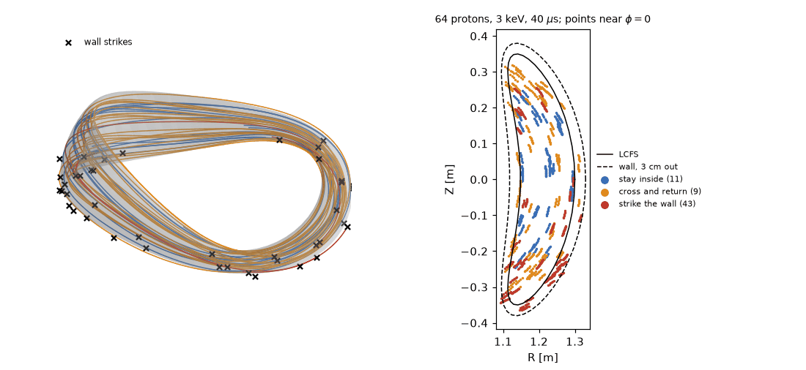

```python
vmec = vmex.essos_vmec_field(wout)                     # or Vmec("wout_*.nc")
outside = vmex.VmecExtender.from_wout(wout, external_field=coil_grid)
tracing = Tracing(field=vmec, model="GuidingCenterAdaptative", particles=particles,
                  maxtime=4e-5, exterior_field=outside, wall=0.03)  # gap [m] or a surface
print(tracing.wall_hits.mean(), tracing.wall_positions[tracing.wall_hits])
```

The full script is
[`trace_particles_vmec_to_wall.py`](examples/particle_tracing/trace_particles_vmec_to_wall.py);
the figure comes from `python docs/make_readme_figures.py wall`.

## Boozer-coordinate tracing

Transform a VMEC equilibrium with [booz_xform_jax](https://github.com/uwplasma/booz_xform_jax),
then trace guiding centres in an axis-regular chart with optional Monte Carlo
collisions. `method="dopri8"` (default), `"dopri5"` or `"rk4"` take fixed
steps; `"adaptive"` (Dopri5) and `"adaptive8"` (Dopri8) control each
particle's step to `tolerance`. This tracer provides forward diagnostics.

```python
import numpy as np
from netCDF4 import Dataset
from booz_xform_jax import Booz_xform
from essos.boozer import BoozerField, trace_boozer
from essos.constants import ALPHA_PARTICLE_CHARGE, ALPHA_PARTICLE_MASS, ONE_EV

booz = Booz_xform(verbose=0, mboz=32, nboz=32)
booz.read_wout("wout.nc", flux=False)
booz.run()
with Dataset("wout.nc") as wout:
    phi_edge = float(wout.variables["phi"][-1])  # boundary toroidal flux
field = BoozerField.from_booz_xform(booz, psi0=-phi_edge / (2 * np.pi))

n = 1000
speed = np.sqrt(2 * 3.5e6 * ONE_EV / ALPHA_PARTICLE_MASS)
result = trace_boozer(field, s=np.full(n, 0.25), theta=np.random.uniform(0, 2*np.pi, n),
                      zeta=np.random.uniform(0, 2*np.pi, n), pitch=np.random.uniform(-1, 1, n),
                      speed=speed, mass=ALPHA_PARTICLE_MASS, charge=ALPHA_PARTICLE_CHARGE,
                      tmax=1e-2)      # species=BackgroundSpecies(...) adds collisions
print(result.lost.mean(), result.loss_fractions())
```

To select the shared native RK driver, omit `method` and pass
`integrator="essos_rk45"` or `"essos_dopri8"`:

```python
result = trace_boozer(
    field, s=[0.25], theta=[0.0], zeta=[0.0], pitch=[0.5],
    speed=speed, mass=ALPHA_PARTICLE_MASS, charge=ALPHA_PARTICLE_CHARGE,
    tmax=1e-4, timestep=1e-8, integrator="essos_dopri8",
    adaptive=True, rtol=1e-9, atol=1e-9,
    native_controller="i", native_dense_output="standard",
)
```

Native stepping defaults to adaptive I control and standard interpolation;
`adaptive=False` selects fixed steps. `timestep` is the first adaptive trial
or fixed step, independent of `n_save`. PI and the optional dense-output modes
use the same native options as `Tracing`. Each orbit is solved over the full
horizon, with no controller resets at saves or progress boundaries. Legacy
interval compaction is unused in this path, and progress reports completion.
`result.step_stats[:, :]` contains trials/accepted/rejected counts and
`result.solver_status` contains native `RKStatus` codes. Losses are root-found
at `s=1`, later saves hold the crossing state, and failed solves remain failures.
Native Boozer stepping currently supports collisionless orbits; `species`
continues to select collisions on the existing legacy path.

The Boozer field provides `|B|` and profiles without a Cartesian position map.
Its native embedded error is
`max(norm(du,dw), abs(dzeta), abs(dv_parallel)/speed) / (rtol+atol)` in the
regular chart `u=sqrt(s)*cos(theta), w=sqrt(s)*sin(theta)`. The reference scales
are unit flux radius, one radian and birth speed. These are coordinate error
budgets, rather than the metre-based position budget used for VMEC. Angular
winding and parallel turning points do not change these scales. Native energy
diagnostics sample saved and terminal states. The existing
[`Boozer/VMEC comparison example`](examples/particle_tracing/trace_particles_boozer_vs_vmec.py)
selects the same native integrator for both fields.

`psi0` is minus VMEC's boundary toroidal flux over `2 pi`. A particle
is lost at `s = 1`; `result.loss_times` and `result.states` hold when and where.

Boozer tracing evaluates `|B| = sum [bc_mn(s) cos(m theta - n zeta) + bs_mn(s) sin(m theta - n zeta)]`
and its derivatives, together with the flux functions `G`, `I` and `iota`.

## Comparison with other codes

256 collisionless 3.5 MeV alphas per equilibrium, started at `s = 0.5` with
uniform Boozer angles and pitch, traced for 10 ms and lost at `s = 1`, in the
Landreman-Paul QA reactor-scale `wout`, the ARIES-CS `n3are` `wout`, and the
W7-X standard configuration scaled to the same minor radius (1.70 m) and
volume-averaged `|B|` (5.86 T). Apple M4 (load about 3 from other processes), 8 CPU
cores per code; compilation and field set-up excluded. DESC traces the first 32
alphas only, on `VMECIO.load(wout, L=24, M=8, N=8)` with the half-mesh lambda fix of
PlasmaControl/DESC#2352, and its times were taken with other DESC runs sharing the
machine. Run with
[`examples/cross_code_benchmark/benchmark.py`](examples/cross_code_benchmark/benchmark.py).

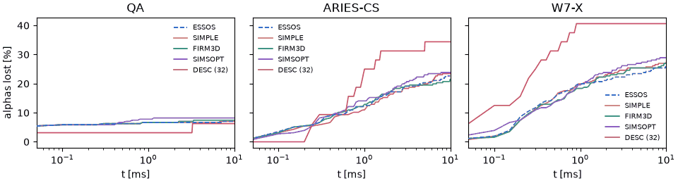

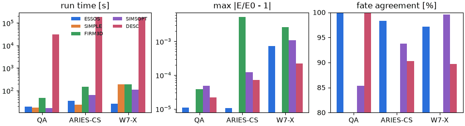

| Equilibrium | Code | Method | Run time | Lost | Same fate as SIMPLE and FIRM3D | max \|E/E0 - 1\| |
|---|---|---|---|---|---|---|
| QA | ESSOS `trace_boozer` | Dopri8, `dt = 2.1e-07 s` (default) | 19 s | 7.0 ± 1.6% | 100.0% | 1e-05 |
|  | SIMPLE | symplectic, defaults | 17 s | 7.0 ± 1.6% | - | not reported |
|  | FIRM3D | RK45, tol 1e-9, `gc_noK` | 48 s | 7.4 ± 1.6% | - | 4e-05 |
|  | SIMSOPT | RK45, tol 1e-9, `gc_noK` | 17 s | 8.2 ± 1.7% | 85.4% | 5e-05 |
|  | DESC | Tsit5, tol 1e-7, `L = 24, M = N = 8` | 3859 s | 6.2 ± 4.3% (32) | 100.0% | 2e-05 |
| ARIES-CS | ESSOS `trace_boozer` | Dopri8, `dt = 1.1e-07 s` (default) | 36 s | 22.7 ± 2.6% | 98.3% | 1e-05 |
|  | SIMPLE | symplectic, defaults | 24 s | 23.4 ± 2.6% | - | not reported |
|  | FIRM3D | RK45, tol 1e-9, `gc_noK` | 146 s | 21.5 ± 2.6% | - | 5e-03 |
|  | SIMSOPT | RK45, tol 1e-9, `gc_noK` | 64 s | 23.8 ± 2.7% | 93.7% | 1e-04 |
|  | DESC | Tsit5, tol 1e-7, `L = 24, M = N = 8` | 23150 s | 34.4 ± 8.4% (32) | 90.3% | 7e-05 |
| W7-X | ESSOS `trace_boozer` | Dopri8, `dt = 1.4e-07 s` (default) | 26 s | 25.8 ± 2.7% | 97.1% | 7e-04 |
|  | SIMPLE | symplectic, defaults | 191 s | 27.3 ± 2.8% | - | not reported |
|  | FIRM3D | RK45, tol 1e-9, `gc_noK` | 191 s | 27.0 ± 2.8% | - | 3e-03 |
|  | SIMSOPT | RK45, tol 1e-9, `gc_noK` | 111 s | 28.9 ± 2.8% | 99.6% | 1e-03 |
|  | DESC | Tsit5, tol 1e-7, `L = 24, M = N = 8` | 21807 s | 40.6 ± 8.7% (32) | 89.7% | 2e-04 |

The fate agreement is the share of particles lost or confined as in SIMPLE and
FIRM3D, over the particles on which those two agree. The bar plot scales DESC's
time from 32 to 256 particles. ESSOS, SIMSOPT and FIRM3D use the same 32x32
`booz_xform` spectrum (ESSOS keeps modes above its default `1e-6` of `B00` and,
above 48 modes, evaluates them from a table in the Boozer angles); SIMPLE reads
the `wout` directly and DESC fits it. ± is the binomial standard error.

## Tracing notes

- **VMEC magnetic axis.** VMEC guiding centres are integrated in
  `sqrt(s) (cos theta, sin theta)`, which is regular on the axis, so orbits
  cross it; trajectories are returned in `(s, theta, phi, ...)` with `theta`
  in `[0, 2 pi)`.
- **LCFS and wall.** A VMEC guiding-centre trace stops at the exact LCFS
  crossing (`tracing.lcfs_times`, `lcfs_positions`, `lcfs_energies`), found by
  root finding. Pass `exterior_field=` (ESSOS coils, a VMEX `VmecExtender` or
  `MgridField`, or any batched `xyz -> B`) and `wall=` (a `SurfaceClassifier`
  or a signed-distance callable, positive inside) to follow the orbit outside
  in Cartesian coordinates until it strikes the wall (`wall_times`,
  `wall_positions`, `wall_energies`) or comes back inside, where it returns to
  flux coordinates (`returns`). `tracing.status` gives each outcome
  (`essos.dynamics.VMEC_STATUS`); `trajectories_xyz` and `region` hold the
  whole orbit. A non-finite step ends that orbit as `failed`, with its time.
  Loss fractions use the exact wall, or LCFS, times. Collisions are switched
  off outside the LCFS. Supplying `condition` replaces these events; it is
  evaluated on `(s, theta, phi, ...)`. See
  [`examples/particle_tracing/trace_particles_vmec_to_wall.py`](examples/particle_tracing/trace_particles_vmec_to_wall.py).
- **Stopping coil-field traces.** Pass `stopping_criteria=LevelsetStoppingCriterion(...)`
  to end Cartesian traces once they leave a prescribed distance from a surface,
  and read the per-line mask from `tracing.boundary_hits`.
- **Step budget.** `max_steps` (default `1_000_000`) bounds every orbit solve,
  so a trace that cannot finish returns instead of running unbounded.
- **Progress bars** are off by default; pass `progress=True` when interactive.
  With `particle_batch_size=n` particles are traced `n` at a time and the bar
  counts completed particles (batches are bypassed under `jax.jit`/`grad`).
- **Model choice.** `FieldLineArclength` traces a fixed physical length so
  rescaling `B` does not change the run; `FieldLineToroidal` sets coverage
  directly in toroidal angle for flux-coordinate fields.

## Optional: near-axis fields

Near-axis expansions need [pyQSC_JAX](https://github.com/uwplasma/pyQSC_JAX),
which is not on PyPI and therefore cannot be a declared dependency:

```sh
pip install git+https://github.com/uwplasma/pyQSC_JAX.git
```

Everything else works without it; the near-axis entry points raise with this
command if it is missing.

## Examples

| Folder | Contents |
|---|---|
| [`coil_optimization`](examples/coil_optimization) | VMEC and near-axis targets, augmented Lagrangian, stochastic, multi-objective, particle confinement, finite beta |
| [`fieldline_tracing`](examples/fieldline_tracing) | Coil and VMEC field lines, Poincare sections, connection length |
| [`particle_tracing`](examples/particle_tracing) | Guiding-centre and full-orbit tracing, classifiers, electric fields, Boozer vs VMEC |
| [`particle_tracing_collisions`](examples/particle_tracing_collisions) | Collisional tracing and velocity-distribution statistics |
| [`comparisons_simsopt`](examples/comparisons_simsopt) | Side-by-side runs with SIMSOPT |
| [`cross_code_benchmark`](examples/cross_code_benchmark) | Alpha losses against SIMSOPT, FIRM3D and SIMPLE |
| [`simple_examples`](examples/simple_examples) | Coils from near-axis or BOOZ_XFORM, perturbed coils, combined fields, MGRID |
| [`paper`](examples/paper) | Integrator, gradient and Poincare figures |

## Testing

```sh
pytest
```

## License

MIT, see [LICENSE](LICENSE).

## Acknowledgments

Developed by the [UWPlasma](https://rogerio.physics.wisc.edu/) group at the
University of Wisconsin-Madison, with support from Simons Foundation grant
560651.
