# ESSOS

<p>
    
    
    
    
</p>

Stellarator coil optimization and particle tracing in JAX, on CPU or GPU.
Coil objectives and adaptive tracing support automatic differentiation.

```sh
pip install essos
```

## What it does

- **Automatic differentiation.** `jax.grad` works through coil geometry,
  Biot-Savart fields and adaptive tracing.
- **Coil optimization.** Fit coils to a plasma boundary under length, curvature,
  separation, coil-surface-distance and force constraints, with `least_squares`,
  an augmented Lagrangian, multi-objective (Pareto) search, or stochastic
  optimization over Gaussian coil perturbations. Coils can also target a
  near-axis field, particle confinement, or a finite-beta boundary (VMEX, or
  the plasma field from [virtual_casing_jax](https://github.com/uwplasma/virtual_casing_jax)
  in [`optimize_coils_virtual_casing.py`](examples/coil_optimization/optimize_coils_virtual_casing.py)).
- **Particle tracing.** Guiding-centre and full-orbit (Boris) models, with
  Monte Carlo collisions on background species with density and temperature
  profiles (NRL Coulomb logarithm per species pair), electric fields and
  alpha-loss diagnostics.
- **Boozer-coordinate tracing.** Guiding-centre diagnostics from the Boozer
  `|B|` spectrum and flux functions `iota`, `G` and `I`, with fixed-step
  (RK4, Dopri5, Dopri8) or adaptive Dormand-Prince stepping and optional collisions.
- **Field-line tracing.** Adaptive, arclength and toroidal-angle models, with
  Poincare sections.
- **Fields.** Biot-Savart from coils, VMEC equilibria (stellarator-symmetric or
  not, analytic derivatives, optional `mode_tolerance` truncation), near-axis
  expansions, and `CombinedField` to trace a sum of fields as one.
- **Interpolated fields.** `InterpolatedField(source, R=..., Z=..., nr, nz, nphi, nfp)`
  tabulates any Cartesian field (coils, dipoles, MGRID, combined) on a
  cylindrical grid and evaluates `B`, `dB/dX` and guiding-centre terms from a
  tricubic spline; it saves to `.npz` or MGRID and works under `jit` and
  `grad`. See [`trace_particles_interpolated_dipoles.py`](examples/particle_tracing/trace_particles_interpolated_dipoles.py).
- **VMEC MGRID.** Export coil fields and load MGRID files as JAX-compatible
  three-dimensional magnetic fields.
- **Surfaces.** Fourier-represented toroidal surfaces, from a VMEC `wout` or
  built directly.
- **Parallel by default.** ESSOS asks JAX for one device per CPU core and
  shards particles over every CPU core or GPU (`ESSOS_CPU_DEVICES` overrides
  the count; `devices=` picks). Compiled traces are cached on disk
  (`ESSOS_XLA_CACHE`, default `~/.cache/essos/xla`).
- **Checked against SIMSOPT.** [`examples/comparisons_simsopt`](examples/comparisons_simsopt)
  compares coils, surfaces, VMEC import, field lines, guiding-centre and
  full-orbit tracing, and losses with SIMSOPT on the same inputs. Alpha
  losses are also compared with SIMSOPT, FIRM3D and SIMPLE
  ([below](#comparison-with-other-codes)).

## Coil optimization

Fit coils to a VMEC boundary, trading normal-field error against coil length and
curvature. Losses compose with `+`, and `L.grad` is the exact gradient.


```python
from essos.coils import Coils, CreateEquallySpacedCurves
from essos.fields import BiotSavart
from essos.losses import custom_loss
from essos.surfaces import BdotN_over_B, SurfaceRZFourier
from scipy.optimize import least_squares

surface = SurfaceRZFourier.from_wout_file("wout.nc", s=1, ntheta=30, nphi=30,
                                          range_torus="half period")
coils = Coils(curves=CreateEquallySpacedCurves(3, 3, 10.0, 5.6, n_segments=45,
                                               nfp=2, stellsym=True),
              currents=[1.0] * 3)

L = (custom_loss(lambda field, surface: abs(BdotN_over_B(surface, field)).sum(),
                 "field", surface=surface)
     + custom_loss(lambda field: (field.coils.length - 32.0).clip(0).mean(), "field")
     + custom_loss(lambda field: (field.coils.curvature - 0.1).clip(0).mean(), "field"))
L.dependencies = {"field": BiotSavart(coils)}

result = least_squares(L, L.starting_dofs, L.grad, max_nfev=400)
optimized = L.dofs_to_pytree(result.x)["field"].coils
```

More in [`examples/coil_optimization`](examples/coil_optimization).

## Field-line tracing


```python
import jax.numpy as jnp
from essos.coils import Coils
from essos.dynamics import Tracing
from essos.fields import BiotSavart

field = BiotSavart(Coils.from_json("coils.json"))
R0 = jnp.linspace(1.21, 1.40, 8)
seeds = jnp.array([R0, jnp.zeros_like(R0), jnp.zeros_like(R0)]).T

tracing = Tracing(field=field, model="FieldLineAdaptative", initial_conditions=seeds,
                  maxtime=8000, times_to_trace=40000, atol=1e-8, rtol=1e-8)
tracing.poincare_plot(shifts=[0.0])
```

More in [`examples/fieldline_tracing`](examples/fieldline_tracing).

## VMEC MGRID fields

Run [`examples/simple_examples/mgrid_from_coils.py`](examples/simple_examples/mgrid_from_coils.py)
to export the included Landreman-Paul QA coils, load the file as a magnetic
field, and compare its interpolated field with direct Biot-Savart. It prints
the differences and saves a plot; the maximum difference at its four sample
points is about 0.2%. Accuracy depends on grid resolution and distance from
the coils, so compare in your region of interest before using a grid.

The cylindrical grid covers one field period in phi. The field repeats across
periods, and R and Z queries are clamped to the grid bounds, so set the bounds
to cover the region you intend to evaluate.

## Particle tracing


```python
from essos.constants import ALPHA_PARTICLE_CHARGE, ALPHA_PARTICLE_MASS, ONE_EV
from essos.dynamics import Particles, Tracing

particles = Particles(initial_xyz=seeds, mass=ALPHA_PARTICLE_MASS,
                      charge=ALPHA_PARTICLE_CHARGE, energy=4000 * ONE_EV)
tracing = Tracing(field=field, model="GuidingCenterAdaptative", particles=particles,
                  maxtime=1e-4, times_to_trace=800, atol=1e-7, rtol=1e-7)
tracing.plot()
print(tracing.loss_fractions)
```

More in [`examples/particle_tracing`](examples/particle_tracing), including
full-orbit, collisional and electric-field variants.

## Tracing to the wall

Inside the last closed flux surface (LCFS), guiding centres move in VMEC
coordinates. An orbit that crosses the LCFS continues in Cartesian coordinates
in a field you supply for the outside (coils, an mgrid, or a VMEX
`VmecExtender`) until it strikes the wall or comes back in. Below, 3 keV
protons in a VMEX free-boundary equilibrium of the Landreman-Paul QA coils,
with a wall 3 cm outside the LCFS.


```python
vmec = vmex.essos_vmec_field(wout)                     # or Vmec("wout_*.nc")
outside = vmex.VmecExtender.from_wout(wout, external_field=coil_grid)
tracing = Tracing(field=vmec, model="GuidingCenterAdaptative", particles=particles,
                  maxtime=4e-5, exterior_field=outside, wall=0.03)  # gap [m] or a surface
print(tracing.wall_hits.mean(), tracing.wall_positions[tracing.wall_hits])
```

The full script is
[`trace_particles_vmec_to_wall.py`](examples/particle_tracing/trace_particles_vmec_to_wall.py);
the figure comes from `python docs/make_readme_figures.py wall`.

## Boozer-coordinate tracing

Transform a VMEC equilibrium with [booz_xform_jax](https://github.com/uwplasma/booz_xform_jax),
then trace guiding centres in an axis-regular chart with optional Monte Carlo
collisions. `method="rk4"` (default), `"dopri5"` or `"dopri8"` take fixed
steps; `"adaptive"` (Dopri5) and `"adaptive8"` (Dopri8) control each
particle's step to `tolerance`. This tracer provides forward diagnostics.

Install the transform extra with `pip install 'essos[booz]'`.

```python
import numpy as np
from netCDF4 import Dataset
from booz_xform_jax import Booz_xform
from essos.boozer import BoozerField, trace_boozer
from essos.constants import ALPHA_PARTICLE_CHARGE, ALPHA_PARTICLE_MASS, ONE_EV

booz = Booz_xform(verbose=0, mboz=32, nboz=32)
booz.read_wout("wout.nc", flux=False)
booz.run()
with Dataset("wout.nc") as wout:
    phi_edge = float(wout.variables["phi"][-1])  # boundary toroidal flux
field = BoozerField.from_booz_xform(booz, psi0=-phi_edge / (2 * np.pi))

n = 1000
speed = np.sqrt(2 * 3.5e6 * ONE_EV / ALPHA_PARTICLE_MASS)
result = trace_boozer(field, s=np.full(n, 0.25), theta=np.random.uniform(0, 2*np.pi, n),
                      zeta=np.random.uniform(0, 2*np.pi, n), pitch=np.random.uniform(-1, 1, n),
                      speed=speed, mass=ALPHA_PARTICLE_MASS, charge=ALPHA_PARTICLE_CHARGE,
                      tmax=1e-2)      # species=BackgroundSpecies(...) adds collisions
print(result.lost.mean(), result.loss_fractions())
```

`psi0` is minus VMEC's boundary toroidal flux over `2 pi`. A particle
is lost at `s = 1`; `result.loss_times` and `result.states` hold when and where.

Boozer tracing evaluates `|B| = sum [bc_mn(s) cos(m theta - n zeta) + bs_mn(s) sin(m theta - n zeta)]`
and its derivatives, together with the flux functions `G`, `I` and `iota`.

## Comparison with other codes

256 collisionless 3.5 MeV alphas per equilibrium, started at `s = 0.5` with
uniform Boozer angles and pitch, traced for 10 ms and lost at `s = 1`, in the
Landreman-Paul QA reactor-scale `wout`, the ARIES-CS `n3are` `wout`, and the
W7-X standard configuration scaled to the same minor radius (1.70 m) and
volume-averaged `|B|` (5.86 T). Apple M4 (load about 3 from other processes), 8 CPU
cores per code; compilation and field set-up excluded. DESC traces the first 32
alphas only, on `VMECIO.load(wout, L=24, M=8, N=8)` with the half-mesh lambda fix of
PlasmaControl/DESC#2352, and its times were taken with other DESC runs sharing the
machine. Run with
[`examples/cross_code_benchmark/benchmark.py`](examples/cross_code_benchmark/benchmark.py).


| Equilibrium | Code | Method | Run time | Lost | Same fate as SIMPLE and FIRM3D | max \|E/E0 - 1\| |
|---|---|---|---|---|---|---|
| QA | ESSOS `trace_boozer` | Dopri8, `dt = 2.1e-07 s` (default) | 19 s | 7.0 ± 1.6% | 100.0% | 1e-05 |
|  | SIMPLE | symplectic, defaults | 17 s | 7.0 ± 1.6% | - | not reported |
|  | FIRM3D | RK45, tol 1e-9, `gc_noK` | 48 s | 7.4 ± 1.6% | - | 4e-05 |
|  | SIMSOPT | RK45, tol 1e-9, `gc_noK` | 17 s | 8.2 ± 1.7% | 85.4% | 5e-05 |
|  | DESC | Tsit5, tol 1e-7, `L = 24, M = N = 8` | 3859 s | 6.2 ± 4.3% (32) | 100.0% | 2e-05 |
| ARIES-CS | ESSOS `trace_boozer` | Dopri8, `dt = 1.1e-07 s` (default) | 36 s | 22.7 ± 2.6% | 98.3% | 1e-05 |
|  | SIMPLE | symplectic, defaults | 24 s | 23.4 ± 2.6% | - | not reported |
|  | FIRM3D | RK45, tol 1e-9, `gc_noK` | 146 s | 21.5 ± 2.6% | - | 5e-03 |
|  | SIMSOPT | RK45, tol 1e-9, `gc_noK` | 64 s | 23.8 ± 2.7% | 93.7% | 1e-04 |
|  | DESC | Tsit5, tol 1e-7, `L = 24, M = N = 8` | 23150 s | 34.4 ± 8.4% (32) | 90.3% | 7e-05 |
| W7-X | ESSOS `trace_boozer` | Dopri8, `dt = 1.4e-07 s` (default) | 26 s | 25.8 ± 2.7% | 97.1% | 7e-04 |
|  | SIMPLE | symplectic, defaults | 191 s | 27.3 ± 2.8% | - | not reported |
|  | FIRM3D | RK45, tol 1e-9, `gc_noK` | 191 s | 27.0 ± 2.8% | - | 3e-03 |
|  | SIMSOPT | RK45, tol 1e-9, `gc_noK` | 111 s | 28.9 ± 2.8% | 99.6% | 1e-03 |
|  | DESC | Tsit5, tol 1e-7, `L = 24, M = N = 8` | 21807 s | 40.6 ± 8.7% (32) | 89.7% | 2e-04 |

The fate agreement is the share of particles lost or confined as in SIMPLE and
FIRM3D, over the particles on which those two agree. The bar plot scales DESC's
time from 32 to 256 particles. ESSOS, SIMSOPT and FIRM3D use the same 32x32
`booz_xform` spectrum (ESSOS keeps modes above its default `1e-6` of `B00` and,
above 48 modes, evaluates them from a table in the Boozer angles); SIMPLE reads
the `wout` directly and DESC fits it. ± is the binomial standard error.

## Tracing notes

- **VMEC magnetic axis.** VMEC guiding centres are integrated in
  `sqrt(s) (cos theta, sin theta)`, which is regular on the axis, so orbits
  cross it; trajectories are returned in `(s, theta, phi, ...)` with `theta`
  in `[0, 2 pi)`.
- **LCFS and wall.** A VMEC guiding-centre trace stops at the exact LCFS
  crossing (`tracing.lcfs_times`, `lcfs_positions`, `lcfs_energies`), found by
  root finding. Pass `exterior_field=` (ESSOS coils, a VMEX `VmecExtender` or
  `MgridField`, or any batched `xyz -> B`) and `wall=` (a `SurfaceClassifier`
  or a signed-distance callable, positive inside) to follow the orbit outside
  in Cartesian coordinates until it strikes the wall (`wall_times`,
  `wall_positions`, `wall_energies`) or comes back inside, where it returns to
  flux coordinates (`returns`). `tracing.status` gives each outcome
  (`essos.dynamics.VMEC_STATUS`); `trajectories_xyz` and `region` hold the
  whole orbit. A non-finite step ends that orbit as `failed`, with its time.
  Loss fractions use the exact wall, or LCFS, times. Collisions are switched
  off outside the LCFS. Supplying `condition` replaces these events; it is
  evaluated on `(s, theta, phi, ...)`. See
  [`examples/particle_tracing/trace_particles_vmec_to_wall.py`](examples/particle_tracing/trace_particles_vmec_to_wall.py).
- **Stopping coil-field traces.** Pass `stopping_criteria=LevelsetStoppingCriterion(...)`
  to end Cartesian traces once they leave a prescribed distance from a surface,
  and read the per-line mask from `tracing.boundary_hits`.
- **Step budget.** `max_steps` (default `1_000_000`) bounds every Diffrax solve,
  so a trace that cannot finish returns instead of running unbounded.
- **Progress bars** are off by default; pass `progress=True` when interactive.
  With `particle_batch_size=n` particles are traced `n` at a time and the bar
  counts completed particles (batches are bypassed under `jax.jit`/`grad`).
- **Model choice.** `FieldLineArclength` traces a fixed physical length so
  rescaling `B` does not change the run; `FieldLineToroidal` sets coverage
  directly in toroidal angle for flux-coordinate fields.

## Optional: near-axis fields

Near-axis expansions need [pyQSC_JAX](https://github.com/uwplasma/pyQSC_JAX),
which is not on PyPI and therefore cannot be a declared dependency:

```sh
pip install git+https://github.com/uwplasma/pyQSC_JAX.git
```

Everything else works without it; the near-axis entry points raise with this
command if it is missing.

## Examples

| Folder | Contents |
|---|---|
| [`coil_optimization`](examples/coil_optimization) | VMEC and near-axis targets, augmented Lagrangian, stochastic, multi-objective, particle confinement, finite beta |
| [`fieldline_tracing`](examples/fieldline_tracing) | Coil and VMEC field lines, Poincare sections, connection length |
| [`particle_tracing`](examples/particle_tracing) | Guiding-centre and full-orbit tracing, classifiers, electric fields, Boozer vs VMEC |
| [`particle_tracing_collisions`](examples/particle_tracing_collisions) | Collisional tracing and velocity-distribution statistics |
| [`comparisons_simsopt`](examples/comparisons_simsopt) | Side-by-side runs with SIMSOPT |
| [`cross_code_benchmark`](examples/cross_code_benchmark) | Alpha losses against SIMSOPT, FIRM3D and SIMPLE |
| [`simple_examples`](examples/simple_examples) | Coils from near-axis or BOOZ_XFORM, perturbed coils, combined fields, MGRID |
| [`paper`](examples/paper) | Integrator, gradient and Poincare figures |

## Native forward orbit solvers

`Tracing(..., integrator="essos_rk45")` selects Dormand–Prince 5(4);
`integrator="essos_dopri8"` selects Prince–Dormand 8(7). The existing
`GuidingCenter`/`FullOrbit` models select fixed steps; their `Adaptative`
variants select adaptive steps. The default remains Diffrax. Native defaults
are I control and `rtol=atol=1e-9`; PI is available with
`native_controller="pi"`, `native_pcoeff=.4`, `native_icoeff=.3`.

All native stepping, GPU execution and private field adapters live in
[`essos/rk.py`](essos/rk.py).

Native VMEC CUDA tracing automatically uses one warp per particle for spectra
padded to at most 128 modes, and four for larger spectra. The shared stage loop
evaluates the initial derivative once and retains it after a rejected trial,
avoiding a second compiled RHS body. These are the standard native CUDA defaults
for the existing field adapters and Dopri5/8 methods.

Both native methods share the same stepping driver, FSAL reuse, standard
dense output, bounded retries and root-found stopping events. Their standard
interpolants match the corresponding Diffrax methods. Saves do not constrain
adaptive steps. Solver results include accepted/rejected counts and explicit
failure statuses; `solve_rk(..., record_steps=True)` retains accepted times for diagnostics.

The physical embedded error is the maximum of the position and velocity
block errors, divided by their reference length/birth speed and by
`atol+rtol`. VMEC position errors are measured in Cartesian coordinates;
Boozer uses flux-radius, toroidal-radian and birth-speed blocks. These are
local normalized estimates, **not global trajectory-error guarantees**.
`native_error_control="standard"` selects the usual componentwise RMS budget.

`essos.rk.prepare_solver(..., execution="cuda")` exposes the
independent GPU loops for fixed-field Biot–Savart GC/Lorentz and VMEC GC;
it returns a scalar solver for `jax.jit(jax.vmap(solve))`. Cartesian states
are `(x,y,z,vpar)` or `(x,y,z,vx,vy,vz)`; VMEC uses ESSOS's existing
five-component axis-regular chart. This low-level path uses zero electric
field, standard dense output and I control, and stops VMEC orbits at the LCFS.
`execution="jax"` uses the portable path. `Tracing` uses the portable driver
and retains its existing electric-field, stopping and exterior-continuation
interfaces. The generic `essos.rk.solve_rk` also accepts an arbitrary array RHS.

For Boozer, use `trace_boozer(..., integrator="essos_dopri8",
native_execution="cuda")`. Its CUDA adapter supports fixed cosine Fourier
fields with K=0; the portable path also supports sine spectra, angle tables
and PI. GPU arrays are private solver views of the original field data;
the public field classes are unchanged. This addition is forward-only:
split collisions and accepted-step reverse AD belong to separate changes.

### Forward comparison

64 particles, RTX 5060 Laptop GPU, JAX 0.11.2, eight saves, three interleaved
blocked warm samples. VMEC/Boozer rows were rerun on 2026-10-26 with the shared
VMEC defaults; coil rows retain their 2026-10-24 measurements. Native and Diffrax
use Dopri8 and the same physical/chart embedded error and I coefficients;
controller details and rounding can change adaptive counts. Fixed pairs use
identical timesteps. Native CUDA includes the private field adapters; Diffrax
uses public field evaluation. Gains describe the complete forward implementation.
Coils use the unscaled QA coils at 4 keV, 20 us for GC and 2 us for Lorentz;
VMEC/Boozer use reactor-scale QA at 4 keV and 20 us. Compare backends within rows.

| Field / model | Stepping | Native / Diffrax warm ms | Native / Diffrax buffers MiB | Measured |
|---|---|---:|---:|---|
| boozer / gc | adaptive | 1.659 / 3.769 | 0.026 / 0.151 | 2026-10-26 |
| boozer / gc | fixed | 18.201 / 50.142 | 0.026 / 0.154 | 2026-10-26 |
| coils / gc | adaptive | 84.426 / 160.362 | 0.026 / 5.980 | 2026-10-24 |
| coils / gc | fixed | 419.872 / 676.766 | 0.026 / 5.970 | 2026-10-24 |
| coils / lorentz | adaptive | 29.429 / 70.426 | 0.070 / 0.731 | 2026-10-24 |
| coils / lorentz | fixed | 782.063 / 1891.586 | 0.070 / 0.721 | 2026-10-24 |
| vmec / gc | adaptive | 4.836 / 7.171 | 0.066 / 0.965 | 2026-10-26 |
| vmec / gc | fixed | 88.169 / 161.807 | 0.066 / 0.965 | 2026-10-26 |

Buffers are compiler estimates of arguments + outputs + temporaries minus aliases,
excluding resident field data/executable constants; they are not peak VRAM.
Position errors are Cartesian metres for coils/VMEC and flux-chart units for
Boozer; velocity errors include both absolute and birth-speed-normalized values
against a tighter Diffrax reference. The measured gains include the private
field adapters and describe the complete forward implementation.

Generate all eight comparison workloads and their files on a CUDA machine:

```sh
python -m examples.benchmarks.benchmark_native_orbits --suite \
  --execution cuda --output output/native_forward
```

Choose a fresh output folder. The script creates per-workload `comparison.json`
and `comparison.csv`, plus aggregate `forward.csv` and `forward.md`. Generated
results are kept under `output/` and are not versioned. Three blocked warm
samples alternate backend order after startup; setup, compilation and the tighter
reference are excluded. Compilation may use a persistent cache and is not
reported as a cold measurement. Reports include inputs, source hashes, step
counts, failures, error metrics and compiler buffers.

Defaults reproduce the table's 64 particles, 4 keV, seed 42, eight saves,
rtol=atol=1e-9 and 20 us GC workloads. Fixed VMEC/Boozer use 160 steps, coil GC
224, and coil Lorentz 1792 over 2 us. For one workload, omit `--suite` and select
`--field vmec`, `--field boozer` or `--field coils --model gc/lorentz`, with
`--stepping adaptive/fixed`. A matching Boozer transform can be supplied with
`--field-cache`; otherwise the optional `essos[booz]` dependency computes it.

### QA Boozer alpha workload

Previously recorded full workload: 8192 alphas, 3.52 MeV, birth s=0.3,
seed 42, 20 ms, 101 saves, 16 direct Fourier modes. The preceding profiling
run identified an A100/JAX 0.7.2; the full console logs identify a CUDA device.
Compilation and warm execution are separated. This is a CATAPULT-sized
workload, not a new measurement against CATAPULT.

| Method | Control | Compile s | Warm s | Accepted / rejected | Lost / failed |
|---|---|---:|---:|---:|---:|
| Native Dopri5 | I, rtol=atol=1e-10 | 4.247 | 21.554 | 895113025 / 63143676 | 110 / 0 |
| Native Dopri8 | I, rtol=atol=1e-10 | 5.069 | 18.448 | 351025279 / 62226975 | 111 / 0 |
| Native Dopri8 | I, rtol=atol=1e-8 | 4.985 | 9.223 | 189259503 / 7909253 | 106 / 0 |
| Existing RK4 | Fixed dt=1.25e-7 s | 2.728 | 20.244 | 1310720000 grid slots / 0 | 108 / 0 |

These full-workload measurements predate the current extraction and have not
been rerun after the VMEC and initialization updates. RK4 checks loss at endpoints;
native adaptive methods refine the LCFS crossing. The differing loss counts are
not an accuracy proof. Regenerate the workload with the script below when ready.

Run on the machine's normal JAX backend (the alpha example selects CUDA
execution automatically when available):

```sh
python -m examples.benchmarks.benchmark_native_boozer_alpha \
  --integrator essos_dopri8 --particles 8192 --horizon .02 \
  --rtol 1e-10 --atol 1e-10 --output output/native_boozer_alpha
```

The example saves its Boozer transform, births, trajectories, statistics,
timings and a diagnostic plot. Reuse its `boozer_inputs.npz` with
`--field-cache`; select `essos_rk45` or `rk4` for the corresponding baseline.

## Native split orbit and collisions

`essos.split.trace_split` advances a native Dopri8 orbit, then applies the
nonrelativistic collision map. Defaults are the moment predictor
(`moment_tolerance=0.005`), native collision tolerance `0.001`, and separate
orbit `rtol`/`atol`. These local controls do not bound global statistical error.
`execution="independent"` selects the specialized GPU loop with the same
predictor and retained Brownian rejection memory; `"shared"` uses shared JAX.

GC includes perpendicular spatial diffusion with three Wiener components
independent of speed/pitch noise. VMEC uses its existing Cartesian geometry;
Boozer additionally requires geometric Fourier tables from the same transform:

```python
from essos.split import trace_split, BoozerGeometry
result = trace_split(field, particles, species, tmax=tmax, timestep=dt,
                     spatial_geometry=BoozerGeometry.from_booz_xform(booz))
```

The solver applies Cartesian spatial kicks and inverts the regular coordinate
map, retaining its nonlinear drift. Missing geometry or failed inversion raises
or reports failure. Lorentz uses its three-component velocity collision map.
Public field classes are unchanged.

### Timings and compilation

```sh
python -m examples.benchmarks.benchmark_split_orbits \
  --field coils --model gc --case native_independent --stepping adaptive \
  --particles 64 --repeats 3 --output output/native_split_gc_gpu
```

Select `--model lorentz`, `--stepping fixed` or `--case native_shared` for the
other native cases. Reports separate compilation, synchronized warm execution,
orbit/collision counts, compiler buffers and allocator peaks. The legacy Diffrax
GC baseline omits spatial diffusion; use the explicitly labelled diagnostic
`--no-spatial-diffusion` for that comparison.

Observed lowering plus compilation for the corrected adaptive 64-particle
adapter checks (local GPU, 2026-10-28):

| Field / model | Shared JAX, s | Independent GPU, s |
|---|---:|---:|
| Biot–Savart / GC | 12.93 | 63.51 |
| Biot–Savart / Lorentz | 8.49 | 81.50 |
| VMEC / GC | 9.49 | 369.99 |
| Boozer / GC | 12.23 | 209.41 |

Both paths use the GPU: 5 keV protons, moment budget .01, collision tolerance
.001, orbit `rtol=atol=1e-9`, .4 ns horizon, GC spatial diffusion enabled.
All four shared/GPU adapter pairs passed agreement and repeatability checks.
Caching was allowed; these are single startup observations, not cold averages
or independent QA physics validation. The [compilation report](examples/benchmarks/results/native_split_20261025/compilation_20261027.md)
retains the separate cold measurements and `--cold-compile` reproduction.

### Physical benchmarks

The following figures use 2,000 particles, hot non-Maxwellian births and a
1 keV proton bath without a source. Black curves are independent references;
shading shows sampling uncertainty, not particle variance or timestep error.
The [benchmark guide](examples/benchmarks/results/native_split_20261025/README.md)
documents the physical models, reference refinements, controller comparisons
and unresolved discrepancies. Generated reports stay in ignored `output/`;
only these PNGs are retained with their reproduction scripts.

Thermalization checks speed/pitch moments and distributions. First passage
checks the first crossing from `5 T` to `<=2 T`, with boundary resolution
controlled separately from collision accuracy:

```sh
python -m examples.benchmarks.validate_beam_relaxation \
  --particles 2000 --batch-size 2000 --coefficient-model impact \
  --methods conservative --settings fine --output output/thermalization.json
python -m examples.benchmarks.validate_production_tolerance \
  --particles 2000 --batch-size 2000 --output output/first_passage.json
```

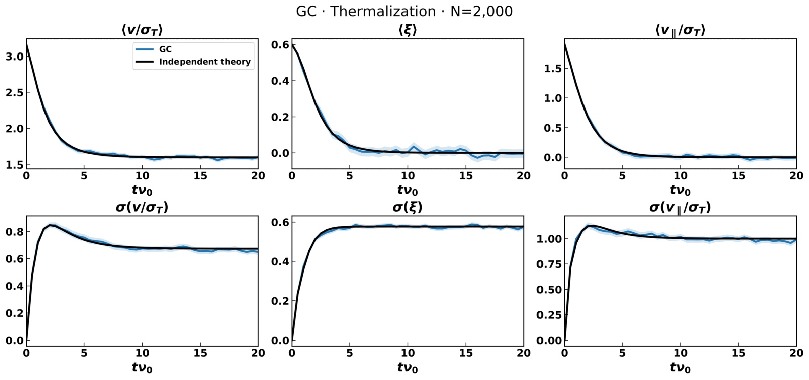
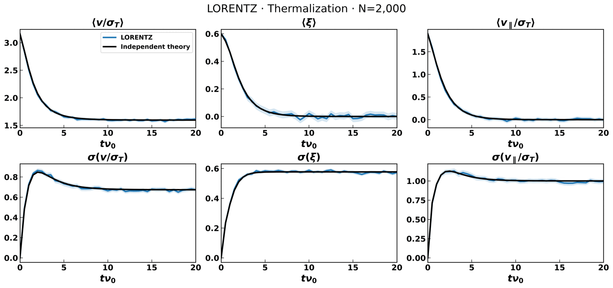
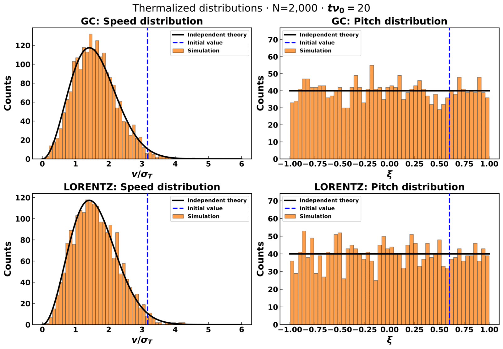
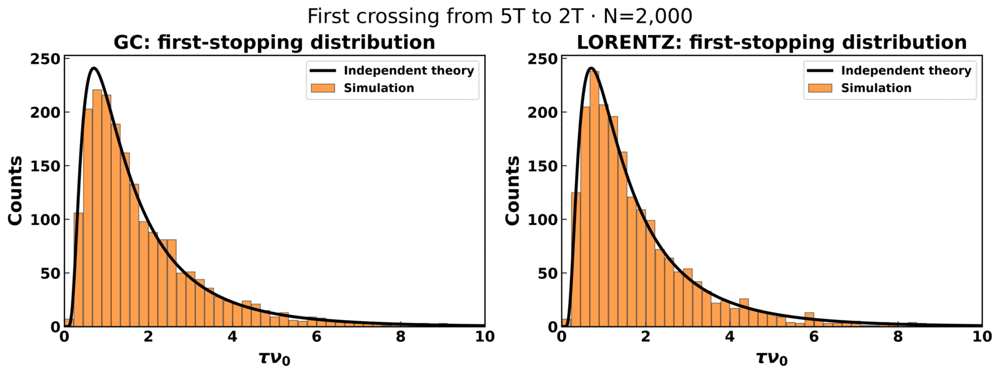

Presentation figures use bold labels, 320-dpi PNGs and vector PDF exports.
Evolution panels show means above standard deviations, with 95% sampling bands.
Histograms show counts with the independent black theory drawn on top; dashed
blue lines mark the birth speed and pitch. First stopping shows only the
histogram and black reference for the tight adaptive run. Figure files can be
regenerated from saved reports with the scripts' --plot-only option.

Uniform-field spatial and velocity statistics use moment budget .01, collision
tolerance .001 and orbit `rtol=atol=1e-10`. GC uses explicit spatial kicks;
Lorentz includes finite gyromotion. The GC chart curves overlap because they
express the same prescribed field, not distinct MHD equilibria.

```sh
python -m examples.benchmarks.benchmark_split_coordinate_physics \
  --study diffusion --models gc lorentz --charts cartesian --particles 2000 \
  --tolerance .01 --save-points 201 --output output/uniform
python -m examples.benchmarks.benchmark_split_coordinate_physics \
  --study diffusion --models gc lorentz --charts cartesian --particles 2000 \
  --tolerance .01 --seed 8706 --output output/uniform_seed8706
```

The earlier six-save run with seed 7706 found spatial spreading within sampling intervals, but
speed-variance gaps `+9.19 +/- 7.23%` (GC) and `-11.32 +/- 5.46%` (Lorentz)
remain recorded. The independent seed 8706 gives `-1.00 +/- 6.30%` and
`-2.50 +/- 6.14%`; it does not make the original population pass.

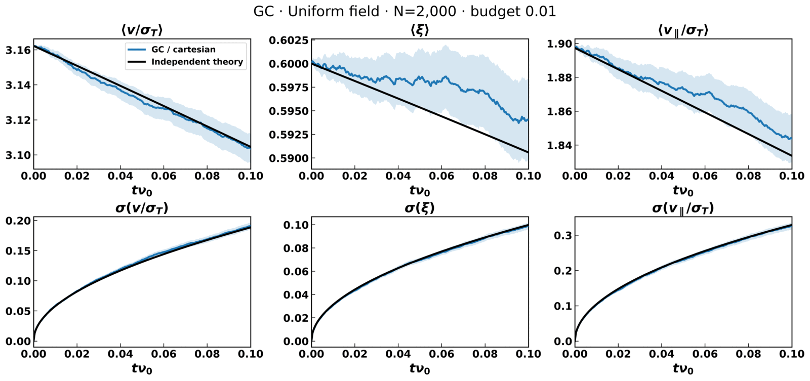
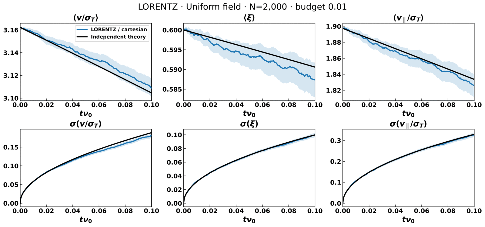

The refreshed primary uniform/helix figures retain 2,000 particles and budget
.01, with 201 actual saved times instead of six; no particle-curve smoothing
is used. A changed save grid can change the realized Brownian paths.
The earlier [independent-seed uniform comparison](docs/readme_split_coordinate_diffusion_seed8706.png)
remains a separate sampling diagnostic. Velocities use the thermal scale
sigma_T = sqrt(T/m) and time uses t*nu0.

Mirror and helix cases test coupled orbit/collision moments at budget .01.
VMEC/Boozer labels below denote manufactured coordinate charts of prescribed
fields; real equilibrium adapter checks are separate. GC axial references omit
perpendicular spatial kicks and represent the strong-magnetization limit.
Lorentz uses independent full-Lorentz numerical references with orbit/collision
refinement checks; speed retains independent radial theory. Grey and blue
bands show separate reference and production sampling intervals.

```sh
python -m examples.benchmarks.benchmark_split_coordinate_physics \
  --study coupled --fields helix --models gc lorentz --charts cartesian \
  --particles 2000 --tolerance .01 --save-points 201 \
  --output output/coupled_moments
```

This generates both references. To reuse a full-Lorentz reference, generate it
with `python -m examples.benchmarks.lorentz_collision_reference --particles 2000
--steps 400 --phase .1 --output output/lorentz_reference.json` and pass
`--lorentz-reference output/lorentz_reference.json` to the coupled command.
Mean position/pitch agree within combined sampling intervals in the corrected
Lorentz comparison, but some early helix variance/covariance gaps still exceed
pointwise intervals. These figures do not establish 1% accuracy for all moments.

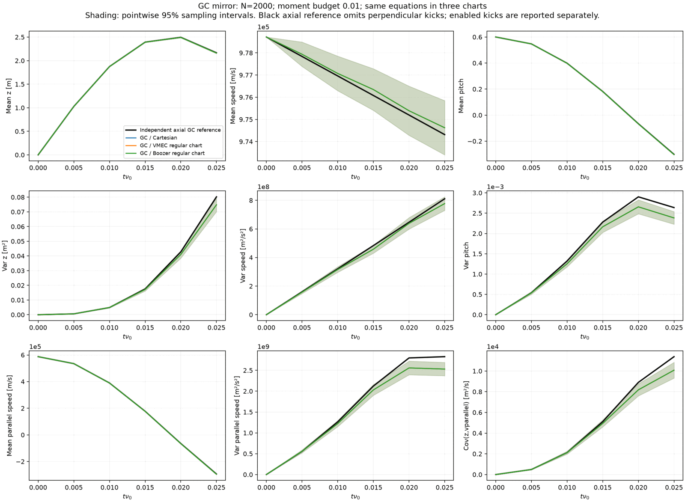
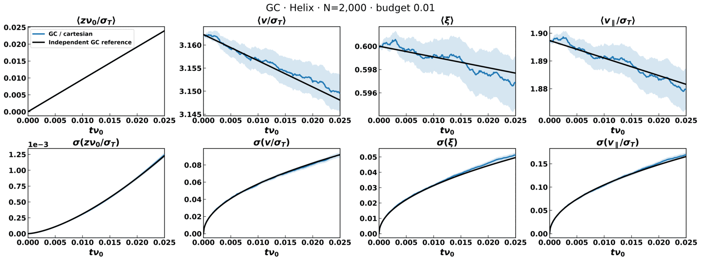
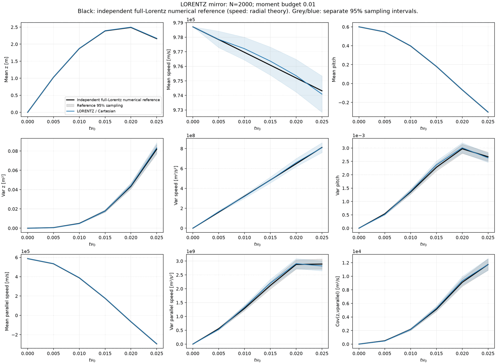
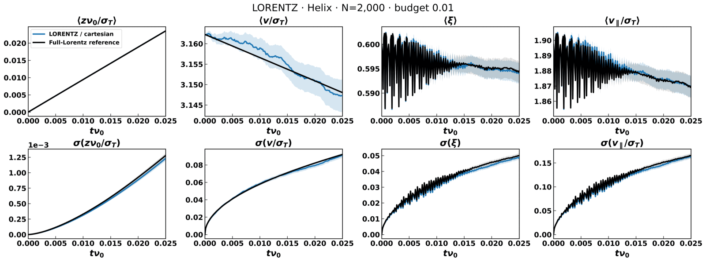

Fixed/adaptive multirate convergence and paired Brownian refinement remain
available separately. The latter compares budgets .01/.005 on 64 common paths
for the axial GC model without perpendicular kicks:

```sh
python -m examples.benchmarks.benchmark_split_multirate \
  --particles 2000 --models gc lorentz --output output/multirate
python -m examples.benchmarks.benchmark_split_path_convergence \
  --control moments --particles 64 --tolerances .01 .005 \
  --refinements 8 16 32 --max-steps 2000 --max-roots 4096 \
  --output output/paired_convergence
```

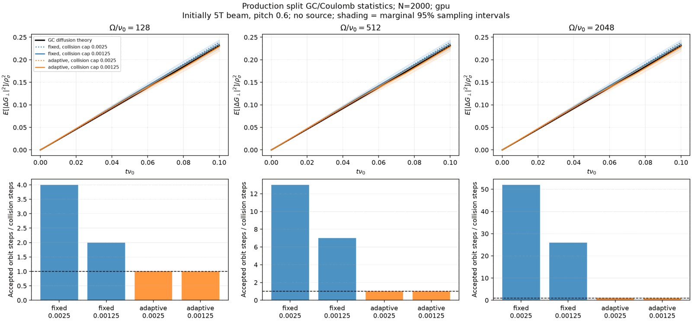
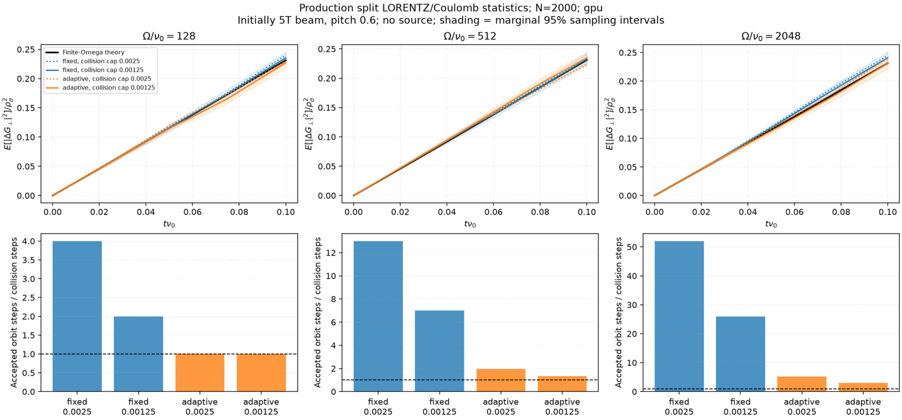
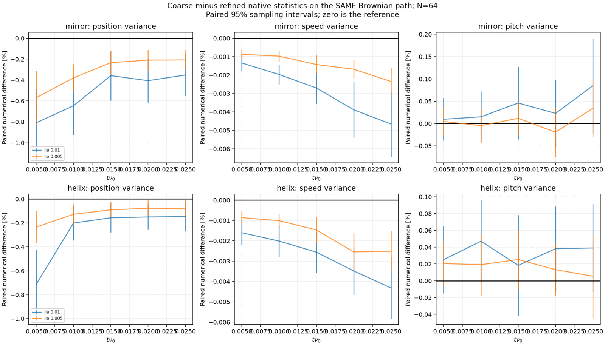

## Accepted-map native reverse AD

This branch builds on `feat/native_split_collisions`. Reverse AD is opt-in:
`solve_rk(..., adjoint="accepted")` handles Dopri5/Dopri8 orbits, and
`trace_split(..., adjoint="accepted")` handles the full orbit/collision map.
The implementation is consolidated in [essos/native_ad.py](essos/native_ad.py).

The forward solver selects accepted intervals and retains its Wiener increments.
Reverse freezes those intervals, random increments, rejection decisions and
event fractions. It differentiates RK stages, dense saves, collision
coefficients, pitch deflection, speed diffusion and GC spatial kicks.
Coordinate kicks use the derivative of the converged Cartesian inverse;
Newton iteration decisions are excluded. This does not differentiate the
motion of a first-hit time or the adaptive mesh.

| Field / model | Independent GPU forward with AD recording | Reverse execution |
|---|---|---|
| Direct Biot–Savart / GC | Includes the moment predictor and spatial kicks | Persistent GPU for uniform alpha cases; otherwise checkpointed JAX |
| Direct Biot–Savart / Lorentz | Includes the moment predictor and velocity collisions | Persistent GPU for uniform alpha cases; otherwise checkpointed JAX |
| VMEC / GC | Includes coordinate spatial kicks | Checkpointed JAX on the selected device |
| Boozer / GC | Requires `spatial_geometry=BoozerGeometry.from_booz_xform(transform)` | Checkpointed JAX on the selected device |

Set `execution="independent"` for the GPU forward loop and
`reverse_execution="auto"` to select the available reverse implementation.
`"shared"` explicitly selects JAX reverse; `"independent"` requires the
specialized direct-coil reverse. Field classes and their storage are unchanged.
The coordinate benchmark differentiates birth controls with a fixed equilibrium;
it does not regenerate VMEC/Boozer equilibria from boundary coefficients.

One-particle GPU kernel audits (float64, RTX 5060 Laptop, JAX 0.11.2) give the
following directional derivatives. Both columns use the same accepted times
and Wiener increments. Coil audits perturb pitch, energy and one coil DOF;
coordinate audits perturb pitch, energy and birth radius.

| Case | Reverse | Frozen-path JVP |
|---|---:|---:|
| Direct coils / GC, fixed | 0.0395485633371120 | 0.0395485633371120 |
| Direct coils / Lorentz, fixed | -0.205256475887027 | -0.205256475887028 |
| QA VMEC / GC, adaptive | 0.458124210711454 | 0.458124210711437 |
| Manufactured Boozer spectrum/geometry / GC, adaptive | 0.459437117932997 | 0.459437117932998 |

These are two-interval derivative fixtures, not physical ensemble studies or
long-horizon performance measurements. Reproduce them with the benchmark's
`--kernel-audit` option, for example:

```sh
python -m examples.benchmarks.benchmark_native_ad --kernel-audit \
  --field coils --model gc --stepping fixed --output output/native_ad/audit_gc.json
```

Use `--model lorentz` for the second row, or `--field vmec`/`--field boozer`
with `--model gc --stepping adaptive` for the coordinate rows. Coordinate cold
compilation is substantially heavier than these tiny execution workloads;
these GPU audits are outside the fast CI suite.

Checkpoint segments default to 16 accepted orbit steps. Set
`adjoint_orbit_checkpoint_steps` to trade live replay workspace for stored
checkpoints. `adjoint_max_accepted_steps` and `adjoint_max_orbit_steps` bound
outer intervals and total accepted inner steps separately. Insufficient
capacity raises an error during reverse; it never returns a truncated gradient.
There is no particle chunking.

The benchmark below checks reverse directional derivatives against JVPs through
an independent replay of the same accepted schedule and Wiener increments.
Its diagnostic scalar exercises position and velocity sensitivities; it is
not an optimization objective. Ordinary finite differences that rerun adaptation
measure a different map.

```sh
python -m examples.benchmarks.benchmark_native_ad \
  --field coils --model gc --stepping adaptive --particles 64 \
  --output output/native_ad/coils_gc_adaptive.json
```

Repeat with `--model lorentz`, `--field vmec`, or `--field boozer` (GC), and
`--stepping fixed` for fixed orbit/collision intervals. The default honors the
selected JAX backend; it chooses the independent forward loop on GPU and shared
execution on CPU. Boozer setup requires the optional `booz_xform_jax` package.
Coil runs differentiate coil Fourier/current parameters and three birth
controls; coordinate runs differentiate the three birth controls.

Each case records compilation, first execution, blocked warm medians, compiled
buffer sizes, allocator counters, accepted steps and gradient agreement. Run
each case in a fresh process for allocator peaks. AD is measured first; the
later forward counters are cumulative. Repeat with `--forward-only` in another
process for an isolated forward peak. `--cold-compile` disables the persistent
compilation cache. Complete value-and-gradient
time includes forward recording and reverse replay; it is distinct from a
reverse-only time. Compilation/setup are excluded from warm timings. Reports
are generated under ignored `output/`; generated JSON/CSV/SVG/profile files
are not retained in this branch. The physics figures above remain reproducible
with their existing scripts.

Fast AD regressions run with `pytest tests/test_native_ad.py`. Large physical
ensembles and timing benchmarks are separate from CI.

The recovered coil-optimization examples retain final-radius/classifier
objectives, length/curvature/B·n penalties, axis-field targets, fixed births,
toroidal targets, safety stops and PNG trajectory plots. GC and full-orbit
reference parameters remain editable inside their entry scripts:

```sh
python -m examples.coil_optimization.optimize_coils_particle_confinement_guidingcenter_native --help
python -m examples.coil_optimization.optimize_coils_particle_confinement_fullorbit_native --help
```

Use `--collisions` for the full accepted split adjoint. Collisionless examples
use `Tracing(..., native_adjoint="accepted")`. Array loss-fraction, loss-location
and heat objectives are retained in `essos/particle_losses.py`; their jax_9/10
provenance and units are documented there. Runtime optimization reports and
plots are written under ignored `output/`.

### QI coil ALM examples recovered from the JAX branches

Three GC examples recover the classic `en/jax_13` setups (commit `638916d`),
also compared with `jax_9`, `jax_10` and `jax_12`. The original QI coils
and matching surface are retained in `examples/input_files/`: the coil JSON
is required physical input, rather than a generated benchmark report.
VMEC supplies the fixed classifier and birth geometry; particles follow
the direct Biot--Savart coil field. Only coil Fourier/current DOFs vary.

```sh
python -m examples.coil_optimization.optimize_coils_native_gc_alm_loss_fraction
python -m examples.coil_optimization.optimize_coils_native_gc_alm_distance
python -m examples.coil_optimization.optimize_coils_native_gc_alm_heat_flux
```

Each entry has an editable `PARAMETERS` dictionary; shared defaults are in
`examples/coil_optimization/native_gc_alm.py`, and CLI flags override them.
Defaults retain 20 fixed-seed 3.52 MeV alphas born at 70% of the local
axis-to-boundary distance, 5.7 T mean field on the original magnetic axis,
1e-4 s horizon, ten saves, 45 m length and 1/m curvature upper limits.
The loaded file contains five independent coils; limits apply to all five.
All three cases default to collisional GC tracing with a uniform
electron/deuterium bath. Both orbit and collision steps are adaptive, using
native Dopri8 with collision tolerance `0.001`, moment-predictor tolerance
`0.01` (`--moment-tolerance`) and orbit `rtol=atol=1e-7`.
`--no-collisions` selects collisionless native GC.
No example selects a JAX backend or chunks particles.
Current DOFs are normalized after the 5.7 T rescaling; `--max-change` bounds
dimensionless changes in the public coil DOFs, including the currents.
With `--execution auto` (default), collisional examples select the specialized
native forward/reverse kernels on GPU and shared JAX on CPU. Use
`--execution shared` to select the portable implementation explicitly.
Uniform multispecies rates are summed before stepping. The ALM outer GPU JIT
disables CUDA command-buffer capture for the guarded persistent reverse;
computation remains on the selected GPU.

Native preparation evaluates the same coil Fourier series and its derivatives
with basis contractions, retaining the public DOFs, scaling and symmetries.
The length/curvature constraints use these derivatives; B.n/|B| uses the native
direct-coil field evaluator at the original surface points. Values and gradients
are checked against the existing formulas. Public field/coil classes are unchanged.
The one-particle, two-step GPU smoke with twenty physical coils, two background
species and the real classifier passes both recorded forward/reverse and the
heat-flux ALM initialization. Its solver directional derivative is
`8.350803831323357e-7`, versus frozen accepted-step JVP `8.350803831323323e-7`.

The fixed classifier uses direct cell indexing on regular grids and the same
eight-corner trilinear interpolation for stopping and all three particle losses.
Nonuniform grids retain a bounded cell search. This native adapter preserves
the original table, periodic angle, outside fill and position derivatives;
it does not change the surface or the sigmoid loss. Its value and gradient
are checked against the original interpolator, including the periodic seam.

The particle metric is an ALM equality constraint targeting zero, alongside
the axis-field equality and coil upper bounds. Distance reproduces the classic
per-save escape-centroid distance to the infinite boundary tangent line at
theta=3*pi/2, phi=pi; it is not a first-hit distance to a curved boundary line.
Heat reproduces the first-loss-weighted, birth-normalized `E_total*v_perp`
proxy, not a surface power density. The heat case also enables the historical
smooth B.n/|B| constraint; `--bdotn-weight 0` disables it.

The current ESSOS ALM uses bounded Optimistix L-BFGS internally, replacing the
older JAXopt wrapper and perturbation weighting. Native Dopri8 uses adaptive
I control and checkpointed accepted-map reverse for every particle constraint.
The axis constraint now uses the same fixed QI axis as the initial current
normalization, rather than the old circle inferred from coil centre radii.
The experimental historical custom VJPs that held trajectories fixed are not
used. A separate safety surface 0.2 m outside the soft classifier stops escapes;
`--safety-margin` adjusts it without moving the soft confinement target.

For a short run, append `--maxiter 10 --inner-maxiter 10`. `--evaluate-only`
performs the initial ALM value/gradient without optimizer updates. Initialization
and the full inner L-BFGS update are separate JIT programs: the first update has
its own cold compilation. The script announces each inner solve before starting;
the next cost/checkpoint appears after that complete outer update. Each fresh
output directory receives `history.csv`, `summary.json`, optimized coil input,
trajectory/DOF arrays and a PNG comparing up to ten initial/final trajectories
and coils with their R-Z projections. These outputs are ignored by Git.
With plots enabled, all three examples also save coil overlays, saved-time loss
fractions, heat-proxy histograms and matched initial/final loss-location maps in
`comparison_plots/`, using the already saved trajectories.
Iteration zero and every completed outer ALM iteration also write
`iterations/000000.npz`, `000001.npz`, etc., containing public `coil_dofs`,
optimizer `parameters` and the iteration number matching `history.csv`.
`initial_coils.json` preserves the coil definition and scaling for reconstruction:

```python
import numpy as np
from essos.coils import Coils
with np.load("output/native_gc_alm_heat_flux/iterations/000005.npz") as data:
    coils = Coils.from_json("output/native_gc_alm_heat_flux/initial_coils.json").with_dofs(data["coil_dofs"])
```

These per-iteration checkpoints save coil DOFs only, with no extra particle
solves. Particle trajectories remain saved for the initial and final configurations.

Reproduce coil overlays, saved-time loss fractions, and lost-particle heat-proxy
maps from a completed or downloaded run without tracing again:

```sh
python -m examples.coil_optimization.plot_native_gc_alm /path/to/run1 /path/to/run2
```

The PNGs are written under each run's `comparison_plots/`. The original QI
equilibrium is resolved from the saved settings or bundled inputs; `--wout`
selects its local copy. Losses use the first saved point outside the unshifted
classifier, so their positions and times are limited by the save spacing.
Colours show `E_total*v_perp` in W m, a heat proxy rather than heat flux per unit
area. These counts are distinct from the differentiable classifier loss score.

All three ALM scripts accept `--optimizer scipy`. This retains the existing
constraint definitions, multiplier updates, scaled coil DOFs and native split
AD, while running inner L-BFGS-B and its line search on the host. One compiled
native value/gradient executable is reused across evaluations and outer updates;
the full inner optimizer is not traced into XLA. Compilation and first execution
are timed separately, with inner progress and solver termination messages.
The native value/gradient itself can still have substantial compilation cost.
SciPy enforces the same scaled `[-1, 1]` box directly (Optimistix uses a tanh
parameterization); its inner `gtol` is `--omega-tol`, and `--scipy-ftol` defaults
to `1e-12`. These are different inner optimizers, so iteration paths can differ.
The 500-particle A100 compilation reduction has not yet been measured.
Diagnostic retracing now also uses dynamic JIT coil inputs. Logged and retraced
particle costs are printed together and stored under `cost_retrace` in the run
summary; they must be checked before interpreting small optimization gains.

```sh
python -m examples.coil_optimization.optimize_coils_native_gc_alm_loss_fraction \
  --optimizer scipy --particles 20 --horizon 1e-4 \
  --collision-tolerance 0.001 --moment-tolerance 0.01 \
  --maxiter 10 --inner-maxiter 10 --output output/qi_loss_scipy
```

## Testing

```sh
pytest
```

## License

MIT, see [LICENSE](LICENSE).

## Acknowledgments

Developed by the [UWPlasma](https://rogerio.physics.wisc.edu/) group at the
University of Wisconsin-Madison, with support from Simons Foundation grant
560651.
