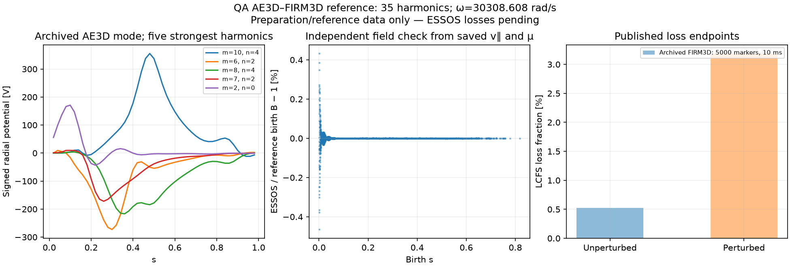

Published AE3D--FIRM3D loss benchmark
====================================

This case imports the actual QA wave and saved particle initial conditions
from `Knyazev et al., On shear Alfven wave-induced energetic ion transport
in optimized stellarators <https://arxiv.org/abs/2603.03118>`_. The
`archived reference packet <https://doi.org/10.5281/zenodo.21299908>`_
contains the equilibrium, AE3D potentials, FIRM3D scripts and figure data.
This is a collisionless, computed-wave stellarator benchmark. No FAX
eigenmode calculation is substituted in the tracing comparison.

Reference and conventions
-------------------------

The selected case is ``QA_35harmonics_scale0_001``. It contains one eigenmode
with **35 Fourier harmonics**, each with 49 signed radial samples. The
archived classification tables give the following LCFS losses:

.. list-table::
   :header-rows: 1

   * - Case
     - Lost / initial markers
     - Fraction
     - Duration
   * - Unperturbed
     - 26 / 5000
     - 0.52%
     - 10 ms
   * - AE3D wave, archived scale 0.001
     - 159 / 5000
     - 3.18%
     - 10 ms

The scale in the filename is the paper's magnetic-energy amplitude label;
it is not a voltage or a multiplier to be applied again. The archived mode
already contains the potential amplitudes used by the tracing script.
The source packet is released under CC BY 4.0; attribution is to Knyazev,
Paul, Lachmann, Hyder, Goodman, Czekanski and Spong (2026).

The reference pins FIRM3D commit
``bc65bab877d88b6b00d6d248f54e5c75d893e6ac``. Its
`from_ae3d implementation
<https://github.com/ColumbiaStellaratorTheory/firm3d/blob/bc65bab877d88b6b00d6d248f54e5c75d893e6ac/src/firm3d/field/boozermagneticfield.py>`_
and archived tracing scripts establish these conventions:

* Angular frequency is ``sqrt(eigenvalue)*1000`` rad/s. For this mode it is
  **30308.607688 rad/s**, or **4823.764732 Hz** in cycles per second. No
  additional factor of ``2*pi`` is applied based on a figure's frequency label.
* The angular dependence is ``Phi_mn(s)*sin(m theta - n zeta + omega t)``.
  Signed Fourier amplitudes and full toroidal mode numbers are retained.
* The physical ``Phi_mn(s)`` is interpolated linearly. FIRM3D adds zero at
  the axis for nonzero poloidal mode number when the first radial sample
  is off axis. Beyond the last sample, it holds the last value. Select
  ``--interpolation linear`` to reproduce these archived profiles.
  ESSOS now defaults to natural cubic interpolation of the same samples,
  with the same axis extension and endpoint clamping. Neither option
  applies a taper or peak-amplitude normalization.
* ``alpha=(n-m*iota)*Phi/[omega*(G+iota*I)]`` is applied per harmonic,
  retaining ``I``. The equilibrium has ``K=0`` in both Boozer formulations.
  ``psi0=-phi_edge/(2*pi)`` has the same sign in both implementations.
* The reference mass is ``2*mp+2*mn = 6.69509884346e-27 kg``, at a nominal
  birth energy of 3.52 MeV. These values are explicit benchmark inputs;
  ESSOS's general particle constants are unchanged.
* The saved columns are ``s, theta, zeta, v_parallel, mu_per_mass``.
  All five are preserved. The births already sample the fusion source,
  so the markers have equal weights; no additional volume weighting is
  applied. A smaller test takes a deterministic prefix of this cohort.

``essos.ae3d_adapter.AE3DMode`` reads the upstream NumPy export using a
restricted NumPy-only unpickler. ``TabulatedAlfvenMode`` implements natural
cubic potentials by default, optional linear profiles, and the existing
perturbation interface, with a finite C1 extension on axis and no artificial
inner loss boundary. It reuses
the existing Boozer GC RHS and adaptive integrator. No matrix solve or
reference ODE integrator is introduced.

Current validation status
--------------------------

The exact inputs have been downloaded and verified. The importer and
archive-integrity tests pass. The reference figure below is a preparation
audit; its bars are the archived FIRM3D results. Full-duration ESSOS loss
agreement has not yet been established.

The birth-field check is independent of the importer: the archived magnetic
moment and parallel velocity imply
``B_birth=(2*E_birth/mass-v_parallel**2)/(2*mu_per_mass)``.
At the initial ESSOS settings, this field differs from the ESSOS birth field
by **0.02396% RMS** and **0.46463% maximum**. This is a remaining numerical
representation difference. FIRM3D used cubic interpolation on a 48x48x48
grid; the current ESSOS provider uses its existing radial interpolation in
``sqrt(s)`` and a 48x48 quintic angular table, retaining 937 equilibrium
harmonics above a relative amplitude threshold of 1e-7.

The runner preserves the archived ``v_parallel`` and ``mu_per_mass`` by
initializing each marker's speed from the ESSOS birth field. It records the
resulting energy difference (maximum 0.3655% here), rather than silently
resetting the archived magnetic moment. Equilibrium resolution, harmonic
cutoff and orbit tolerance must be checked when interpreting loss differences.
Matching the same 5000 births removes resampling noise as an explanation for
different loss counts; increasing particle count cannot fix a systematic
field or convention difference.

Retrieve and prepare
--------------------

The complete published ZIP is 1.13 GB. The committed manifest pins 12
members by archive offsets, sizes, CRCs and SHA256 hashes. The retrieval
helper fetches about **9.4 MB**, validates the extracted members and refuses
a server response that would download the complete ZIP. Downloaded scripts
are treated as reference text and never executed.

.. code-block:: bash

   python -m examples.benchmarks.ae3d_firm3d_archive --download
   python -m examples.benchmarks.ae3d_firm3d_loss

Alternatively use an existing local archive, without network access:

.. code-block:: bash

   python -m examples.benchmarks.ae3d_firm3d_archive \
     --archive /path/to/Knyazev_JPP2026.zip

The retrieval helper verifies each member's checksum. Its whole-archive MD5
is provenance from Zenodo metadata; range retrieval does not verify the
complete ZIP's MD5. Preparation validates all member SHA256 hashes before
loading the scientific arrays. It performs field evaluation and plotting,
with no particle tracing and no FAX dependency.

Run commands
------------

The following are explicit commands for a separate run. Long computations
must be approved before starting them in the shared workspace.

Small CPU coupling check, four short trajectories with a 120-second cap:

.. code-block:: bash

   python -m examples.benchmarks.ae3d_firm3d_loss --run \
     --particles 2 --tmax 2e-6 --platform cpu --wall-seconds 120 \
     --output examples/benchmarks/results/ae3d_firm3d_smoke

Full 5000-marker cohort on a GPU, unperturbed and perturbed, with a
six-hour total process cap. Run from the repository root in your
CUDA-enabled JAX environment:

.. code-block:: bash

   python -m examples.benchmarks.ae3d_firm3d_archive --download
   python -u -m examples.benchmarks.ae3d_firm3d_loss --run \
     --particles 5000 --case both --tmax 0.01 \
     --interpolation natural-cubic --method adaptive --tolerance 1e-9 \
     --platform cuda --wall-seconds 21600 \
     --output examples/benchmarks/results/ae3d_firm3d_5000_spline_gpu

This uses all 5000 archived birth states and all 35 wave harmonics. Natural
cubic interpolation, RK5 and tolerance 1e-9 are also the example defaults.
Only ``--run`` starts particle tracing. GPU execution is explicitly selected
by ``--platform cuda``; it requires a working CUDA backend and does not fall
back to CPU. The runner uses the first visible GPU; ``CUDA_VISIBLE_DEVICES``
can select it on a machine with several GPUs. The printed case header and
saved summary identify the backend and device.

The output contains ``summary.json`` with loss counts/fractions and device
metadata, ``diagnostics.npz`` with initial states and loss times,
``ae3d_firm3d_loss.png`` with the field/reference audit and endpoints, and
``ae3d_firm3d_loss_history.png`` with loss fraction against time. SVG copies
of the figures are also written. Completed cases remain saved if the cap
interrupts a later case. Regenerate the figures from saved output with no
particle tracing:

.. code-block:: bash

   python -m examples.benchmarks.ae3d_firm3d_loss --report-only \
     --output examples/benchmarks/results/ae3d_firm3d_5000_spline_gpu

Use a fresh ``--output`` each time. ``--case unperturbed`` or
``--case perturbed`` can run cases separately. ``--angular-points`` and
``--mode-tolerance`` control the existing ESSOS field representation;
``--tolerance`` controls adaptive orbit integration. The script rejects
unresolved/nonfinite orbits and records the actual cohort, duration and
reference counts. A smaller cohort or shorter duration is labelled as such,
not presented as a reproduction of the full reference.

The archived piecewise-linear potentials have radial derivative jumps.
An eighth-order adaptive method can reject many steps at these knots,
and a vectorized batch waits for its slowest marker. ``--method adaptive``
selects the existing fifth-order method and is now the example default;
``adaptive8`` remains available. A short diagnostic found
``--method adaptive --tolerance 1e-9`` faster than RK8 at comparable
endpoint accuracy for one difficult orbit. The full-duration, 64-marker
comparison used these settings and completed with zero failed orbits.
Full-cohort resolution and tolerance convergence remain to be checked.
Neither solver choice changes the GC equations.

``--interpolation natural-cubic`` is the default and constructs a
natural cubic spline of the physical potentials in ESSOS's normalized
toroidal flux ``s``. It preserves the table values and removes interior
first-derivative jumps. Both choices retain the existing endpoint clamping;
natural boundary conditions set the second derivative, not the first
derivative, to zero. Cubic results are labelled as interpolation-sensitivity
calculations in the metadata and figure because the archived FIRM3D
calculation used linear profiles. ``--interpolation linear`` remains
available for matching that original radial interpolation.

For identical first 64 archived markers over 10 ms, the completed CPU
comparison gave 3/64 lost (4.6875%) with linear profiles and 4/64 (6.25%)
with natural cubic profiles, with zero failed orbits in either case. Three
markers were lost in both runs; cubic lost one additional marker. These
small-cohort results do not establish agreement with the 5000-marker
reference or determine the converged full-cohort loss difference.

Compare interpolations with identical archived markers, duration, solver,
tolerance and field resolution. Changing solver and interpolation together
would confound the comparison. Inserting samples evaluated from an existing
linear or cubic curve reproduces the same curve and is not an independent
radial-resolution study; that requires additional original eigenfunction data.

ASCOT5 source audit
~~~~~~~~~~~~~~~~~~

At commit ``24be846af2dd2088d39ef4eab4ae729d3cbc8e66``,
`ASCOT MHD_STAT <https://github.com/ascot4fusion/ascot5/blob/24be846af2dd2088d39ef4eab4ae729d3cbc8e66/src/mhd/mhd_stat.c>`_
uses natural cubic splines on a uniform ``rho`` grid for separately supplied
``alpha`` and ``Phi`` profiles, and evaluates derivatives from the splines.
`MHD_NONSTAT <https://github.com/ascot4fusion/ascot5/blob/24be846af2dd2088d39ef4eab4ae729d3cbc8e66/src/mhd/mhd_nonstat.c>`_
uses two-dimensional splines in ``rho`` and time. Interpolation failures or
points outside the Boozer/MHD domain cause the evaluated perturbation to be
zeroed. The boundary profiles still require appropriate input data.

ASCOT's ``rho`` is based on normalized poloidal flux; it is not the ``s``
used here. ASCOT interpolates ``alpha`` independently, whereas this adapter
derives it from ``Phi`` and the equilibrium to preserve the ideal relation
pointwise. Therefore the optional spline here is not a replica of an ASCOT
reconstruction or an ASCOT particle-loss benchmark.

ASCOT's adaptive GC orbit follower uses
`Cash--Karp RK5 <https://github.com/ascot4fusion/ascot5/blob/24be846af2dd2088d39ef4eab4ae729d3cbc8e66/src/simulate/step/step_gc_cashkarp.c>`_,
with marker-specific step lengths and error control. ESSOS's ``adaptive``
option is Dormand--Prince RK5, with different coefficients and error control.
The earlier speed measurement compared ESSOS RK5 to RK8; it did not measure
a Cash--Karp versus Dormand--Prince speed difference.

Redraw the committed preparation image without FAX, an equilibrium download
or particle tracing:

.. code-block:: bash

   python -m examples.benchmarks.ae3d_firm3d_loss --report-only \
     --data examples/benchmarks/references/ae3d_firm3d_prepared \
     --output docs/_static/analytical_perturbations

Relationship to FAX
------------------

FAX already has AE3D comparisons using the public CTOK reference. That is
a different equilibrium and input packet. The QA tracing benchmark here
uses the archived AE3D wave directly and isolates particle coupling from
eigenmode calculation. It does not claim that FAX's native operator already
reproduces this QA eigenmode. That separate comparison needs the same
equilibrium and density profile, frequency, relative harmonic amplitudes
and radial eigenfunctions before replacing the archived mode with a FAX mode.
