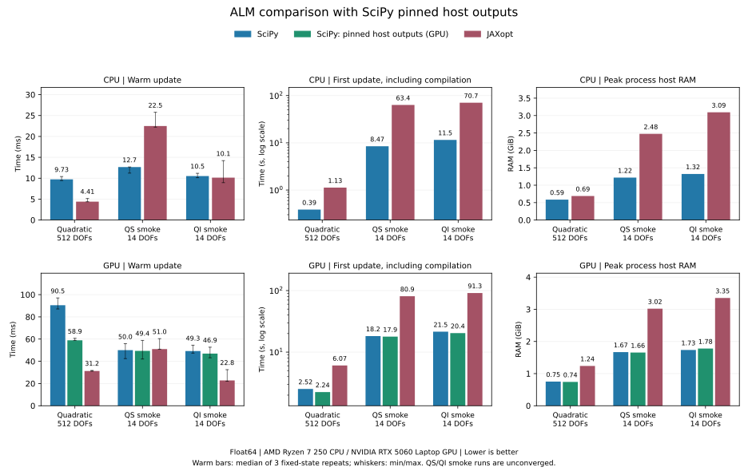

# ALM: SciPy and native JAXopt

SciPy is the default backend and does not require Optax or JAXopt. The optional
native JAXopt L-BFGS-B backend is restored through
`ALM_model_jaxopt_lbfgsb`. Both use the same ALM initialization, gradient weights,
constraint/slack representation, conditional multiplier and penalty updates,
scaling, padding and checkpoints. Only the inner solver and compilation boundary
change.

```sh
pip install 'essos[jaxopt]'
python -m examples.coil_optimization.optimize_coils_surface_augmented_lagrangian --case qs --backend jaxopt
python -m examples.coil_optimization.optimize_coils_surface_augmented_lagrangian --case qi --backend scipy
```

For an editable checkout, install the extra with `pip install -e '.[jaxopt]'`.
The JAXopt package may import Optax itself; neither is a core ESSOS dependency.

```python
from essos import augmented_lagrangian as alm

solver = alm.ALM_model_jaxopt_lbfgsb(
    constraints, loss=objective, model_mu='Mu_Adaptative_2', jit_update=True)
# Or: alm.ALM_model_scipy(...)
```

JAXopt's native line search and optimizer iterations run inside JAX. Compiling
the full update avoids SciPy's Python callbacks and synchronizations between
host and device for each objective/gradient evaluation. This can reduce warm
solve time, particularly for inexpensive GPU evaluations. Compilation can take
longer and consume more host memory. These are workload-dependent tradeoffs,
not a general guarantee that either solver wins. See the
[JAXopt documentation](https://jaxopt.github.io/stable/index.html) and
[JAX benchmarking guidance](https://docs.jax.dev/en/latest/benchmarking.html).

Both factories retain `jit_update=False` as their historical default. Set it
to `True` for the compiled JAXopt path; with `False`, construction of its inner
solver can cause compilation on subsequent updates too. The example defaults
to full compilation for `--backend jaxopt`; `--no-jit-outer` disables it.
SciPy always compiles values/gradients, and `jit_update=True` additionally
compiles its dual update. Its host optimizer loop cannot be compiled by JAX.
SciPy's `method`, `inner_options` and `inner_callback` controls are only supported
by the SciPy factory.

## Measured results

The timing table below uses the small synthetic smoke problems. It does not
measure convergence of the full source QS case described below.

Recorded on 2026-10-20 in WSL/Linux: AMD Ryzen 7 250 CPU (16 logical CPUs,
one JAX CPU device), NVIDIA GeForce RTX 5060 Laptop GPU, Python 3.14.4,
JAX 0.11.2, SciPy 1.18.1 and JAXopt 0.8.5. Both backends use the current
shared ALM implementation with `jit_update=True` and history size 10.
The [raw results](alm_benchmark_results.json) include setup time, all individual
warm samples, returned costs/residuals and software/device metadata.

| Device | Case | Backend | First update (s) | Warm update (ms) | Peak host RAM (MiB) | Peak JAX GPU allocation (MiB) |
|---|---|---|---:|---:|---:|---:|
| CPU | Quadratic, 512 DOFs | SciPy | 0.386 | 9.73 | 600.6 | — |
| CPU | Quadratic, 512 DOFs | JAXopt | 1.126 | 4.41 | 706.5 | — |
| CPU | QS smoke | SciPy | 8.466 | 12.68 | 1248.4 | — |
| CPU | QS smoke | JAXopt | 63.439 | 22.49 | 2534.6 | — |
| CPU | QI smoke | SciPy | 11.524 | 10.52 | 1355.0 | — |
| CPU | QI smoke | JAXopt | 70.673 | 10.15 | 3168.5 | — |
| GPU | Quadratic, 512 DOFs | SciPy | 2.520 | 90.49 | 769.3 | 96.1 |
| GPU | Quadratic, 512 DOFs | JAXopt | 6.068 | 31.25 | 1268.2 | 144.1 |
| GPU | QS smoke | SciPy | 18.206 | 50.03 | 1708.2 | 256.6 |
| GPU | QS smoke | JAXopt | 80.933 | 51.01 | 3092.0 | 256.6 |
| GPU | QI smoke | SciPy | 21.483 | 49.25 | 1776.2 | 224.1 |
| GPU | QI smoke | JAXopt | 91.296 | 22.80 | 3432.7 | 304.1 |



The green GPU bars include the new pinned host output option; CPU results use
ordinary SciPy and JAXopt. Warm-time whiskers show the minimum and maximum
of the three recorded repeats. First-update times use a logarithmic scale.

Relative to ordinary SciPy on the quadratic case, JAXopt's warm update was
2.21 times faster on CPU and 2.90 times faster on GPU. With pinned host outputs,
the GPU difference is 1.89 times. The tiny QS case favored SciPy on CPU. CPU QI and
GPU QS were approximately tied; GPU QI favored JAXopt for warm execution.
SciPy had lower first-update time and peak host memory in every measured case.
GPU allocator peaks were essentially equal for QS and lower with SciPy for
the quadratic and QI cases. The plot compares **fixed-work execution**, with
the quality differences below; it does not compare time to convergence.

The objective and aggregate physical residual norm after the measured update
were as follows. Each cell lists **SciPy / JAXopt**:

| Device | Case | Objective | Residual norm |
|---|---|---:|---:|
| CPU | Quadratic | 1.9959023 / 1.9959028 | 4.1594770 / 4.1594768 |
| GPU | Quadratic | 1.9959023 / 1.9959028 | 4.1594770 / 4.1594768 |
| CPU | QS smoke | 29.3200 / 18.0120 | 1.69442 / 0.84462 |
| GPU | QS smoke | 29.3200 / 13.9060 | 1.69442 / 0.71066 |
| CPU | QI smoke | 0.019515 / 0.038638 | 5.47356 / 5.53067 |
| GPU | QI smoke | 0.015663 / 0.005523 | 5.42894 / 5.69821 |

Quadratic objectives and residuals agree within `1e-5` between backends.
QS/QI outputs differ after the short, unconverged solves; their warm speed
ratios do not imply equivalent optimization progress. The solvers also use
different line searches and stopping rules: SciPy's default gradient tolerance
is capped at half the initial projected gradient to ensure initial progress.
Nonlinear QS/QI trajectories also differ between CPU and GPU in these runs.
Assess production choices at the required resolution and common feasibility
and optimality thresholds.

## Reducing SciPy overhead

The bridge passes NumPy inputs directly into the compiled JAX value/gradient
function. This avoids an extra eager `jnp.asarray`/device-placement operation
at every SciPy evaluation. It retains joint value/gradient evaluation, cached
compilation, the initial-evaluation cache and the existing stopping rules.

A controlled 512-variable experiment alternated the original and improved
callbacks, with 20 warm repetitions per variant on each device:

| Device | Original callback (ms) | Direct NumPy input (ms) | Time reduction |
|---|---:|---:|---:|
| CPU | 11.03 | 8.75 | 20.7% |
| GPU | 89.30 | 78.13 | 12.5% |

Both variants took 27 SciPy iterations and 31 evaluations and returned the
same parameters, gradients, constraint state and diagnostics within `1e-10`.
The quadratic SciPy records in the raw results retain all 20 timing samples
and evaluation counts under `callback_bridge_experiment`. These are separate
interleaved experiments; the main table uses fresh isolated worker processes.
Isolated-worker timings also vary between runs; the interleaved comparison
isolates the effect of the input conversion change.

Further useful controls are `jit_update=True`, appropriate `parameter_scale`
for differently scaled variables, and fixed gradient constraint weights.
Compilation and analytic gradients are already used in this comparison.
The example enables the compiled SciPy dual update with
`--backend scipy --jit-outer`; `JAX_PLATFORMS=cpu` selects CPU evaluations on Linux/WSL.
For expensive field evaluations the callback overhead may be a smaller fraction
of total work. SciPy's host line search still needs a value and gradient before
choosing the next point, so device-to-host synchronization remains on GPU.
See [JAX asynchronous dispatch](https://docs.jax.dev/en/latest/async_dispatch.html).
Matching native JAXopt's efficiency on every workload would require a different
optimizer execution path; a fully compiled GPU loop is the reason to keep the
optional native backend.

### GPU pinned host outputs

`ALM_model_scipy(..., scipy_pinned_host=True)` asks the compiled JAX function
to place its value and gradient directly into pinned host buffers. This reduces
the transfer/dispatch overhead before SciPy consumes them. The option defaults
to `False` and requires a single GPU with pinned-host memory support; it was
tested with JAX 0.11.2 and the NVIDIA GPU above. See
[JAX memory spaces](https://docs.jax.dev/en/latest/201/memory-spaces.html).

```sh
JAX_PLATFORMS=cuda python -m examples.coil_optimization.optimize_coils_surface_augmented_lagrangian \
  --case qs --backend scipy --jit-outer --scipy-pinned-host
```

A further controlled quadratic experiment used 20 interleaved warm repeats
per configuration. The current SciPy bridge took **78.85 ms** with ordinary
device outputs and **63.13 ms** with pinned host outputs, a **19.9% time
reduction**. Both used 27 optimizer iterations and 31 evaluations, with all
returned parameters, gradients and diagnostics matching within `1e-10`.
These numbers come from a separate controlled experiment, rather than the
isolated workers in the main table.

Separate isolated workers with this option produced the following results:

| GPU case | First update (s) | Warm update (ms) | Peak host RAM (MiB) | Function evaluations |
|---|---:|---:|---:|---:|
| Quadratic, 512 DOFs | 2.240 | 58.93 | 758.6 | 31 |
| QS smoke | 17.863 | 49.39 | 1694.8 | 5 |
| QI smoke | 20.360 | 46.94 | 1821.8 | 4 |

The QS/QI changes were small relative to ordinary outputs in the main table.
Their costs and residuals matched the ordinary-output runs within `1e-8`.
The raw GPU SciPy records retain these runs under `pinned_host_variant` and
the controlled experiment under `pinned_output_experiment`. The GPU SciPy
suite passed 17 checks, including bounded weighted slacks and padding; the
CPU guard check and QI command-line smoke also passed.

Pinned buffers reduce transfer overhead; SciPy still waits for each result
because its next trial point depends on the preceding value and gradient.
The GPU round trip can be avoided completely by running both the objective
and SciPy on CPU, or by using a native GPU optimizer loop such as the optional
JAXopt backend. For these small smoke cases, CPU evaluations were faster;
the best choice at production resolution needs a separate measurement.

## Reproduce the comparison

Run from the checkout root on Linux/WSL with both backends installed:

```sh
python -m examples.coil_optimization.benchmark_alm \
  --platforms cpu cuda --backends scipy jaxopt --sizes 512 \
  --repeats 3 --output docs/alm_benchmark_results.json
python docs/plot_alm_benchmarks.py
```

To measure the optional GPU output placement separately:

```sh
python -m examples.coil_optimization.benchmark_alm \
  --platforms cuda --backends scipy --sizes 512 --scipy-pinned-host \
  --output alm_pinned_benchmark.json
python docs/plot_alm_benchmarks.py --pinned-results alm_pinned_benchmark.json
```

Omit `cuda` on a CPU-only machine. The benchmark enables `jit_update=True`
for both backends; `--no-jit-update` measures the alternative. A saved previous
module can also be included with `--baseline-module /path/to/old/module.py`.

Each case/backend/device runs in a fresh process. Timings use float64, disable
persistent compilation caches and GPU preallocation, and call
`jax.block_until_ready` before stopping the clock. Setup includes problem
construction, initial constraint weights where applicable, and solver
initialization; backend/device startup and imports precede setup. First-update
time includes compilation. Warm time is the median of three further updates
from the **same initial parameters and ALM state**, with all device work
synchronized. These repetitions measure a fixed workload; they are not three
successive optimization iterations. Host peak RSS covers the whole worker,
including Python, JAX and compilation. GPU peaks cover JAX's allocator only,
not total driver/context VRAM. CPU allocator statistics are unavailable.

The quadratic case has 512 variables, a diagonal Hessian spanning 1 to 10,
initial values 0.25, target values spanning 0.5 to 1.5, two equalities fixing
the first variables at 0.75, and inequalities `x <= 1`. Both solvers receive
40 inner iterations, history size 10 and initial inner tolerance `1e-6`.
This times one ALM update, not convergence of the constrained optimization.

QS and QI use the example's synthetic smoke configuration: 14 variables, a
4-by-4 surface grid, eight coil segments, nine trace points, two field-line
labels, two pitch values and one iota integration period. Fixed elementwise
gradient weights use the same relative perturbation and seed 42 for both
backends. Only two inner iterations are allowed. Their outputs are
**unconverged execution checks**. Equal iteration limits do not guarantee equal
function evaluations, line-search work or final quality, so these measurements
do not establish time to an equivalent QS/QI design or production performance.

## Source QS case

The full `--case qs` run preserves the non-GFrame `QS_maybe_final` problem
from `en/jax_10` at `9258ce01821ca44d293ceb0857f343b8745ad960`:

| Setting | Source and restored full QS case |
|---|---|
| Initial surface | R=10 m, a=4 m torus; all m<=2, abs(n)<=2 modes free |
| Initial coils | Four circular base coils, order 6, radius 5.7 m, 1 A, nfp=2, stellarator symmetry |
| Spectral scaling | 1.2, infinity norm, on coil and surface modes |
| Surface sampling | 60 poloidal x 60 toroidal points over one field period (`range_torus='full period'`), without duplicate endpoints |
| Target geometry and field | Original QA wout and `LandremanPaul2021_QA_coils.json` (three reference coils, order 3, 45 segments) |
| Constraints | Normal field, length, curvature, major radius, area, volume, flux, metric aspect bound, iota, QS, geometric toroidal contours |
| Length / curvature bounds | 40 m / 0.5 m^-1 |
| Objective | Zero; area mean absolute QS triple product is an ALM equality |
| Normal-field reduction | Source scalar shifted log-sum-exp, with P=20000 and target 1e-3 |
| Iota constraint | Source area-weighted ratio of contravariant field components; a proxy |
| Gradient weights | Multiply whole Lagrangian terms once; norms in physical coefficient coordinates |
| Volume normalization | Source mean of x dot outward normal divided by 3; physical volume divided by (2 pi)^2 |
| Penalties | Initial 1, growth 1.01, cap 10000; decrease threshold 0.99 |
| Solver tolerances | eta=1e-5, omega=1e-7, with the source's individual physical constraint tolerances |
| Budgets | 60001 outer updates, 50 inner iterations, history size 10 |

The default `--qs-formulation source` restores these formulations. Source
inequality signs are translated to main's `h>=0` convention. Whole-term weights
use `gradient_weighting='lagrangian'`; multiplier increments use physical
residuals independently of gradient/base weights. The existing
`gradient_weighting='residual'` choice remains available for eq/ineq.
`initialize_constraint_weights(..., jacobian_scale=...)` maps Jacobian columns
to physical coefficients without applying spectral scaling twice to the solver.

The earlier port changed the scalar normal constraint to thousands of pointwise
constraints, replaced algebraic iota by traced winding, and applied gradient
weights to residuals, squaring their effect on quadratic penalties. Those
choices are available as `--qs-formulation traced --gradient-weighting residual
--weight-coordinates scaled`; they define a different problem and are not the
source benchmark. The source normal reduction can underestimate the pointwise
maximum, and its iota proxy does not replace field-line validation.

Main's corrected surface integrals remain unchanged; source mode converts
volume residuals/tolerances to the source normalization in the example only.
Flux uses Fourier tangents instead of polygon edges. Duplicate surface
endpoints are omitted. These remaining quadrature differences, modern field
implementations and projected dual updates prevent a claim of identical
iterates or convergence time. The geometric FFT bound remains a shaping
constraint; the QS criterion is the coordinate-independent triple product.

Run on a configured CUDA installation with the optional JAXopt extra:

```sh
python -m pip install -e '.[jaxopt]'
JAX_PLATFORMS=cuda ESSOS_CPU_DEVICES=1 XLA_PYTHON_CLIENT_PREALLOCATE=false \
python -m examples.coil_optimization.optimize_coils_surface_augmented_lagrangian \
  --case qs --backend jaxopt --jit-outer --resolution 60 --segments 60 \
  --qs-formulation source --gradient-weighting lagrangian --weight-coordinates physical \
  --outer-iterations 60001 --inner-iterations 50 \
  --penalty-growth 1.01 --decrease-tol 0.99 --eta-tol 1e-5 --omega-tol 1e-7 \
  --constraint-weights element --weight-perturbation relative --weight-seed 42 \
  --checkpoint-every 10 --output qs_source_run
```

For SciPy, use `--backend scipy`; `--scipy-pinned-host` optionally enables the
GPU transfer optimization. Results include geometry and convergence plots,
`diagnostics.json`, coil/surface files and `checkpoint.pkl`. A finite reduced
grid execution check does not establish convergence at this full resolution.
Nonfinite updates save `last_finite.pkl` and `failed_iterate.pkl`, even before
the periodic checkpoint interval, and report the failed update and state group.

## Test coverage

The port adds 18 collected tests relative to main: 14 ALM feature groups and
four QS/QI physics groups. Counting the renamed existing backend test gives
19 added function names. Configuration matrices remain explicit within these
groups. The 38 CPU tests, GPU pinned-host group and a 12-update native QS
execution check passed. That check used a 9 x 9 surface grid, all 186 primal
DOFs and 60 coil segments; it was not converged. A local full-grid GPU attempt
exhausted the 8 GiB device, so full-grid convergence and resolution of the remote
nonfinite iterate remain unverified.
Combined CPU/GPU coverage of `essos/augmented_lagrangian.py` is
**744/744 executable lines and 258/258 branches**, without exclusions.
The [feature audit](alm_feature_coverage.json) records the main commit and counts.

Reproduce with pytest, coverage and the optional JAXopt extra installed:

```sh
export JAX_ENABLE_X64=true ESSOS_CPU_DEVICES=1 PYTEST_DISABLE_PLUGIN_AUTOLOAD=1 COVERAGE_CORE=ctrace
JAX_PLATFORMS=cpu COVERAGE_FILE=.coverage.cpu python -m coverage run --branch --source=essos -m pytest -q tests/test_augmented_lagrangian.py tests/test_alm_extensions.py tests/test_surface_coil_alm_example.py
JAX_PLATFORMS=cuda XLA_PYTHON_CLIENT_PREALLOCATE=false COVERAGE_FILE=.coverage.gpu python -m coverage run --branch --source=essos -m pytest -q tests/test_alm_extensions.py -k pinned_host
python -m coverage combine --keep .coverage.cpu .coverage.gpu
python -m coverage report --include='*/augmented_lagrangian.py'
```
