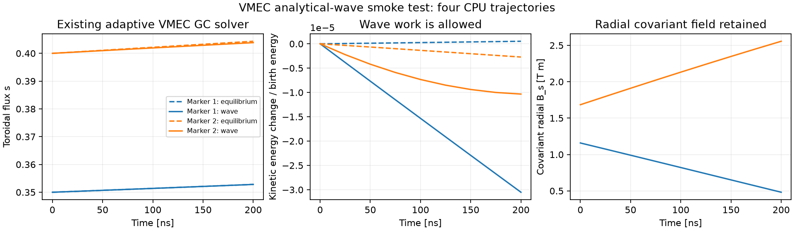
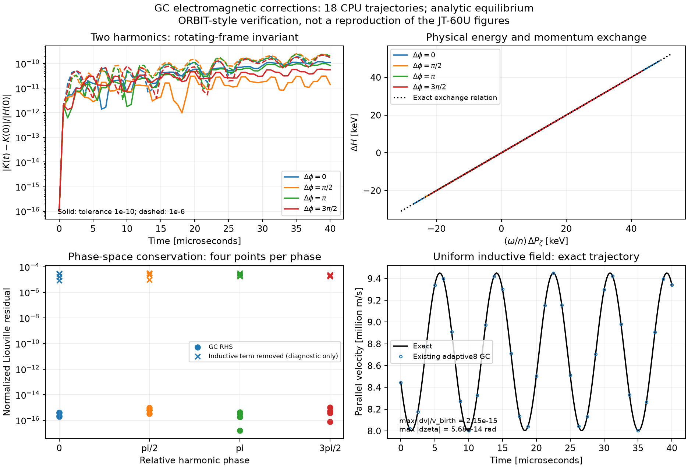
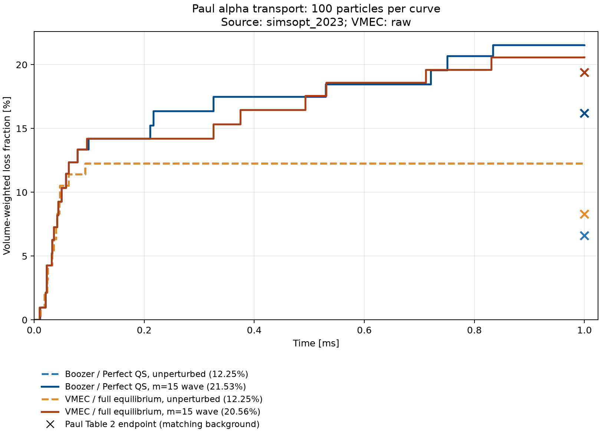

Prescribed Alfvén perturbations
==============================

ESSOS follows collisionless guiding centres in an equilibrium with imposed,
time-dependent shear-Alfvén potentials. Analytical modes work in Boozer
coordinates and in full VMEC geometry through the existing guiding-centre
functions and integrators. This model prescribes the wave; it does not evolve
its growth, nonlinear saturation or response to the particles.

Equations and conventions
-------------------------

The reduced electromagnetic action uses a static equilibrium field and

.. math::

   \delta\mathbf A=\alpha\mathbf B_0,\qquad
   \delta\mathbf B=\nabla\times(\alpha\mathbf B_0),\qquad
   \delta\mathbf E=-\nabla\Phi-\partial_t\alpha\,\mathbf B_0.

Here ``alpha`` is in metres, ``Phi`` is in volts and frequency is in rad/s.
The Hamiltonian retains the equilibrium magnitude:

.. math::

   H=\tfrac12 Mv_\parallel^2+\mu B_0+q\Phi,\qquad
   \mu=\frac{Mv_\perp^2}{2B_0},\qquad \dot\mu=0.

The existing scalar RHS receives the corrections required by the action.
Equivalently, define

.. math::

   \mathbf B^* &= \mathbf B_0+\frac{Mv_\parallel}{q}\nabla\times\mathbf b_0
                     +\delta\mathbf B,\\
   B_\parallel^* &= \mathbf b_0\cdot\mathbf B^*,\\
   \mathbf E^* &= \mathbf E_0+\delta\mathbf E-\frac{\mu}{q}\nabla B_0.

Then

.. math::

   \dot{\mathbf R}&=\frac{v_\parallel\mathbf B^*+
                                  \mathbf E^*\times\mathbf b_0}{B_\parallel^*},\\
   \dot v_\parallel&=\frac{q}{M}\frac{\mathbf B^*\cdot\mathbf E^*}{B_\parallel^*}.

In ESSOS's curvature-drift form, the updates include magnetic flutter,
inductive electric acceleration and the parallel-force correction that
cancels the extra curvature contraction with the perturbed field. There is
no additional matrix solve or replacement GC integrator. Time-dependent
Runge--Kutta evaluations use the physical time of each stage.

The native-coordinate equations retain all equilibrium covariant magnetic
components, including VMEC's radial component. The simplified Boozer model
uses ``B_cov = I dtheta + G dzeta`` and neglects its radial covariant component.
Boozer stores the mass-normalized moment ``v_perp**2/(2 B0)``; native
``GuidingCenterMu`` stores the physical moment in J/T.

Kinetic energy can change through wave work while magnetic moment stays
constant. Inferring magnetic moment from the fixed birth energy would suppress
that exchange. Native perturbed traces therefore use the existing five-state
``GuidingCenterMu`` function with the usual adaptive solver.

Analytical modes
----------------

``essos.perturbations.AnalyticalAlfvenMode`` supplies

.. math::

   \Phi &= \widehat\Phi f(s)\sin(m\theta_B-n\zeta_B+\omega t+\varphi),\\
   \alpha &= \frac{n-m\iota}{\omega(G+\iota I)}\Phi.

The latter relation enforces the linear ideal condition
``B0 . delta E = 0``. The toroidal harmonic number ``n`` includes the full
field-period factor. The default radial factor ``s**(m/2)`` makes the angular
harmonic smooth on axis; an optional Gaussian localizes it radially.
``AlfvenSpectrum`` superposes modes with their individual phases and frequencies.

``AnalyticalVmecAlfvenMode`` instead defines its harmonic in VMEC angles.
To trace the identical Boozer wave in VMEC, use ``MappedBoozerPerturbation``
with ``VmecBoozerMap`` from the same ``booz_xform_jax`` calculation. Its
derivatives include the coordinate-map chain rule. The current map requires
stellarator symmetry.

The Paul comparison uses a radially uniform potential, which is singular on
axis for nonzero ``m``. Its default stopping surface is ``s=1e-8``. Inner stops,
outer-boundary losses and numerical failures are separate diagnostics; inner
stops enter the paper-style loss fraction. They are not a coordinate cure or
a convergence test of that cutoff. Smooth analytical modes need no such stop.
Native perturbed tracing currently supports collisionless GC models inside
the equilibrium. Exterior continuation requires an exterior wave model.

Small CPU example
-----------------

From the checkout root:

.. code-block:: bash

   python -m examples.particle_tracing.vmec_alfven_cpu_smoke

This follows two particles without and with a smooth VMEC-angle mode: four
trajectories, 0.2 microseconds each, under a 120-second process cap including
compilation. It uses ``GuidingCenterAdaptative`` and saves to
``examples/benchmarks/results/vmec_alfven_cpu_smoke``. The example checks finite
trajectories, baseline energy conservation and constant magnetic moment.

Electromagnetic verification
----------------------------

.. code-block:: bash

   python -m examples.benchmarks.alfven_gc_verification

The 120-second CPU benchmark checks two coupled harmonics at four relative
phases and two solver tolerances, plus uniform induction: 18 short trajectories.
It verifies rotating-frame energy--momentum exchange, the time-dependent
phase-space conservation identity, and an exact inductive trajectory. A
diagnostic that removes induction demonstrates that the conservation checks
detect a missing term. The production RHS is used for every actual trace.
These are analytic verification cases inspired by
`Bierwage, White and Matsuyama (2022) <https://arxiv.org/abs/2205.11280>`_,
not a reproduction of their tokamak equilibrium.

Paul alpha-loss comparison
--------------------------

The collisionless comparison follows
`Paul, Mynick and Bhattacharjee (2023), Table 2
<https://arxiv.org/html/2306.12531v2#S6.T2>`_: vacuum QA, ``m=15``, ``n=7``,
source frequency 399000 rad/s, edge proxy ``m*alpha_hat/a=1e-3``, 3.52 MeV,
and 1 ms. The equilibrium is scaled to minor radius 1.7 m and axis
``B00=5.86 T``. Boozer suppresses QS-breaking field-strength harmonics;
VMEC retains the full equilibrium.

The saved comparison contains 100 common initial coordinate/pitch proposals,
with physical-volume importance weights computed for each background. The
explicit historical convention maps angles and parallel velocity together
with frequency and potential; it is a comparison assumption, not confirmation
of the original paper runtime. The saved run uses angular frequency -399000
rad/s, potential amplitude -3725.818890765528 V and the documented historical
library mass 6.69509884346e-27 kg at fixed 3.52 MeV. Normal ESSOS mass defaults
are unchanged. No island-width fit or fitted orbit invariant is used.

.. list-table:: Weighted losses at 1 ms
   :header-rows: 1
   :widths: 25 18 15 25 12

   * - Background
     - Case
     - ESSOS
     - Approx. 95% sampling interval
     - Paper
   * - Boozer / Perfect QS
     - Unperturbed
     - 12.25%
     - 7.16--20.16%
     - 6.6%
   * - Boozer / Perfect QS
     - Wave
     - 21.53%
     - 14.57--30.62%
     - 16.2%
   * - VMEC / full equilibrium
     - Unperturbed
     - 12.25%
     - 7.16--20.16%
     - 8.3%
   * - VMEC / full equilibrium
     - Wave
     - 20.56%
     - 13.77--29.56%
     - 19.4%

All four saved cases have zero failed markers. Boozer wave losses comprise
13 LCFS exits and eight inner stops; VMEC has 13 and seven, respectively.
The maximum Boozer invariant drift is 8.42e-9; native baseline relative energy
change is 8.09e-6 and native wave relative magnetic-moment change is zero.
The original 600-second CPU job completed three cases; a separate native
resume completed the wave case in 549.71 seconds under another 600-second cap.

The crosses represent four published endpoints, one for each background/case.
The paper used 5000 particles. This is a small comparison, not established
quantitative paper reproduction: the exact published equilibrium/runtime,
equilibrium-resolution convergence and inner-cutoff sensitivity remain
unconfirmed. Sampling intervals exclude these systematic uncertainties.

Recovering the figures
----------------------

Compact reference data live in ``examples/benchmarks/references``:

* ``paul_loss_100.npz`` contains the four weighted loss curves;
  ``paul_loss_100.json`` records endpoints, intervals, inputs and checks.
* ``paul_births_100.npz`` preserves the exact 100 already-converted births.
* ``gc_verification.npz/.json`` and ``vmec_alfven_smoke.npz/.json`` preserve
  the short verification/example data.
* The three TOML files record the two published Table 2 columns and the
  historical particle-mass option.

Regenerate all three PNG/SVG figures without tracing particles:

.. code-block:: bash

   python -m examples.benchmarks.plot_alfven_results

The default destination is ``docs/_static/analytical_perturbations``. To review
regenerated images separately, pass ``--output /path/to/figures``.

Rerunning the loss benchmark
---------------------------

The reference equilibrium is committed at
``examples/input_files/wout_LandremanPaul2021_QA_lowres.nc``, SHA256
``4d301a3c32aa6b12f0c13f2c440d223427275fb00862fac3e64e52dc8421c23c``.
Both loss runners require the optional ``booz_xform_jax`` dependency:

.. code-block:: bash

   python -m pip install -e '.[booz]'

Prepare the four-case job below without running trajectories. The CPU budget
is 1200 seconds for the complete job; use ``--platform gpu`` on a GPU machine.

.. code-block:: bash

   python -m examples.benchmarks.paul_boozer_vmec_benchmark \
     --dry-run --particles 100 --platform cpu --wall-seconds 1200 \
     --batch-size 16 --diagnostic-batch-size 32 \
     --source-convention simsopt_2023 --particle-model simsopt_2023 \
     --births examples/benchmarks/references/paul_births_100.npz \
     --wout examples/input_files/wout_LandremanPaul2021_QA_lowres.nc \
     --output examples/benchmarks/results/paul_100_rerun

Remove ``--dry-run`` to execute the prepared job. The launcher preserves
existing completed results and refuses to overwrite a completed Boozer run.
Generated output stays ignored by Git. The comparison module verifies matching
births, mass, energy, equilibrium hash and wave parameters before plotting:

.. code-block:: bash

   python -m examples.benchmarks.paul_boozer_vmec_loss_comparison \
     --particles 100 \
     --boozer examples/benchmarks/results/paul_100_rerun/boozer \
     --vmec examples/benchmarks/results/paul_100_rerun/vmec \
     --output examples/benchmarks/results/paul_100_rerun/comparison

This last command only postprocesses completed results. Its output includes
``boozer_vmec_loss_100.png/.svg``, ``comparison.csv``, ``summary.json`` and
``loss_curves.npz``. Failed or unfinished cases are rejected.
