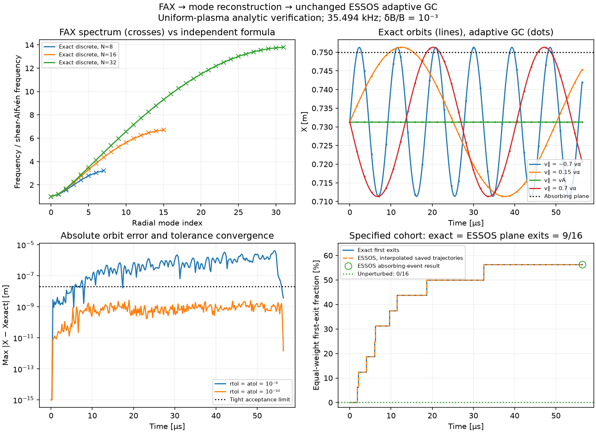
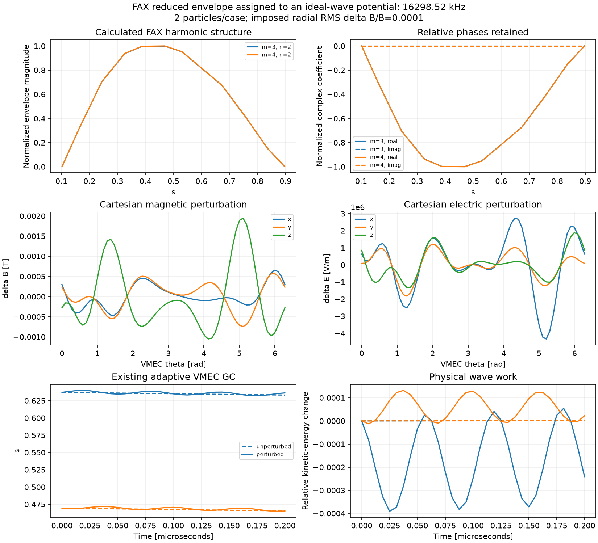

FAX mode reconstruction
=======================

The optional FAX integration imports a calculated global harmonic envelope
and frequency, constructs reduced electromagnetic potentials and follows
particles with the existing VMEC guiding-centre RHS. The analytical-perturbation
equations and integrators are unchanged.

Physical interpretation
------------------------

The current FAX global radial operator returns scalar harmonic envelopes,
not calibrated Cartesian magnetic/electric components. This first interface
requires the explicit interpretation ``potential_shape``: the computed
envelope is assigned to the electric potential, and the parallel vector
potential is obtained harmonic by harmonic from the reduced ideal relation.
This is a stated polarization assumption. It does not establish that FAX's
scalar unknown is the physical potential of a full ideal-MHD eigenmode.

An imposed amplitude and propagation sign are also necessary: the Hermitian
eigenproblem determines positive frequency and relative harmonic structure,
but not a saturated mode amplitude or a direction of rotation. Complex
coefficients are retained; their magnitudes are never substituted for the
actual coefficients when reconstructing fields. The saved eigenvector also
fixes its otherwise arbitrary global phase for repeatable particle runs.

The framework currently supports the same reduced action as the analytical
implementation: ``delta A=alpha B0`` and ``|B0|`` in the Hamiltonian. General
compressional modes and arbitrary vector displacements need a separate
physical reconstruction.

Modules and data
----------------

``essos.fax_adapter.FaxMode`` captures ``s``, integer full-torus harmonic
labels, complex structure, frequency in Hz, the stated interpretation and
equilibrium provenance. ``from_result`` accepts a FAX problem/result without
making FAX a dependency of ESSOS. It rejects failed eigenpairs, nonpositive
eigenvalues and inconsistent frequency units. Versioned ``save``/``load``
use NPZ arrays plus JSON metadata, without pickle. Loading verifies the
tracing equilibrium's SHA256. The producer must also verify the coordinate
convention: a matching file hash alone cannot establish it.

``essos.mode_reconstruction.SpectralAlfvenMode`` interpolates complex
coefficients with cubic splines and evaluates the angular dependence in
ESSOS's regular ``(sqrt(s) cos(theta), sqrt(s) sin(theta), zeta)`` chart.
Its input coefficients have the factor ``s**(abs(m)/2)`` removed. This avoids
undefined angle derivatives on axis and supports either sign of ``m``.
Evaluation, spatial/time derivatives and amplitude/frequency parameters are
JAX compatible. File loading and spline construction occur on the host;
this does not yet supply an end-to-end equilibrium-design gradient through
the upstream FAX solve and mode selection.

Annular FAX samples require an explicit radial extension. The example applies
a quintic window over one edge-grid interval at each boundary, making the
potentials C2 before extending them by zero. This changes the mode near those
boundaries and is recorded as ``taper_width_s``. It is not an inferred axis
solution. Production calculations must check radial resolution and taper
sensitivity.

``perturbed_fields`` reconstructs contravariant ``delta B`` and covariant
``delta E`` in the native coordinates. ``physical_components`` converts them
to Cartesian vectors using the equilibrium embedding. These diagnostics
do not add the perturbation to the GC equations a second time.

``radial_field_rms`` defines the imposed amplitude using the physical-area
and wave-phase RMS of ``delta B.normal/|B0|`` at a specified flux surface.
Two time phases give the exact phase average for one fixed frequency; angular
quadrature still needs convergence checks. This normalization is independent
of eigenvector norm and is different from the Paul edge proxy.

Independent analytic benchmark
------------------------------

``examples/benchmarks/fax_shear_alfven_benchmark.py`` verifies the complete
FAX -> mode packet -> spectral potentials -> coordinate map -> existing
adaptive GC path against a uniform-plasma shear-Alfven solution. The standard
dispersion relation is given, for example, in Richard Fitzpatrick's
`MHD Waves, equations (8.39) and (8.42)
<https://farside.ph.utexas.edu/teaching/plasma/lectures/node107.html>`_.
The trajectory and finite-cohort first-exit formulas below are derived here
from the reduced GC model; their numerical values are not literature data.

The equilibrium is Cartesian ``B0 = B0 ez``, with constant mass density.
Define

.. math::

   v_A = \frac{B_0}{\sqrt{\mu_0\rho}},\qquad
   \omega_A = k_\parallel v_A,\qquad
   \eta = k_\perp Y+k_\parallel Z-\omega_A t.

For the shear wave choose the potentials

.. math::

   \alpha=A\cos\eta,\qquad
   \Phi=B_0v_A A\cos\eta,\qquad
   A=\frac{\epsilon}{k_\perp}.

Thus ``delta Bx = -B0 epsilon sin(eta)`` and
``delta Ey = B0 vA epsilon sin(eta)``; other field components vanish.
In particular, the inductive contribution cancels the electrostatic parallel
field. For constant ``B0``, the reduced GC equations give

.. math::

   \dot X = \epsilon(v_A-v_\parallel)\sin\eta,\qquad
   \dot Y=0,\qquad \dot Z=v_\parallel,\qquad
   \dot v_\parallel=\dot\mu=0.

Writing ``eta0 = k_perp Y0 + k_parallel Z0`` and
``Delta = k_parallel (v_parallel - vA)``, the independent closed form is

.. math::

   X(t) = X_0+C[\cos(\eta_0+\Delta t)-\cos\eta_0],\qquad
   C=\frac{\epsilon}{k_\parallel},\qquad
   Y(t)=Y_0,\quad Z(t)=Z_0+v_\parallel t.

A comoving marker has ``v_parallel=vA`` and no radial motion: magnetic
flutter and ExB drift cancel exactly. Deleting either term would produce a
finite drift. This is an exact solution of the implemented reduced GC action,
with the background magnitude in the Hamiltonian. It is not an exact full
Lorentz-orbit solution at arbitrary wave amplitude or gyroradius.

FAX calculation and mapping
~~~~~~~~~~~~~~~~~~~~~~~~~~~

The benchmark solves FAX's constant-coefficient, one-harmonic Neumann radial
problem on 8, 16 and 32 points, with local continuum frequency ``omegaA`` and
positive radial stiffness ``c_r=(0.2 omegaA)^2``. The independently evaluated
finite-difference spectrum is

.. math::

   \omega_j^2=\omega_A^2+
       \frac{4c_r}{h^2}\sin^2\!\left(\frac{j\pi}{2N}\right),\qquad
   j=0,\ldots,N-1,\quad h=\frac{0.9}{N-1}.

The lowest envelope is constant and its frequency is ``omegaA``. The radial
stiffness exercises the numerical operator; it is not a calibrated plasma
profile. Since the continuum frequency is an analytic input to this fixture,
this comparison verifies FAX's assembly/eigensolve, not its prediction of a
toroidal continuum from a VMEC equilibrium.

The 16-point eigenvector passes through the real ``FaxMode`` NPZ save/load
path, including a SHA256 of the input fixture. Its arbitrary global phase is
fixed so its mean coefficient is real and positive. Its envelope is assigned
to ``Phi``, with explicitly imposed amplitude and propagation sign ``-1``.
Use ``m=0, n=-1`` and the straight-field-line coordinate map
``s=X/(1 m), theta=k_perp Y, zeta=k_perp Y+k_parallel Z``.
The covariant profiles ``iota=0, G=B0/k_parallel, I=-G`` represent the same
uniform Cartesian field. This gives the potentials above through the existing
harmonic-by-harmonic ideal relation. The radial window is flat on
``0.1 < s < 0.9``, and every orbit is checked to remain in that interval.

Specified loss test and parameters
~~~~~~~~~~~~~~~~~~~~~~~~~~~~~~~~~~

The input fixture is
``examples/benchmarks/references/fax_shear_alfven_input.json``:
``B0=5 T``, ``rho=1e-6 kg/m^3``, ``k_parallel=0.05/m``, ``k_perp=0.4/m``
and ``epsilon=1e-3``. Consequently the frequency is 35.494 kHz, the imposed
potential amplitude is 55.754 kV and ``C=0.02 m``. Wave frequency over alpha
gyrofrequency is 9.25e-4; the maximum ``k_perp rho_L`` is 0.0217 or less.

The cohort contains 16 equal-weight 3.52 MeV alpha markers: four velocities
``(-0.7 v_alpha, 0.15 v_alpha, vA, 0.7 v_alpha)`` crossed with phases
``(0, pi/2, pi, 3pi/2)``. Their respective phase-dependent initial X values
are ``linspace(0.730, 0.734, 4) m``; ``Y0=eta0/k_perp`` and ``Z0=0``.
The absorbing plane is ``X=0.75 m``. The duration is two wave periods,
56.348 microseconds.

For each marker, the analytic first exit is the earliest nonnegative root,
in the direction of its phase propagation, of

.. math::

   \cos(\eta_0+\Delta t)
      =\cos\eta_0+\frac{X_{\rm wall}-X_0}{C}.

There are **nine exits out of 16**, so the exact fraction for this chosen
cohort and plane is **56.25%**. The baseline has no radial motion and zero
exits. This value follows from the specified initial conditions, wall and
duration; it is not a published stellarator or FAX transport loss fraction.
Increasing marker count is unnecessary for verifying these deterministic
first-exit predictions. This case does not measure statistical convergence
or reactor confinement.

Validation and saved result
~~~~~~~~~~~~~~~~~~~~~~~~~~~

The CPU benchmark performs four 16-marker traces: unperturbed with the plane,
perturbed at loose and tight tolerances without stopping, and perturbed at
tight tolerance with the existing absorbing event. It uses the unchanged
``GuidingCenterAdaptative`` solver and GC functions, with no reference ODE
integrator. Oracles use independent NumPy formulas. The generic Cartesian
event supplies a hit mask; its stored stopped trajectories freeze at the last
saved interior point. First-exit times are therefore compared using linear
crossing interpolation of the unrestricted tight trajectories, rather than
treating the frozen positions as exact event locations.

The saved 64-trajectory run took 47.6 seconds on CPU, including calculation
and plotting. All 15 acceptance gates passed:

.. list-table::
   :header-rows: 1
   :widths: 58 42

   * - Check
     - Observed result
   * - Maximum relative discrete eigenvalue error, all three grids
     - 8.0e-15
   * - Reconstructed magnetic/electric field relative error
     - 8.7e-14 or less
   * - Maximum radial orbit error, rtol=atol=1e-6
     - 4.16e-6 m (4.16 micrometres)
   * - Maximum radial orbit error, rtol=atol=1e-10
     - 2.71e-9 m (2.71 nanometres)
   * - Magnetic-moment drift, tight trace
     - Zero
   * - Marker-by-marker absorbing-plane loss classification
     - Exact match: 9/16 perturbed; 0/16 baseline
   * - Maximum interpolated first-exit time error
     - 4.12 ns; saved time spacing 220 ns

Run the bounded benchmark with FAX installed or available on ``PYTHONPATH``:

.. code-block:: bash

   python -m examples.benchmarks.fax_shear_alfven_benchmark

The process has a hard 120-second CPU wall-clock cap, including imports and
compilation. An existing output is preserved; use ``--output`` for a fresh
directory. Results include the mode packet, diagnostic arrays, acceptance
gates, input parameters and PNG/SVG figure.

Regenerate the documentation plot from committed data, without FAX or tracing:

.. code-block:: bash

   python -m examples.benchmarks.fax_shear_alfven_benchmark --report-only \
     --data examples/benchmarks/references/fax_shear_alfven \
     --output docs/_static/analytical_perturbations

Focused oracle and live-adapter tests:

.. code-block:: bash

   python -m pytest -q tests/test_fax_shear_alfven_benchmark.py

The live FAX test skips when that optional dependency is absent. A successful
uniform-plasma benchmark verifies this reduced coupling. Curvature terms,
VMEC mapping, general MHD polarization and toroidal losses need their own
tests and independently matched reference inputs.

Small shared-equilibrium example
--------------------------------

With the local sibling FAX checkout installed:

.. code-block:: bash

   python -m pip install -e ../fax
   python -m pip install -e '.[booz]'
   python -m examples.particle_tracing.fax_mode_particles \
     --compute --interpretation potential_shape --frequency-sign 1

The example uses the same unscaled reactor-size QA ``wout`` and one host
Boozer transform for FAX geometry, ESSOS profiles and the VMEC-to-Boozer map.
It solves a deliberately coarse, two-harmonic FAX global problem on 12 radial
surfaces, imposes radial-field RMS 1e-4 at ``s=0.4``, and follows two alpha
particles without and with the reconstructed wave. A 120-second CPU process
cap includes imports, compilation and plotting. No equilibrium rescaling or
QS filtering occurs between the two codes.

Output is in ``examples/benchmarks/results/fax_mode_particles``:
``mode.npz``, ``diagnostics.npz``, ``summary.json`` and a six-panel PNG/SVG
figure. The figure shows the calculated harmonics and complex phases, physical
magnetic/electric components, radial trajectories and energy exchange.
Loss estimates use the same initial markers and physical-volume weights in
both cases, and unresolved trajectories are rejected. The short run is a
coupling demonstration, not a statistically meaningful transport benchmark.

The first saved run completed in 57.4 seconds, with zero failed markers,
baseline relative energy change 1.17e-6 and zero magnetic-moment drift in
the wave case. Its calculated frequency is 16.30 MHz. At the two births,
the ratios of wave angular frequency to alpha gyrofrequency are 0.377 and
0.347. This is not a well-separated low-frequency guiding-centre ordering;
the present coarse mode is unsuitable for a physical alpha-loss benchmark.
Neither frequency nor the FAX operator was tuned to improve that comparison.
Mode polarization, eigenmode convergence and physical ordering must be
established before interpreting a longer transport calculation.

Redraw saved diagnostics without FAX or particle tracing:

.. code-block:: bash

   python -m examples.particle_tracing.fax_mode_particles --report-only

The committed compact reference also redraws the documentation image in a
fresh checkout:

.. code-block:: bash

   python -m examples.particle_tracing.fax_mode_particles --report-only \
     --data examples/benchmarks/references/fax_mode_particles \
     --output docs/_static/analytical_perturbations

Reuse a saved mode with the same equilibrium, without installing FAX:

.. code-block:: bash

   python -m examples.particle_tracing.fax_mode_particles \
     --mode examples/benchmarks/references/fax_mode.npz \
     --frequency-sign 1 \
     --output examples/benchmarks/results/fax_mode_particles_reuse

Public tracing benchmarks
--------------------------

The inspected FAX benchmark manifest contains STELLGAP CTOK continuum/gap
references, AE3D matrix/eigenvector references and FAR3D stability artifacts.
It does not provide an end-to-end reference particle-loss fraction for a
FAX-calculated mode. Frequency/eigenvector parity cannot validate particle
transport by itself.

The public `ASCOT MHD tutorial
<https://ascot4fusion.github.io/ascot5/tutorials/mhd.html>`_ supplies a useful
next comparison: an analytical tokamak, prescribed rotating potentials,
magnetic/electric reconstruction, particle Poincare plots and a single-mode
energy--momentum invariant. Its mode is prescribed rather than calculated by
FAX. Matching that case would test the reconstruction and particle coupling;
it would not validate FAX eigenmode physics. The tutorial's displayed
end-condition counts are not adopted as a quantitative loss target.

A numerical loss benchmark needs the same equilibrium, physical mode
polarization/amplitude, coordinate conventions, initial markers/weights,
integration duration and loss boundary in both codes, together with a saved
reference result. Until such a packet is available, use the uniform-plasma
benchmark above for independent end-to-end verification, the existing Paul
comparison for prescribed-wave loss diagnostics, and the Maxwell-identity
tests for the reconstruction layer. No published FAX loss-fraction agreement
is claimed.

Collisions and device references
~~~~~~~~~~~~~~~~~~~~~~~~~~~~~~~~

ASCOT's public `verification suite
<https://ascot4fusion.github.io/ascot5/testing.html>`_ includes analytical
collisional equilibrium, slowing-down distributions, classical diffusion and
neoclassical transport checks. These provide established targets for the
collision operator. Once pitch and energy become stochastic, the deterministic
slab orbit and its 9/16 first-exit fraction above no longer apply. A coupled
wave/collision comparison needs ensemble distributions and uncertainty, as
well as a timestep study. The current ``Tracing(perturbation=...)`` interface
supports collisionless GC models; attaching a collision stepper is separate
work and is not demonstrated by this benchmark.

Three more realistic reference paths are identifiable:

* `Scott et al., Fast-ion physics in SPARC (2020)
  <https://doi.org/10.1017/S0022377820001087>`_ compares ASCOT5 and SPIRAL
  alpha losses with slowing down and pitch scattering in the design's
  three-dimensional ripple field. This is a device-design, static magnetic
  perturbation benchmark, rather than an eigenmode-induced-loss benchmark.
  Its full-orbit reference, power-loss weighting and thermalization/wall
  definitions must be matched explicitly. The
  `SPARCPublic repository <https://github.com/cfs-energy/SPARCPublic>`_ has
  equilibria and profiles, but their availability does not establish that
  the exact paper's ripple/wall/marker input packet is present.
* `Rueda-Rueda et al., Measurement of toroidal Alfven eigenmode-driven
  fast-ion flows using an imaging neutral particle analyzer at ASDEX Upgrade
  (2024) <https://doi.org/10.1088/1741-4326/ad43fe>`_ is an experimental
  device comparison with LIGKA mode structures and ASCOT5 full-orbit
  simulations. Exact equilibrium, mode, source and diagnostic inputs still
  need to be obtained and checked before treating it as a runnable ESSOS
  reference. The publication alone does not supply such a packet here.
* The `ORNL dataset record for Knyazev et al. (2026)
  <https://impact.ornl.gov/en/datasets/data-and-figure-generating-scripts-for-on-shear-alfv%C3%A9n-wave-induc-2/>`_
  lists an archive of VMEC/STELLGAP/AE3D/FIRM3D inputs, loss calculations and
  figure scripts (DOI ``10.5281/zenodo.21299907``). The
  `paper <https://arxiv.org/abs/2603.03118>`_ concerns collisionless
  reactor-scaled QA/QH/QI designs, rather than measurements in an operating
  device. This is a promising published computed-wave loss comparison for
  the reconstruction interface. The QA packet has now been retrieved and
  checked: see :doc:`ae3d_firm3d_benchmark` for the exact 35-harmonic wave,
  5000 saved birth states, 10 ms loss targets and remaining field-interpolation
  difference. Full-duration ESSOS loss agreement has not yet been established.

For that last path, first import the archived AE3D potentials and reproduce
the FIRM3D reference with the same equilibrium, normalization and marker
distribution. Then compare FAX mode frequency and harmonic structure on that
same equilibrium before substituting the computed FAX mode. This keeps
particle-coupling errors distinguishable from differences between eigenmode
operators. A collisional extension requires an additional independent
reference; the collisionless publication cannot validate it.
