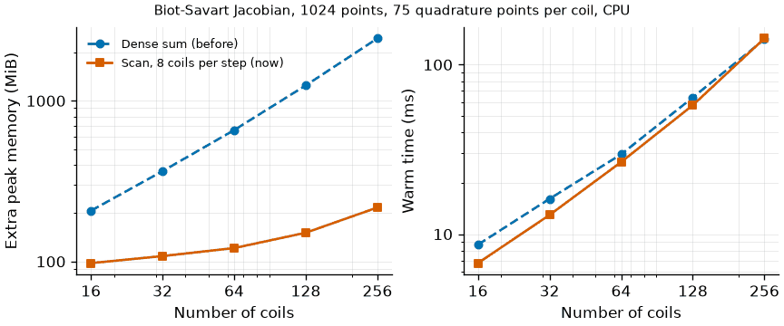

Getting started
=====

.. _installation:

Installation
------------

To use ESSOS, there is no need to install it.
You can simply clone the repository and install it using the following command:

.. code-block:: console

    $ git clone https://github.com/uwplasma/ESSOS.git
    $ cd ESSOS
    $ pip install .

Run an example
--------------

To run the one of the examples, use the following command:

.. code-block:: console

    python examples/trace_fieldlines_coils.py

More examples are in the `examples` folder.

Optimization geometry
---------------------

``coils.dof_names`` labels the flattened Fourier and current variables in the
same order as ``coils.dofs``; ``coils.with_dofs(x)`` returns a differentiable
updated copy without mutating an optimization template. A live VMEC boundary can be converted without
copying mode-ordering code into a driver:

.. code-block:: python

    from essos.surfaces import surfacerzfourier_from_boundary

    surface = surfacerzfourier_from_boundary(rbc, zbs, nfp, nphi=32, ntheta=32)

Existing SIMSOPT coil files can be loaded directly:

.. code-block:: python

    from essos.coils import Coils

    coils = Coils.from_simsopt("coils.json", nfp=2, stellsym=True)

The JAX-native ``loss_coil_separation`` and ``loss_coil_surface_distance``
functions in ``essos.objective_functions`` provide blockwise, differentiable
coil-clearance penalties; ``block_size`` bounds their temporary memory.

Biot-Savart memory
------------------

``BiotSavart.B`` sums the filament field over coils eight at a time with
``lax.scan`` (with ``jax.checkpoint``, so reverse mode keeps no per-coil
residuals). The temporaries of the field, its Jacobian and its gradient with
respect to the coil dofs therefore grow far more slowly with the number of
coils than the dense sum over all coils at once, at unchanged accuracy
(relative difference 1e-15). ``docs/biot_savart_scaling.py`` regenerates the
figure.

