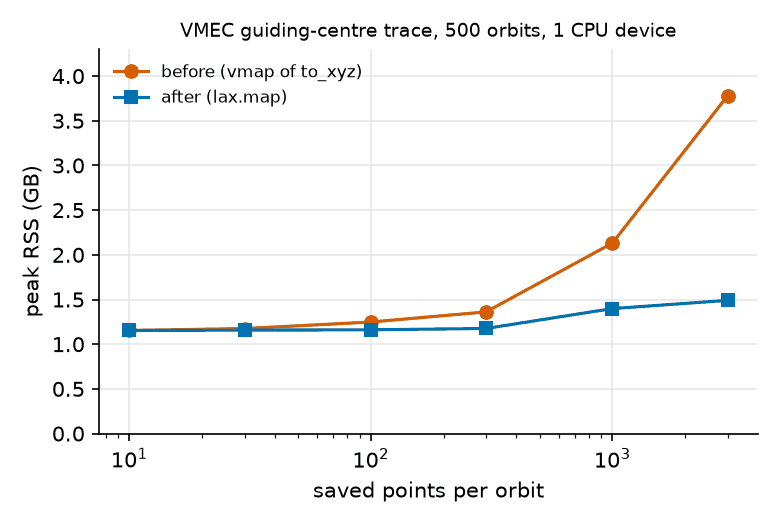

Getting started
=====

.. _installation:

Installation
------------

To use ESSOS, there is no need to install it.
You can simply clone the repository and install it using the following command:

.. code-block:: console

    $ git clone https://github.com/uwplasma/ESSOS.git
    $ cd ESSOS
    $ pip install .

Run an example
--------------

To run the one of the examples, use the following command:

.. code-block:: console

    python examples/trace_fieldlines_coils.py

More examples are in the `examples` folder.

CPU, GPU and multi-device defaults
----------------------------------

Importing ESSOS changes no JAX setting. Call ``essos.configure_jax()`` first, before any JAX computation: it enables float64, requests one JAX CPU device per core the process may use, and caches compiled traces in ``~/.cache/essos/xla``. ``Curves``, ``Vmec``, ``BoozerField.from_booz`` and ``Tracing`` raise an error that names ``jax.config.update("jax_enable_x64", True)`` when float64 is off. Particles are sharded over all devices of the default backend.

.. list-table::
   :header-rows: 1

   * - Setting
     - Default
     - Change it when
   * - ``devices=``
     - all JAX devices
     - Sharing a node, or some devices are busy
   * - ``ESSOS_CPU_DEVICES``
     - one per usable core (affinity, ``SLURM_CPUS_PER_TASK``)
     - Sharing a node; ``1`` gives a single device
   * - ``JAX_PLATFORMS=cpu``
     - GPU when a CUDA ``jaxlib`` is installed
     - The GPU is busy, or a small trace runs faster on CPU
   * - ``XLA_PYTHON_CLIENT_PREALLOCATE=false``
     - JAX preallocates most GPU memory
     - Several processes share one GPU
   * - ``ESSOS_XLA_CACHE``
     - ``~/.cache/essos/xla``
     - The filesystem is slow or small; empty disables it

Optimization geometry
---------------------

``coils.dof_names`` labels the flattened Fourier and current variables in the
same order as ``coils.dofs``; ``coils.with_dofs(x)`` returns a differentiable
updated copy without mutating an optimization template. A live VMEC boundary can be converted without
copying mode-ordering code into a driver:

.. code-block:: python

    from essos.surfaces import surfacerzfourier_from_boundary

    surface = surfacerzfourier_from_boundary(rbc, zbs, nfp, nphi=32, ntheta=32)

Existing SIMSOPT coil files can be loaded directly:

.. code-block:: python

    from essos.coils import Coils

    coils = Coils.from_simsopt("coils.json", nfp=2, stellsym=True)

The JAX-native ``loss_coil_separation`` and ``loss_coil_surface_distance``
functions in ``essos.objective_functions`` provide blockwise, differentiable
coil-clearance penalties; ``block_size`` bounds their temporary memory.

Tracing many VMEC orbits
------------------------

``Tracing`` converts each saved VMEC state to Cartesian one point at a time, so the memory of a trace grows slowly with
``times_to_trace``. Peak memory for 500 guiding centres on one CPU device, with the old vectorized conversion for
comparison:

