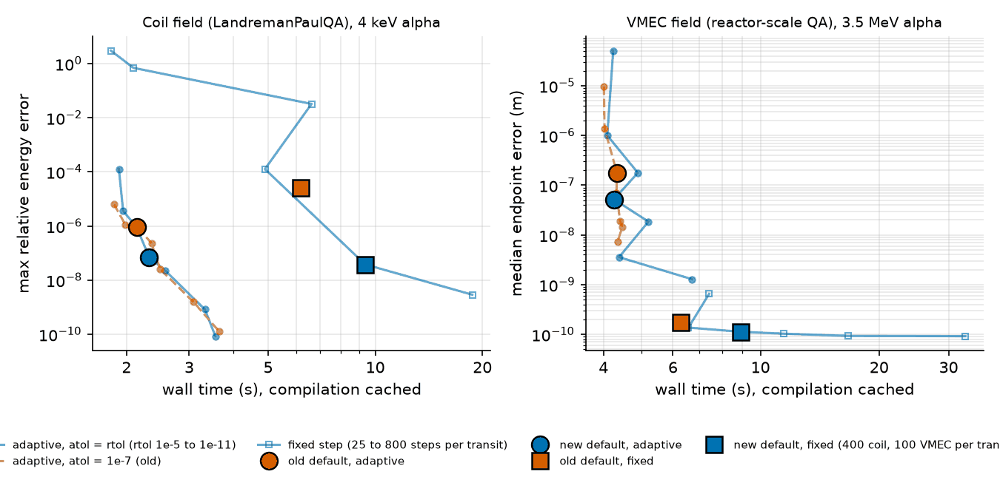

Tracing accuracy and defaults
=============================

``Tracing`` has an adaptive and a fixed-step family of models. Both integrate with Dopri8 by default.

Error against wall time for 6 guiding centres over 40 transits, measured against a Dopri8 reference at
``rtol = atol = 1e-12`` (wall time with the compiled program cached). Circles are the adaptive defaults, squares the
fixed-step defaults; orange is the old setting and blue the current one.

Adaptive or fixed
-----------------

* Use the adaptive models (``GuidingCenterAdaptative``, ``FullOrbitAdaptative``) unless a fixed step is required. Their
  cost follows the tolerance and, on a coil field, they reach a given energy error about 4 times faster than a fixed step (4e-8 in 2.4 s against 9.4 s).
* The fixed-step models need a step small enough for the field: on a coil field the energy error is 3e-2 at 100 steps
  per transit and 4e-8 at 400. A smooth VMEC field is converged from about 100.

Defaults
--------

* ``rtol=1e-8`` and ``atol=None``, which means ``atol = rtol``. An absolute tolerance above ``rtol`` floors the error
  (positions are about 1 m), as the orange dashed curve shows.
* ``timestep=None`` is 1/400 of the transit time ``R0 / v`` (1/100 for a VMEC field), with ``R0 = field.r_axis`` and
  ``v`` the largest particle speed. For adaptive models it only sets the first trial step. These values must be concrete:
  under ``jax.grad`` with traced coil degrees of freedom or energies a fixed-step model raises an error asking for an
  explicit ``timestep``.
* ``max_steps=None`` is 16 times the steps of a fixed-step solve over ``tmax``, enough for adaptive tolerances
  down to about 1e-12 (1e6 when the timestep could not be derived, as in an adaptive trace under ``jax.grad`` of the coil dofs).
* An orbit that ends non-finite or reaches ``max_steps`` raises a ``RuntimeWarning``; raise ``max_steps`` or lower the
  tolerance.
