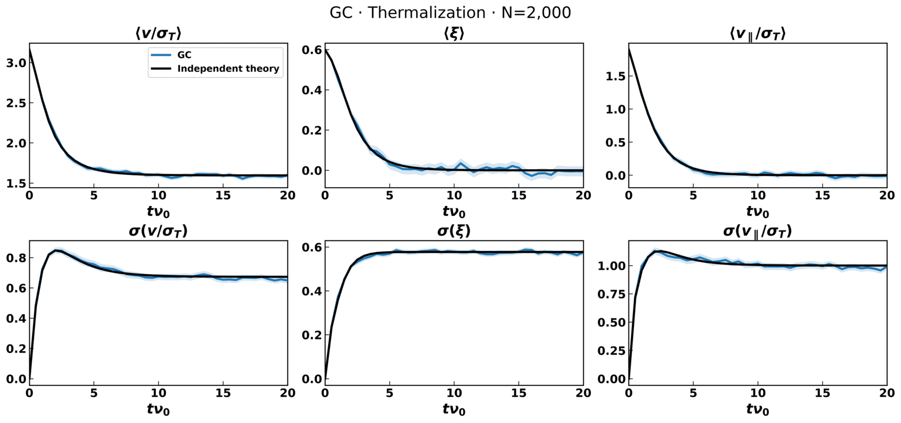
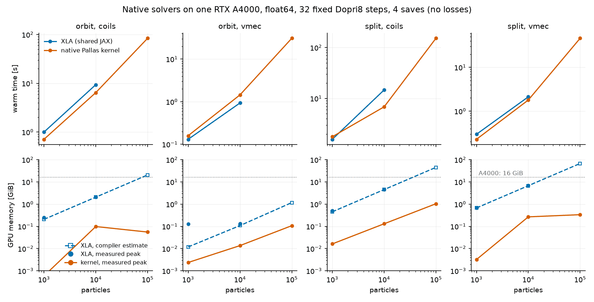
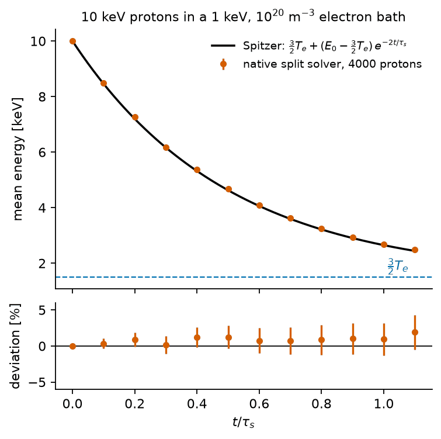

# Native split orbit and collisions: validation and timing

`essos.split.trace_split` advances a native Dopri RK orbit, then applies one Milstein
collision map per interval (Lie splitting), with Brownian bridge memory so rejected steps
never redraw the path. The collision and moment tolerances are local controls, not global
error bounds. Population studies are not part of CI (CI uses `tests/test_native_split.py`).

## Collision operator

`python -m examples.benchmarks.benchmark_native --suite collisions` runs the production
collision maps and Brownian driver (guiding-center and full-Lorentz) in a fixed 1 keV proton
bath and compares them with an independent NumPy/SciPy finite-volume Fokker-Planck
generator that uses no SDE solver:

* `--study thermal`: relaxation of a monoenergetic beam (speed `sqrt(10) sigma`, pitch 0.6).
  Speed and pitch means and variances at 40 times are tested against the reference with
  Student-t standard errors; the run reports the largest |z| against a familywise
  critical value and the mesh refinement change of the reference.
* `--study passage`: first passage of the speed from 5 T to 2 T. The mean, variance and
  Kolmogorov-Smirnov distance of the passage times are compared with the absorbing-boundary
  reference.
* `--law constant` fixes the Coulomb logarithm (exact Maxwell equilibrium); `--law impact`
  uses the production impact-parameter law.

These are statistical-consistency screens for a finite ensemble, not numerical-accuracy
bounds. The 2,000-particle thermalization comparison recorded for the README:



CI checks the same generator analytically: Lorentz pitch-angle moments, Maxwellian
stationarity, the Einstein relation, Brownian-bridge conditioning and the exact first-order
splitting error. The earlier coupled mirror/helix/uniform-field population studies were
removed with their scripts; their results are not reproduced here.

## Timing record (local RTX 5060 laptop GPU, JAX 0.11.2)

Single cold measurements from the previous per-case scripts, fresh process, persistent
cache disabled; 2 alpha particles, 1 ns, adaptive Dopri8 with the moment predictor
(`moment_tolerance=.005`). These are small-population startup costs, not throughput.

| Field / model | Execution | Lowering s | Backend compile s | First execution s |
|---|---|---:|---:|---:|
| Coils / GC | shared JAX | 2.91 | 8.79 | 0.039 |
| Coils / GC | independent GPU | 5.14 | 65.32 | 0.093 |
| Coils / Lorentz | shared JAX | 2.82 | 8.81 | 0.028 |
| Coils / Lorentz | independent GPU | 6.97 | 346.09 | 0.108 |
| VMEC / GC | shared JAX | 9.25 | 13.63 | 0.041 |
| VMEC / GC | independent GPU | 15.89 | 260.03 | 0.041 |
| Boozer / GC | shared JAX | 3.22 | 10.26 | 0.025 |
| Boozer / GC | independent GPU | 5.07 | 66.88 | 0.039 |

## Warm throughput and memory (RTX A4000, JAX 0.12, float64)

`--suite orbit` and `--suite split`, 32 fixed Dopri8 steps over 2e-7 s with four saves and
no losses in that window, best of up to three runs on a GPU shared with other jobs (about
30% run-to-run noise). The kernel's memory peak is the device allocator peak; XLA's is the
compiler's buffer estimate, which equals the measured peak wherever the case fit (1e3 and 1e4).



| 1e4 particles | kernel s | XLA s | kernel GiB | XLA GiB |
|---|---:|---:|---:|---:|
| orbit, coils | 6.4 | 9.4 | 0.10 | 2.1 |
| orbit, VMEC | 1.44 | 0.93 | 0.014 | 0.13 |
| split, coils | 6.8 | 14.7 | 0.13 | 4.5 |
| split, VMEC | 1.79 | 2.12 | 0.27 | 6.8 |

At 1e5 particles the kernel runs split coils in 152 s (1.0 GiB) and split VMEC in 46 s
(0.34 GiB); XLA would need 45 and 68 GiB and does not fit the 16 GiB card. The kernel's
advantage is memory and, for coil fields, speed; for collisionless VMEC orbits XLA is as fast.
Adaptive stepping with losses was not re-timed. Reverse AD of 64 coil particles
(`--suite ad`): native and shared gradients differ by 1.7e-16 (relative), warm 0.77 s against
3.6 s, but the kernel compile took 22 min against 35 s.

## Spitzer slowing-down

The split solver against the analytic energy relaxation of 10 keV protons in a 1 keV,
1e20 m^-3 electron bath (`test_fast_ions_slow_down_on_electrons_and_relax_to_the_background_temperature`):
`<E>(t) = 3T/2 + (E0 - 3T/2) exp(-2 t / tau_s)` with the Spitzer slowing-down time `tau_s`.



## Reproduction

```sh
python -m examples.benchmarks.benchmark_native --suite collisions --study thermal -N 2000 --out output/thermal
python -m examples.benchmarks.benchmark_native --suite collisions --study passage -N 2000 \
  --law impact --out output/passage
python -m examples.benchmarks.benchmark_native --suite split --field coils --model gc -N 64 \
  --execution both --out output/timing
```

Reports stay in the ignored `output/` directory.
