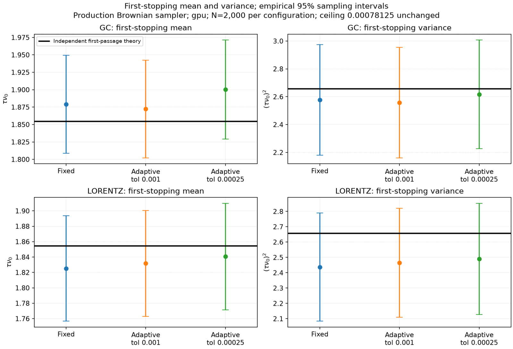

# Native split orbit and collisions: validation and timing record

`essos.split.trace_split` advances a native Dopri RK orbit, then applies one
Milstein collision map per interval (Lie splitting), with Brownian bridge memory so
rejected steps never redraw the path. The collision and moment tolerances are local
controls, not global error bounds; the numbers below are finite-ensemble comparisons
with independent references (NumPy/SciPy finite-volume Fokker-Planck generators and a
separately coded full-Lorentz Euler-Maruyama integrator), 2,000 particles per run,
1 keV proton bath, moment budget .01 and cap .0025 unless noted. Gaps are
`production - reference` in percent of the reference, with marginal 95% sampling
half-widths. Population studies are not part of CI (CI uses `tests/test_native_split.py`).

## Collision operator

* **Thermalization** (`validate_beam_relaxation`) and **first passage** from 5 T to
  <= 2 T (`validate_production_tolerance`) in a fixed bath, against the independent
  radial/Legendre generators (figures below).
* CI checks the same generator analytically: Lorentz pitch-angle moments, Maxwellian
  stationarity, the Einstein relation, Brownian-bridge conditioning and the exact
  first-order splitting error.




## Coupled orbit and collisions (`benchmark_split_coordinate_physics`)

Prescribed mirror (`Omega/nu0=2048`) and helix (`2e6`) fields, evaluated in Cartesian,
VMEC-regular and Boozer-style charts (manufactured charts, not equilibria); GC axial
references omit perpendicular spatial kicks and are strong-magnetization limits. Final
variance gaps at `t*nu0 = .025`:

| Field / chart | Var z % | Var pitch % | Var v_par % |
|---|---:|---:|---:|
| Mirror / Cartesian | -6.73 +/- 5.78 | -9.66 +/- 5.88 | -10.51 +/- 5.66 |
| Mirror / VMEC chart | -6.73 +/- 5.78 | -9.65 +/- 5.88 | -10.51 +/- 5.66 |
| Mirror / Boozer chart | -6.73 +/- 5.78 | -9.66 +/- 5.88 | -10.51 +/- 5.66 |
| Helix / Cartesian | +0.71 +/- 6.00 | +3.95 +/- 6.32 | +0.64 +/- 6.05 |
| Helix / VMEC chart | +0.71 +/- 6.00 | +4.76 +/- 6.37 | +1.38 +/- 6.10 |
| Helix / Boozer chart | +0.68 +/- 5.99 | +3.91 +/- 6.38 | +1.10 +/- 6.14 |

The mirror offsets exceed their sampling intervals for this seed; an independent mirror
ensemble (seed 8707) gives `+1.85 +/- 6.17`, `-0.08 +/- 6.30`, `-1.89 +/- 6.06`. Reference
refinement indicators are 0.23% (mirror) and 0.006% (helix). One population/reference gap
cannot identify numerical bias, and agreement between charts does not resolve the
physical-reference discrepancy.

Full-Lorentz comparison against the independent numerical reference (phase limit .05,
collision refinements to 6.25e-6/nu0): final speed-variance gaps `-0.28 +/- 6.09` (mirror)
and `-3.00 +/- 6.25` (helix), 1.006 and 256.77 mean orbit steps per collision;

| Field | Mean z % | Mean pitch % | Var z % | Var pitch % |
|---|---:|---:|---:|---:|
| Mirror | +0.44 +/- 0.82 | +0.16 +/- 1.06 | +1.64 +/- 8.82 | -1.51 +/- 9.08 |
| Helix | -0.11 +/- 0.33 | -0.13 +/- 0.52 | -7.90 +/- 8.28 | -2.67 +/- 8.48 |

Some early helix variance gaps (-9% to -11% in Var z at `t*nu0` = .005 to .02) remain
outside pointwise intervals; this is not an all-moments pass and does not establish 1%
accuracy.


Uniform field (`Omega/nu0=2048`, `t*nu0=0.1`): perpendicular spreading agrees within
sampling (`-0.88 +/- 4.48` GC, `+0.41 +/- 4.62` Lorentz). Speed-variance gaps depend
strongly on the seed, which indicates ensemble fluctuation rather than step bias (a
paired 8x refinement of the same Brownian increments changes the variance by
`+0.049 +/- 0.108` points and a 2x finer radial reference mesh by 0.014%). The primary
figure (seed 7706, an outlier) is kept:

| Seed | GC % | Lorentz % |
|---|---:|---:|
| 7706 (figure) | +9.19 +/- 7.23 | -11.32 +/- 5.46 |
| 8706 | -1.00 +/- 6.30 | -2.50 +/- 6.14 |
| 8706, `t*nu0=0.025` | -2.36 +/- 5.96 | +0.19 +/- 6.11 |
| 7707 to 7710 (Lorentz) | | +2.01, -3.47, -1.63, +4.59 (all +/- ~6.2) |


## Timing (local RTX 5060 laptop GPU, JAX 0.11.2)

Single cold measurements, fresh process, persistent cache disabled; 2 alpha particles,
1 ns, adaptive Dopri8 with the moment predictor (`moment_tolerance=.005`). These are
small-population startup costs, not throughput measurements.

| Field / model | Execution | Lowering s | Backend compile s | First execution s |
|---|---|---:|---:|---:|
| Coils / GC | shared JAX | 2.91 | 8.79 | 0.039 |
| Coils / GC | independent GPU | 5.14 | 65.32 | 0.093 |
| Coils / Lorentz | shared JAX | 2.82 | 8.81 | 0.028 |
| Coils / Lorentz | independent GPU | 6.97 | 346.09 | 0.108 |
| VMEC / GC | shared JAX | 9.25 | 13.63 | 0.041 |
| VMEC / GC | independent GPU | 15.89 | 260.03 | 0.041 |
| Boozer / GC | shared JAX | 3.22 | 10.26 | 0.025 |
| Boozer / GC | independent GPU | 5.07 | 66.88 | 0.039 |

Later predictor reductions cut the independent coil compile to 66.5 s (GC) and 78.0 s
(Lorentz) with bitwise-identical outputs and unchanged warm time (12.7 ms GC and 4.8 ms
Lorentz, two particles). A two-warp launch layout was faster to compile but gave
non-reproducible outputs at 64 particles and was rejected; the VMEC kernel uses one warp
for the same reason. A warm-throughput comparison of the independent kernel against shared
execution at production particle counts is still needed to justify its compile cost.

## Reproduction

```sh
python -m examples.benchmarks.validate_beam_relaxation --particles 2000 --batch-size 2000 \
  --coefficient-model impact --methods conservative --settings fine --output output/thermalization.json
python -m examples.benchmarks.validate_production_tolerance --particles 2000 --batch-size 2000 \
  --output output/first_passage.json
python -m examples.benchmarks.benchmark_split_coordinate_physics --study coupled \
  --models gc lorentz --particles 2000 --tolerance .01 --output output/coupled
python -m examples.benchmarks.benchmark_split_coordinate_physics --study diffusion \
  --particles 2000 --tolerance .01 --output output/uniform          # --seed 8706 for the other ensembles
python -m examples.benchmarks.benchmark_split_orbits --field coils --model gc --stepping adaptive \
  --case native_independent --particles 64 --cold-compile --output output/timing   # native_shared to compare
```

Generated reports stay in the ignored `output/` directory. Use `--study adapters` for the
coil/VMEC/Boozer shared-versus-GPU agreement and repeatability check.
